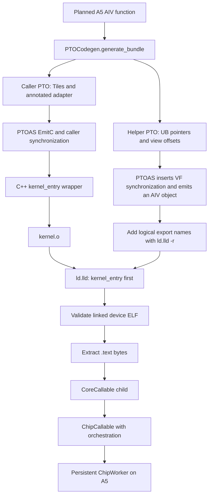

# EmitC and VPTO VF execution

The default pipeline outlines register regions into `FunctionType.VF` helpers
next to SIMT outlining, before SSA and mixed-kernel expansion. Codegen consumes
the explicit calls and helper definitions; physical UB offsets are bound only
after caller memory planning. See [scope outlining](../passes/01-outline_simt_scopes.md#outlineregscopes).

Explicit `pl.reg_scope()` bodies can execute inside an A5 AIV kernel through
the persistent runtime. Ordinary Tile operations use EmitC; each register
scope becomes a separately compiled VPTO helper. This extends the typed VMI
lowering without changing the DSL or automatically selecting vector scopes.

## Artifacts and execution



`PTOCodegen.generate()` retains the combined typed-VMI representation for
diagnostics. The execution driver uses `generate_bundle()` and writes helpers
under `vpto/<kernel>/`, with a manifest describing symbols, parameter types,
effects and offsets. `kernel_config.py` attaches their paths as `vpto_sources`.
Multiple explicit scopes produce multiple helpers linked into the same kernel.

The bundle separates helper artifacts from their callers. `helpers` stores each
artifact once; its historical `VFHelper` type also carries SIMT helpers through
`kind="simt"`. `entry_helpers` maps every emitted InCore function name to its
helper symbols, with sorted entry names and no duplicate symbols within a list.
Lists follow first-use order; entries without helpers have empty lists. SIMT
definitions and adapters are not entries. A cached SIMT artifact can appear in
several entries' lists without duplicating its source. Each codegen invocation
resets this relation, and previously returned bundles retain their own metadata.
The execution driver retains this relation in the version-5 helper manifest
and uses emitted entry names when attaching `vpto_sources` to kernel configs.
For a mixed Group, only the AIV entry links VF helpers; the AIC entry has no
helper dependencies. Grouped SIMT execution remains unsupported.

The VF emitter binds storage from the actual AIV call operands. Planned Tiles
share the lowest captured UB address. Each live C2V receive supplies its current
slot pointer through the adapter's `pto.tile_buf_addr`. Dense constant-offset
windows on the same receive share that pointer. The emitter checks that planned
allocations fall outside each captured pipe reservation. The manifest records
the pointer parameter for each capture in `capture_base_indices` (−1 for a
scalar) and its displacement in `capture_byte_offsets`. VMI adds the Tile
view's element origin once at the memory instruction.

## Two synchronization boundaries

| Boundary | Information supplied by PyPTO | Work performed by PTOAS |
| -------- | ----------------------------- | ----------------------- |
| Caller | Tile operands and `pto.tileop.effects` on a SIMD adapter | Insert MTE2 → V and V → MTE3 events around transfers and the call |
| VF body | Planned and FIFO pointer bases, constant offsets, VMI memory operations and per-scope policy | In automatic mode, insert barriers for overlapping WR, RW and WW accesses |

The caller adapter keeps Tiles visible during dependency analysis. Only its
body extracts a UB pointer with `pto.tile_buf_addr` and calls the helper.
Each Tile capture is marked `read`, or `readwrite` if any store targets it;
scalar captures have `none`. Effects cover the whole captured Tile. Masked
stores use `readwrite` because they preserve inactive lanes, without implying
that the hardware reads those lanes.

PyPTO adds no fixed `pipe_barrier(PIPE_ALL)` around the call. The normal kernel
tail synchronization remains enabled. The boundary contract relies on A5 VF
completion semantics and is restricted to AIV helpers.

In the default `pl.reg_scope(auto_sync=True)` mode, PTOAS owns VF dependency
analysis and barrier placement, including ordering proved by SSA data dependencies.
`pl.reg_scope(auto_sync=False)` passes `--enable-vecscope-mem-bar=false` for
that helper; the author supplies required intra-scope UB barriers through the
statement-only `pl.reg.mem_bar(kind)` API. PyPTO does not override other insertion
settings; their defaults belong to the selected toolchain. Each generated helper
carries `// pypto.reg_auto_sync: true` or `false` in its source header. Runtime
compilation and cache identity resolve the policy from the same source snapshot,
so mixed policies work across separate helpers and artifact relocation. Old
unmarked helpers retain automatic synchronization. Combined diagnostic
`generate()` output, including `skip_ptoas=True`, rejects manual scopes; use
`generate_bundle()` for their compilation. Caller effects, DMA and kernel-tail
synchronization remain in force. PTOAS owns dependency analysis and emits the
device code using the helper's synchronization policy. Compiler diagnostics
propagate to the caller.

In automatic mode, indexed gather/scatter rely on PTOAS v0.77 or newer for conservative
RAW/WAR/WAW synchronization of unknown footprints within a vecscope. This
includes the fix for [PTOAS #1730](https://github.com/hw-native-sys/PTOAS/issues/1730);
PyPTO does not add per-access `VV_ALL` fences. Caller/helper boundary and GM
synchronization continue to use their existing mechanisms.

## Device code and ABI

The LLVM pointer `ptr addrspace(6)`, PTO `!pto.ptr<f32, ub>` and the caller's
`__ubuf__ float*` must describe the same UB address space and parameter ABI.
PyPTO invokes PTOAS once per ordinary VF helper with
`--emit-vpto-device-object` and the helper's synchronization policy. PTOAS uses
the SDK's CANN installation and writes a relocatable AIV ELF. The EmitC caller
is compiled separately.

A relocatable link exposes the logical name of a visible device function when
PTOAS emits it with a CANN ABI suffix (`.vector` or `_mix_aiv`). For example,
the caller can reference `helper` when the object defines `helper.vector`.
The final device link resolves references across the caller and all helpers.
A missing definition produces a linker diagnostic naming the unresolved symbol.
The source snapshot, compiler versions, options and native-object ABI version
participate in the binary cache identity.

The runtime consumes raw code bytes. This path extracts only `.text`, so the
linked image must satisfy all of the following:

- Executable little-endian AI Core ELF64 with nonempty `.text`.
- `kernel_entry` at the start of `.text`, where the runtime begins execution.
- No unresolved symbols or remaining relocations.
- No other nonempty allocated sections, including `.rodata`, `.data` or `.bss`.

Symbol and debug tables are used only at build time. The loader requires all
code and data needed at execution to fit the validated text-only image.
Structural validation does not prove that arbitrary handwritten machine code
is position independent; helpers still have to obey the device-call ABI.

## Supported execution subset

| Property | Current support |
| -------- | --------------- |
| Target | A5, AIV, ONBOARD, PyPTO Tile memory planner |
| Grouping | Standalone AIV or a mixed Group with one AIC function and one AIV function; the AIV may execute on one or both vector lanes |
| Scope | Register operations and canonical hardware loops nested up to four levels |
| Memory | Register loads/stores and indexed accesses supported by the frontend and PTOAS; mixed dtypes and FIFO/local captures |
| Aliasing | Common pointer for aliases of each receive, static displacements and store SSA aliases |
| Masks and scalars | Runtime masks and supported scalar captures |
| Packaging | Source artifact relocation, helper-aware binary cache |

A mixed Group VF can update a Cube result directly in its AIV FIFO slot.
The caller keeps the receive alive across outlined VF calls and downstream Tile
consumers. Before `tfree`, a caller-local SIMD adapter marks the slot as
`readwrite` on PIPE_V. This models returning its credit. PTOAS can then insert
an MTE3 → V event pair when a GM store still reads that slot. Caller code
containing explicit pipe flags cannot use this path because PTOAS may skip
automatic synchronization. Parameter-backed Tiles, strided or dynamic FIFO
windows, ungrouped peers, broader Group layouts, grouped SIMT, CPU simulation
of device objects, Bridge operations requiring additional runtime services, and
general helper control flow remain unsupported.
Memory-mode and alignment constraints are checked by the
frontend and toolchain; supported combinations require compiler and hardware
coverage. See the [register operation reference](../language/06-register-operations.md)
for dtype, mask and indexed-access contracts.

For example, the BF16 cast in this mixed region materializes local UB before
the register epilogue. The scope doubles only the first 64 values; the other
960 values retain the rounded matmul result:

```python
@pl.jit
def mixed_reg(a: pl.Tensor[[32, 32], pl.BF16],
              b: pl.Tensor[[32, 32], pl.BF16],
              out: pl.Out[pl.Tensor[[32, 32], pl.BF16]]):
    with pl.at(level=pl.Level.CORE_GROUP):
        product = pl.matmul(pl.load(a, [0, 0], [32, 32]),
                            pl.load(b, [0, 0], [32, 32]))
        local = pl.cast(product, pl.BF16, mode="rint")
        flat = pl.reshape(pl.tile.move(local, target_memory=pl.MemorySpace.Vec), [1024])
        with pl.reg_scope():
            value = pl.reg.load(flat, lanes=64)
            flat = pl.reg.store(flat, value=pl.reg.add(value, value))
        out = pl.store(pl.reshape(flat, [32, 32]), [0, 0], out)
    return out
```

`tests/st/runtime/vpto/test_mixed_reg_onboard.py` covers this path and a split-AIV
variant with two helpers. It checks full-output numerics, untouched regions,
AIC symbol isolation, AIV linking, cache hits, helper-content invalidation and
artifact relocation. The direct FP32 variants exercise seven distinct producer
payloads on a two-slot ring, masked writeback, a subsequent Tile consumer and
the native MTE3 → V edge before credit return.

## Required hardware loops

A5 PTO codegen accepts canonical `pl.hardware_loop(stop)` inside `pl.reg_scope()`
with nesting up to four levels. VF helpers can carry VecReg and MaskReg
values across iterations; scalar, Tile and Tensor carries remain unsupported.
`start` is zero and `step` is one. Integer stops may be static or dynamic. The scalar capture ABI supports signed
and unsigned 8-, 16-, 32-, and 64-bit integers and index values. The verifier
rejects a nonempty loop when the computed stop exceeds 65535. Static evaluation accounts for the result dtype when it can prove the value,
including narrow unsigned wraparound. Unproven bounds pass through; callers must keep counts
and memory accesses within their valid ranges.
Runtime branches and while loops are rejected.

Scalar integer powers with nonnegative constant exponents, such as `n ** 2`,
lower to scalar multiplications without adding loops. Dynamic or negative
exponents are currently unsupported by the scalar PTO emitter; this is an
operator limitation rather than a hardware-loop range requirement.

Codegen preserves these loops as `scf.for` with `index` induction variables inside
`pto.vecscope`. A runtime `i32` stop is captured as a scalar parameter and converted
with `arith.index_cast`. Qualification and regression testing stop at the generated
PTO boundary. PyPTO adds no hardware-loop marker, LLVM counter rewrite, memory
barrier insertion or post-link instruction checker. PTOAS owns subsequent lowering,
synchronization and optimization.

## Run the complete examples

Build PyPTO and its pinned runtime in the current checkout, select PTOAS v0.79
or newer, and configure the matching CANN/Bisheng toolchain. Keep runtime pin
checking enabled. Reserve an idle A5 device before running either command:

```bash
python examples/runtime/vf_emitc_vpto.py \
  --device "$DEVICE_ID" --timeout 600 --output build/vf-add-example
python examples/runtime/vf_adapter_ub_overlap.py \
  --device "$DEVICE_ID" --timeout 900 --output build/vf-overlap-example
```

Output directories must be new. The parent process bounds compilation,
device initialization, execution and teardown. Both examples retain actual
compiler outputs, command logs and a machine-readable result. Their recording
hooks observe the production compiler; they do not substitute code bytes.

The add example checks `n = 0, 1, 63, 64, 65, 127, 128, 1023, 1024`, a
32-element Tensor offset, guards and changed inputs. It reuses a persistent
Worker through cold compilation, a cache hit, a helper edit that changes add
to subtract, and artifact relocation after removing the original directory.

The overlap example loads a 640-element Tensor slice, constructs overlapping
views and saves snapshots before and after masked writes. It checks both
caller transfer dependencies and VF-internal WR/RW/WW ordering, including
prefix/suffix masks and unchanged sentinels.

## Focused validation

Unit tests cover bundle interfaces, view origins, rejection cases, ELF checks,
helper-aware caching and artifact paths. Hardware tests under
`tests/st/runtime/vpto/` require explicit opt-in, a reserved device ID and a
timeout. Run them serially:

```bash
PYPTO_RUN_VPTO_ONBOARD=1 PYPTO_VPTO_DEVICE_ID="$DEVICE_ID" \
PYPTO_VPTO_TIMEOUT=900 python -m pytest \
  tests/st/runtime/vpto --platform=a5 -k persistent -v
```

The per-PR `onboard-tests-a5` job runs this suite in its `vf-tests-a5` step.
It explicitly enables hardware execution on the card reserved by `task-submit`.
The suite checks the selected device model through ACL in a bounded child
process; it does not require `torch_npu`. Acceptance workers explicitly pass
their source checkout to `check_runtime_pin(checkout_root=...)`, so wheel-based
CI installs still compare the extension stamp, runtime HEAD and checkout gitlink.
Unknown revisions and mismatches fail acceptance. Each test invocation gets a fresh
output directory, and execution is serial with a timeout per child process.
The source/cache relocation probes also preserve each direct invocation under
a fresh `run-*` directory, with `build-result.json` pointing to the latest run. Other platforms
deselect these A5-only tests. The `vf-a5-results` CI artifact retains JUnit
results, device information, command logs and compiler artifacts even on failure.

Compiler-only checks, standalone ACL launches and persistent Worker execution
are separate evidence. A successful simulator or ACL launch does not establish
that the production `.text` was accepted and scheduled by the Worker. Record
the exact toolchain, runtime pin, device, command and logs for each run.
