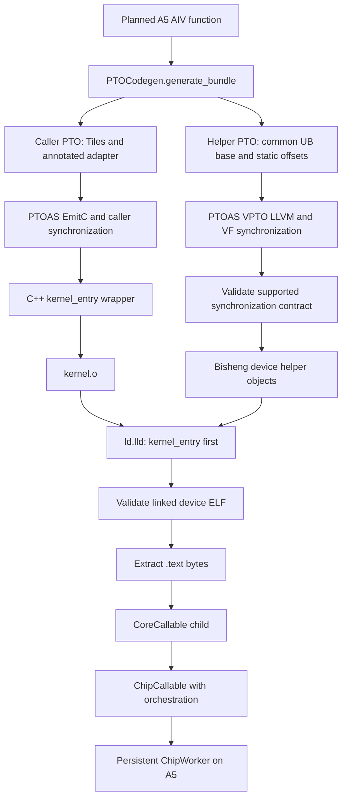

# EmitC and VPTO VF execution

Explicit `pl.reg_scope()` bodies can execute inside an A5 AIV kernel through
the persistent runtime. Ordinary Tile operations use EmitC; each register
scope becomes a separately compiled VPTO helper. This extends the typed VMI
lowering without changing the DSL or automatically selecting vector scopes.

## Artifacts and execution



`PTOCodegen.generate()` retains the combined typed-VMI representation for
diagnostics. The execution driver uses `generate_bundle()` and writes helpers
under `vpto/<kernel>/`, with a manifest describing symbols, parameter types,
effects and offsets. `kernel_config.py` attaches their paths as `vpto_sources`.
Multiple explicit scopes produce multiple helpers linked into the same kernel.

The helper emitter reuses `PTOCodegen`'s register operation lowering. Its UB
pointers denote planned MemRef bases; the VMI emitter adds each Tile view's
element origin exactly once. Captures from different statically allocated
views are reconstructed from one common UB base with constant displacements.
This retains overlap information across the separate compilation boundary.
Tile parameters and their derived views are rejected: their runtime UB pointers
cannot be related using the planner offsets assigned to local allocations.
Tiles selected at runtime by an If, including aliases and derived views, are
also rejected by executable VF helpers. Their representative MemRef offsets
do not establish a static displacement from another capture. Materialize the
selected payload into independent fixed storage before entering RegScope.
An If yielding the same actual Tile descriptor in both arms remains supported.

## Two synchronization boundaries

| Boundary | Information supplied by PyPTO | Work performed by PTOAS |
| -------- | ----------------------------- | ----------------------- |
| Caller | Tile operands and `pto.tileop.effects` on a SIMD adapter | Insert MTE2 → V and V → MTE3 events around transfers and the call |
| VF body | Common UB pointer base, constant offsets and VMI memory operations | Insert barriers for overlapping WR, RW and WW accesses |

The caller adapter keeps Tiles visible during dependency analysis. Only its
body extracts a UB pointer with `pto.tile_buf_addr` and calls the helper.
Each Tile capture is marked `read`, or `readwrite` if any store targets it;
scalar captures have `none`. Effects cover the whole captured Tile. Masked
stores use `readwrite` because they preserve inactive lanes, without implying
that the hardware reads those lanes.

PyPTO adds no fixed `pipe_barrier(PIPE_ALL)` around the call. The normal kernel
tail synchronization remains enabled. The boundary contract relies on A5 VF
completion semantics and is restricted to AIV helpers.

Before compiling LLVM to a device object, PyPTO validates the supported
instruction subset, pointer provenance and existing barrier coverage. This
check inserts no barriers. Unknown relationships or LLVM output forms fail
with a diagnostic rather than silently executing. Masked accesses are checked
over all 64 lanes, so this is not a mask-aware minimal-barrier optimizer.

## Device code and ABI

The LLVM pointer `ptr addrspace(6)`, PTO `!pto.ptr<f32, ub>` and the caller's
`__ubuf__ float*` must describe the same UB address space and parameter ABI.
Helper compilation retains `--cce-generic-addrspace=off` and uses the A5 vector
device target. It emits a device object, not a host fat object. LLVM export
and Bisheng compilation are separate to validate the helper before linking;
all relevant flags participate in the binary cache identity.

The runtime consumes raw code bytes. This path extracts only `.text`, so the
linked image must satisfy all of the following:

- Executable little-endian AI Core ELF64 with nonempty `.text`.
- `kernel_entry` at the start of `.text`, where the runtime begins execution.
- No unresolved symbols or remaining relocations.
- No other nonempty allocated sections, including `.rodata`, `.data` or `.bss`.

Symbol and debug tables may remain in the ELF but are not loaded. Helpers
requiring separate data storage or Bridge/external functions are rejected.
Structural validation does not prove that arbitrary handwritten machine code
is position independent; helpers still have to obey the device-call ABI.

## Supported execution subset

| Property | Current support |
| -------- | --------------- |
| Target | A5, AIV, ONBOARD, PyPTO Tile memory planner |
| Scope | Straight-line register operations; static loops must be unrolled |
| Memory | Contiguous FP32 accesses, 64 lanes, static offsets aligned to 32 bytes |
| Aliasing | Common UB base, static view displacements and store SSA aliases |
| Masks and scalars | Runtime masks and supported scalar captures |
| Packaging | Source artifact relocation, helper-aware binary cache |

Grouped/peer functions, CPU simulation of device objects, Bridge calls,
dynamic memory offsets, general helper control flow and other memory formats
are not admitted. Diagnostic VMI generation supports a wider IR subset than
this execution path. Extending admission requires corresponding compiler and
hardware evidence; it must not weaken rejection of unknown relationships.

## Run the complete examples

Build PyPTO and its pinned runtime in the current checkout, select PTOAS v0.70
or newer, and configure the matching CANN/Bisheng toolchain. Keep runtime pin
checking enabled. Reserve an idle A5 device before running either command:

```bash
python examples/runtime/vf_emitc_vpto.py \
  --device "$DEVICE_ID" --timeout 600 --output build/vf-add-example
python examples/runtime/vf_adapter_ub_overlap.py \
  --device "$DEVICE_ID" --timeout 900 --output build/vf-overlap-example
```

Output directories must be new. The parent process bounds compilation,
device initialization, execution and teardown. Both examples retain actual
compiler outputs, command logs and a machine-readable result. Their recording
hooks observe the production compiler; they do not substitute code bytes.

The add example checks `n = 0, 1, 63, 64, 65, 127, 128, 1023, 1024`, a
32-element Tensor offset, guards and changed inputs. It reuses a persistent
Worker through cold compilation, a cache hit, a helper edit that changes add
to subtract, and artifact relocation after removing the original directory.

The overlap example loads a 640-element Tensor slice, constructs overlapping
views and saves snapshots before and after masked writes. It checks both
caller transfer dependencies and VF-internal WR/RW/WW ordering, including
prefix/suffix masks and unchanged sentinels.

## Focused validation

Unit tests cover bundle interfaces, view origins, rejection cases, ELF checks,
helper-aware caching and artifact paths. Hardware tests under
`tests/st/runtime/vpto/` require explicit opt-in, a reserved device ID and a
timeout. Run them serially:

```bash
PYPTO_RUN_VPTO_ONBOARD=1 PYPTO_VPTO_DEVICE_ID="$DEVICE_ID" \
PYPTO_VPTO_TIMEOUT=900 python -m pytest \
  tests/st/runtime/vpto --platform=a5 -k persistent -v
```

The per-PR `onboard-tests-a5` job runs this suite in its `vf-tests-a5` step.
It explicitly enables hardware execution on the card reserved by `task-submit`.
The suite checks the selected device model through ACL in a bounded child
process; it does not require `torch_npu`. Acceptance workers explicitly pass
their source checkout to `check_runtime_pin(checkout_root=...)`, so wheel-based
CI installs still compare the extension stamp, runtime HEAD and checkout gitlink.
Unknown revisions and mismatches fail acceptance. Each test invocation gets a fresh
output directory, and execution is serial with a timeout per child process.
The source/cache relocation probes also preserve each direct invocation under
a fresh `run-*` directory, with `build-result.json` pointing to the latest run. Other platforms
deselect these A5-only tests. The `vf-a5-results` CI artifact retains JUnit
results, device information, command logs and compiler artifacts even on failure.

Compiler-only checks, standalone ACL launches and persistent Worker execution
are separate evidence. A successful simulator or ACL launch does not establish
that the production `.text` was accepted and scheduled by the Worker. Record
the exact toolchain, runtime pin, device, command and logs for each run.
