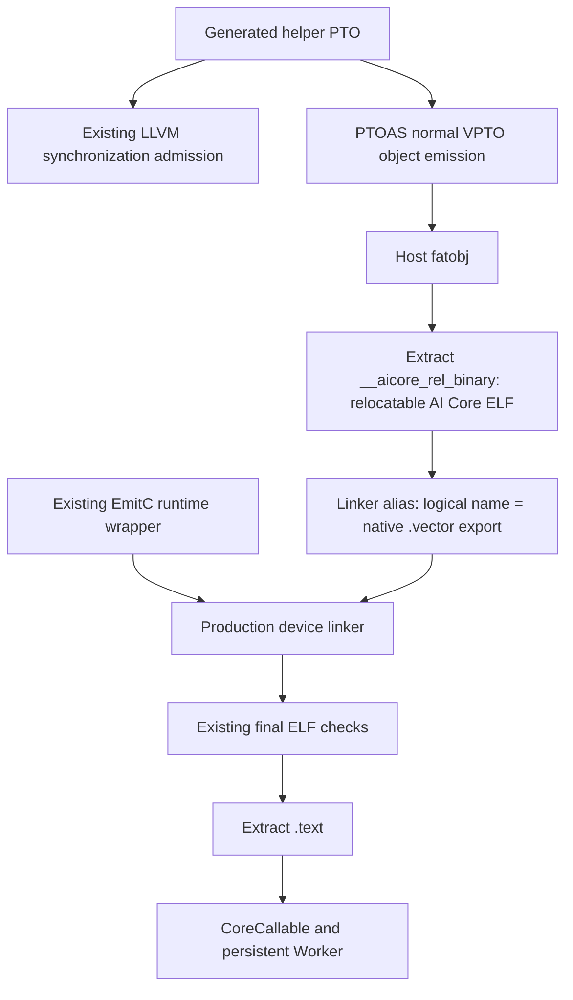

# PTOAS native device-object validation

The initial experiment started from merged PR #3226 (`72a62d13e`) and proved
that PTOAS can own helper object compilation while PyPTO retains its persistent
runtime integration. The helper-only path is now implemented in
`KernelCompiler`; the full mixed caller/helper migration remains separate.

## Experiment and acceptance boundary



The initial experiment changed only helper compilation through a test-scoped hook.
PTOAS invokes Bisheng and applies its native address-space, scheduling and ABI
policies. PyPTO does not manually compile the exported LLVM. LLVM export is
still performed separately for the existing synchronization admission check;
Bridge/external dependencies and unknown synchronization remain rejected.

The extracted object must be little-endian ELF64, `ET_REL`, machine `0x1029`.
The test verifies a global `<logical>.vector` function and adds a linker alias
for the existing caller. It asserts that this operation leaves `.text` bytes
unchanged. This adds no executable adapter. It is separate from the existing
Tile adapter used for caller synchronization.

The section name and symbol suffix are toolchain integration details, not a
PyPTO public API. Production code checks the single-object container, discovers
the actual `.vector` or `_mix_aiv` exports, and uses a new object-ABI cache
identity. The current tests exercise that production code directly, without
the experimental compilation hook or a runtime pin bypass.

## Compiler observations

Using the installed PTOAS 0.70 wheel and CANN 9.3.0:

| Probe | Observed result |
| ----- | --------------- |
| PTOAS repository's mixed GM-pointer add | Native mixed compilation succeeds |
| PyPTO caller/helper fixtures combined into two backend modules | Native mixed UB-pointer compilation succeeds |
| Helper-only normal object output | Contains a relocatable device ELF in `__aicore_rel_binary` |
| Mixed fatobj with a launch entry | Contains a launch image in `.aicore_binary` |
| Mixed fatobj with a device-function export instead of a launch entry | Contains two relocatable device ELFs in `__aicore_rel_binary` |
| Pass the extracted mixed launch image to PyPTO image validation | Rejected: remaining relocations |

In the mixed UB probe, `.rela.text` retains a relocation referencing
`run_vf.vector`. The launch image also exports `_mix_aic` and `_mix_aiv`
entries rather than PyPTO's `kernel_entry(args)` contract. Extracting its
`.text` is not a validated replacement for runtime integration.

Replacing the caller's `pto.aicore` launch marker with
`pto.visibility = "external"` changes the output. The mixed device-function
probe contains separate EmitC and VPTO objects; its host relocation records
point to payload offsets `0` and `0x820`. The caller object imports
`run_vf.vector`, and the helper object defines it. Dumping the section as if it
were one ELF would lose the second object when tools read only the first ELF.
This probe establishes compilation and packaging, not persistent execution of
the complete mixed path.

PTOAS also reports that Bisheng's SIMD VF stack usage report is unavailable;
its automatic scheduler retains scheduling enabled without a stack comparison.
Compilation succeeds, but this warning is retained in the probe logs.

The local PTOAS source reviewed separately is `f03c6cb5c934`, with implementation
unchanged from `235f381f31ac`. These compilation results use the release wheel;
they are not evidence of a fresh build of that local source revision.

## Focused hardware acceptance

Build PyPTO and the pinned runtime in the current worktree. Select the intended
PTOAS wheel ahead of CANN's bundled Python package and keep runtime pin checking
enabled. Reserve an A5 card through the machine's task queue, then run serially:

```bash
PYPTO_RUN_VPTO_ONBOARD=1 \
PYPTO_VPTO_DEVICE_ID="$DEVICE_ID" \
PYPTO_VPTO_TIMEOUT=900 \
PYPTO_VPTO_RUNTIME_OUTPUT="$OUTPUT" \
python -m pytest tests/st/runtime/vpto/test_tile_helper_sync.py \
  -k tile_adapter_persistent \
  --platform=a5 -v
```

The two cases reuse the complete add and masked-overlap examples. They verify
caller transfer synchronization, helper WR/RW/WW ordering, a 32-element Tensor
offset, guards, changed inputs, warm cache hits, helper mutations that change
results, and execution after artifact relocation. The original add boundary
lengths include `0, 1, 63, 64, 65, 127, 128, 1023, 1024`.

Compiler-only results, standalone ACL execution, and persistent Worker
execution must be reported separately. Hardware results and version receipts
are recorded under `build/native-object-validation/`; a compiler success alone
does not complete hardware acceptance.

## Initial experiment results on 2026-10-31

| Evidence | Result |
| -------- | ------ |
| Fresh PyPTO extension and pinned A5 runtime | Built in this worktree; runtime `6b6b88f2353c`, pin matches |
| Pure EmitC `tile_add_64` control | Passed on reserved device 3 |
| Existing VF add and overlap path | 108 + 192 numerical checks passed on device 1 |
| Native-object VF add and overlap path | 108 + 192 numerical checks passed on device 1 (`Ascend950DT_9581`) |
| Cold and changed final code, both examples | All four `.text` payloads are byte-identical to the existing path |
| Cache and artifact checks | Each example compiled twice; warm and relocated loads hit cache; original artifact path removed |
| Focused harness regressions | 17 passed |
| Standalone ACL / simulator | Not run in this round; not used as Worker evidence |

Environment: CANN 9.3.0, driver 25.6.rc2.b023, PTOAS 0.70 release wheel,
Bisheng clang 15.0.5 (2026-09-22 build), Python 3.11.6, torch/torch_npu 2.6.0.
`versions.json`, `runtime-stamp.json`, `acceptance-summary.json`, JUnit files,
device logs and each example's `native-result.json` retain the receipts.
The code identity result applies to these examples; it does not prove general
minimal-barrier optimization or acceptance of dynamic/unknown aliases.

## Production integration verification on 2026-10-31

The production change was rebuilt on base `f9b7d5d84469`, with the same versions
listed above and runtime pin checking enabled. These tests use
`KernelCompiler` directly, without the experimental compilation hook.

| Evidence | Result |
| -------- | ------ |
| Runtime compiler, synchronization validator and harness unit tests | 92 passed |
| Installed-PTOAS alias/synchronization compiler tests | 87 passed |
| Pure EmitC `tile_add_64` control | Passed on reserved A5 device 5 (`Ascend950DT_9581`) |
| `tests/st/runtime/vpto --platform=a5 -k persistent` | 8 passed on device 5; 7 unrelated cases deselected |
| Complete add and overlap examples within that suite | 108 + 192 numerical checks; cache, helper mutation and relocation passed |
| Four cold/changed final `.text` payloads | Byte-identical to the previous path; linker aliases also preserve helper `.text` |
| Configured pre-commit checks | Passed, including Pyright and bilingual documentation checks |

The existing A5 CI `vf-tests-a5` step selects these tests, including both
parameterized examples. No additional CI workflow is needed.
Evidence is under `build/native-object-validation/`: `production-ut.xml`,
`production-alias.xml`, `production-onboard/{control,vpto}.xml`,
`production-onboard/retry.log`, `production-code-comparison.json` and
`production-precommit-clean.log`.

The first queue submission failed before test execution because its multiline
shell command could not be parsed; the corrected single-line submission passed.
An initial Pyright invocation inherited hardware torch 2.6 instead of the
hook's pinned torch 2.8; using the hook's package environment passed.
The original failures remain in `production-onboard/queue.log` and
`production-precommit.log`. Neither failure was skipped or suppressed.

## Complete mixed compilation: Tile adapter blocker

The compilation handoff and runtime integration are tracked in
[PyPTO #3238](https://github.com/hw-native-sys/pypto/issues/3238), including this
PTOAS compilation blocker.
The compiler-only reduction is retained at
`tests/ut/backend/vpto_vf_validation/native_mixed_tile_adapter_repro.pto`.
It reproduces the same failure; both the device-only and guarded-fatobj controls
compile successfully. Commands and logs are under
`build/native-object-validation/issue-reproducer/`.

Combining the actual generated add/overlap caller and helper into native
backend child modules fails with PTOAS 0.70 and this CANN installation:

```text
error: no template named 'Tile'
```

The generated `__pypto_vf_body_0_tile_adapter` has Tile parameters in its
function signature. That signature is outside an AIV preprocessor guard.
The native fatobj path compiles host code as well as device code, while the
PTO-ISA header exposes the Tile definitions in the device compilation context.
The failure occurs before the VPTO helper is linked.

| Paired probe | Result |
| ------------ | ------ |
| Original generated caller, native fatobj command | Fails for both add and overlap |
| Original add caller, AIV device-only command | Compiles |
| Guard the adapter definition with `#if defined(__DAV_VEC__)`, same fatobj command | Compiles for both examples |

These are retained generated-source probes under `generated-mixed/`, not a
PTOAS source fix or a full mixed-runtime acceptance. The backend must handle
the helper's execution domain consistently for its signature and body.

## Follow-up output contract

- Fix or verify the Tile-adapter host-visibility issue in the target PTOAS
  version, then repeat the actual generated mixed-module probes.
- Expose a supported relocatable AIV device-object output from PTOAS, avoiding
  dependence on CANN's host fatobj container layout.
- Define how logical exports map to device symbols, or preserve the requested
  direct-call ABI without a caller-side suffix rule.
- Provide a way to retain inspection IR or a strict synchronization validation
  result alongside the object. Do not remove unknown-dependency rejection.
- Validate the complete mixed caller/helper path with PyPTO's runtime entry;
  the helper-only experiment does not establish that entire migration.
- Keep runtime argument packaging, final ELF compatibility checks, cache
  identity, artifact relocation and Worker scheduling in PyPTO/runtime.
