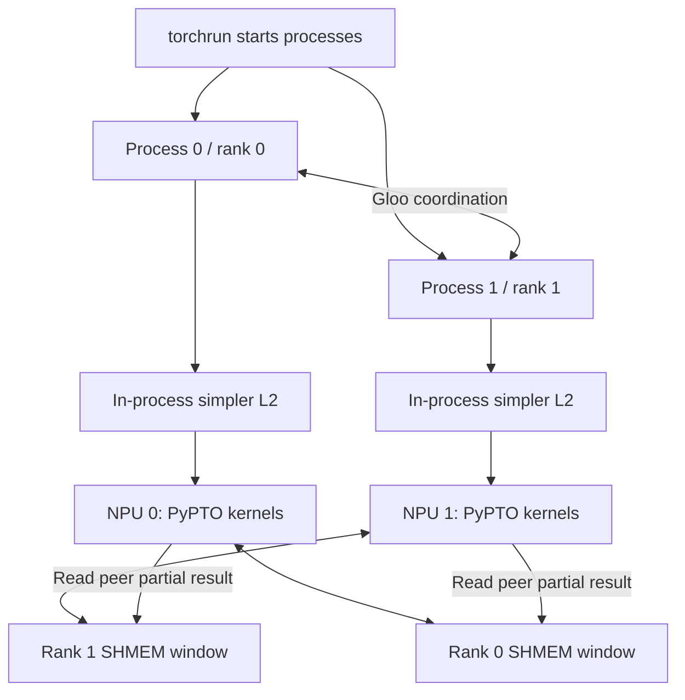

# Path B from scratch: what we built and why

This guide is for readers new to PyPTO, distributed inference and Path B.
Start with one question: **how can several accelerator cards share the work of
running one large model and correctly combine their partial results?**

The result is a validated offline example, not a general production inference
service. For interfaces, historical debugging and evidence locations, see the
[Gloo and symmetric-memory technical record](gloo-shmem-pathb.md).

## 1. What was delivered

We implemented a standalone Qwen3-14B inference example that:

- Uses 2, 4 or 8 Ascend NPUs in one machine.
- Runs one torchrun process per card.
- Loads real weights, processes a prompt and generates subsequent tokens.
- Executes model arithmetic and distributed sums with PyPTO kernels.
- Uses Gloo for coordination and torch_npu symmetric memory for communication windows.
- Offers optional dispatch-plan caching and FFN launch consolidation, with correctness and performance checks.

Changes are in **PyPTO**. The pinned simpler runtime already supplied the
required capabilities: neither its source nor its submodule pointer changed.
No code was merged into vllm-ascend. No commit, push or PR was made.

## 2. A small glossary

| Term | Meaning here |
| ---- | ------------ |
| NPU | An accelerator that executes matrix operations and other model computation |
| rank | One participant's identity in a multiprocess job |
| TP, tensor parallelism | Partitioning some model weights and computation across ranks |
| TP2 / TP4 / TP8 | Tensor parallelism with 2 / 4 / 8 ranks |
| kernel | A program executed on the device |
| host | The CPU side that manages and coordinates execution |
| launch / dispatch | A host request to execute device work |
| allreduce | Combining partial results and making the result available to every rank |
| barrier | A synchronization point that all participants must reach |
| prefill | Processing the input prompt and establishing context |
| decode | Generating subsequent tokens using that context |

TP here does not mean running a complete independent model on each card for
different users. Cards compute partitions of the same inference. Some weights
remain replicated; not every weight is partitioned.

## 3. How the components cooperate

Path B names this engineering route, not a new model or communication protocol.

| Component | Responsibility |
| --------- | -------------- |
| torchrun | Starts processes and assigns rank identities |
| PyTorch / torch_npu | Manages device contexts, weights, device tensors and symmetric memory |
| Gloo | CPU coordination, synchronization and verification exchanges |
| SHMEM | Provides communication windows with published peer-accessible addresses |
| PyPTO | Compiles model arithmetic, window accesses and distributed sums |
| simpler L2 | Schedules compiled tasks inside the current process |



The diagram shows two ranks; four and eight follow the same principle.
Gloo does not replace device allreduce in the model. Copying logits to the CPU
and comparing ranks through Gloo is a separate validation operation.

### Why in-process L2 instead of L3

An address belongs to a process mapping and device context. Its existence in a
parent does not make it usable in a child. Earlier debugging found that L3 fork
children could not directly use the parent's SHMEM mappings.

Following the original boundary, Path B uses an **in-process L2 worker borrowing
the context already established by torch_npu**. This is not a claim that L3 is
generally unusable; this route does not use that different ownership/mapping model.

## 4. What we implemented, in order

### First: repair the shared communication layout

The reference used a 1056-byte CommContext; the newer runtime required 1088 bytes
and different offsets for fields such as rank and window addresses.

Think of a form with agreed columns: if one program writes an address into
column three while another reads column five, transferring the form succeeds
but its meaning is wrong. That is an ABI, or data-layout contract, problem.

We adapted the layout and directly tested its field offsets. The three
communication-engine workspace descriptors are zero because this path uses
peer-window addresses. This does not enable URMA/RDMA/SDMA operations that
require those workspaces.

### Second: adapt the reference to current APIs

We ported selected changes instead of merging the old branch wholesale:

- SHMEM allocation, named slices and CommContext packing.
- A DSL declaration for external windows, with parser and runtime support.
- Existing `Buffer.wrap` registrations for caller-owned device storage.
- PyPTO worker forwarding for borrowed contexts and caller streams.
- Generated callable signatures that count ordinary scalars and context pointers correctly.

Small communication tests preceded the full model, separating transport
problems from model problems.

### Third: verify that ranks read fresh communication data

The generic example checks TSTORE, TPUT and multi-rank sums. The first two are
device operations that write or transfer data into communication windows.

Model allreduce uses **remote_load + add** to read rank-local results and sum
them on the device. We did not use the builtin allreduce with known issues.

The sequence is:

1. Every rank publishes its partial result into its SHMEM window.
2. Wait until all ranks have published.
3. PyPTO kernels read the rank windows and sum their contents.
4. Wait until all ranks finish reading before overwriting for the next round.

The barriers prevent reading unfinished publications and overwriting data still
being read. Both remain in the implementation.

### Fourth: run the real Qwen3-14B model

We implemented weight partitioning, prefill, KV caching, decode and the sums
after o_proj/down_proj, first for TP2 and then TP4/8.

Model code was adapted from the reference consumer with its attribution and
license retained. Referencing that implementation is distinct from introducing
a vLLM runtime dependency: this is a standalone PyPTO example, not vLLM Engine integration.

## 5. Why generating plausible text is insufficient

Plausible output does not exclude numerical errors, stale cache contents or
incorrect rank data. Validation therefore covers several layers:

| Check | Problem it targets |
| ----- | ------------------ |
| ABI, parser and codegen | Incorrect parameter layouts, contexts or dependencies |
| Device communication tests | Invalid addresses, stale reads and synchronization faults |
| Rank agreement | Different final results across cards |
| Model reference comparisons | All ranks agreeing on an incorrect result |
| Bitwise fused/unfused comparison | Performance changes altering model arithmetic |
| Repeated generation | Errors triggered by cache or invocation reuse |

### The numerical contract matters

The accepted contract uses **BF16 storage with FP32 arithmetic**, converting
back to BF16 at defined points. BF16 saves space but represents values less
precisely. Conversion locations and rounding modes affect results.

The implementation retains BF16 RINT conversion points and high-precision
reciprocal-square-root normalization. It passes the corresponding reference
checks; it **does not claim equivalence to unmodified Hugging Face eager BF16**.
Earlier mismatches remain documented and were not relabeled as successes.

With full FFN consolidation, TP2/4/8 checks spanning four prompt lengths and
eight generation steps each produced **96 saved logits tensors bitwise identical
to accepted unfused baselines**. Logits are the scores before selecting a token,
so this check is finer than comparing generated text alone.

## 6. What the performance work changed

After correctness, the user requested performance measurement and launch consolidation.

### Reuse fixed dispatch preparation

An optional DispatchPlan caches callable descriptions and configuration.
It does **not** cache old tensor addresses or Buffer registrations: addresses,
scalar values and registrations remain per invocation.

### Consolidate adjacent host submissions

Originally each layer submitted these FFN stages separately:

```text
Residual + RMS → Gate/Up GEMM → SwiGLU → Down GEMM
```

We first put the last two stages in one chip entry, then all four. Device runtime
scheduling follows their tensor dependencies after a single host submission.

**This does not rewrite four arithmetic kernels into one large kernel.**
The original AIV/AIC tasks, intermediate storage and rounding boundaries remain.

| Mode | Host dispatches per rank/step |
| ---- | ----------------------------: |
| Unfused | 723 |
| SwiGLU + Down | 683 |
| Full FFN | 603 |

Full FFN removes 120 calls, or 16.6%. It does not guarantee a 16.6% latency
reduction, since arithmetic, communication and synchronization still cost time.

Both fusion options default off and are mutually exclusive:

- `--fuse-swiglu-down`: consolidate the last two stages.
- `--fuse-ffn`: consolidate the full FFN.
- `--cache-dispatch-plan`: independently enable configuration caching.

## 7. What the measurements establish

A–B–B–A execution reduces dependence on which configuration ran first:
A is unfused and B is full FFN. Within each TP configuration the same device
allocation is used, caching is enabled for both, and each block warms up separately.

The standard workload is batch 1, a 32-token prompt and seven decode steps.
Five measured sequences per block give 70 pooled decode observations per variant:

| Configuration | Unfused decode median | Full FFN | Observed reduction |
| ------------- | --------------------: | -------: | -----------------: |
| TP2 | 941.2 ms | 866.5 ms | 7.9% |
| TP4 | 848.8 ms | 768.1 ms | 9.5% |
| TP8 | 903.8 ms | 790.0 ms | 12.6% |

Closeout added two TP4 workloads, with three measured sequences per block:

| Workload | Unfused median | Full FFN | Reduction |
| -------- | -------------: | -------: | --------: |
| 1-token prompt + seven decode steps | 850.4 ms | 756.2 ms | 11.1% |
| 32-token prompt + 31 decode steps | 842.5 ms | 771.0 ms | 8.5% |

These results support a repeatable benefit within the tested workload range.
They do not guarantee a speedup on every host, establish TP4 as universally
optimal across different device allocations, or measure online serving throughput/SLA.
The timing boundary is model forward execution.

The longer benchmark checks finite logits, rank agreement, repeatability and
matching tokens across variants; it does not add independent CPU-reference
checks for every additional decode position.

## 8. Where the changes live

| Location | Purpose |
| -------- | ------- |
| `python/pypto/runtime/shmem_gloo.py` | Windows, 1088-byte context and external domain adaptation |
| `python/pypto/language/` | External-window DSL and parsing |
| `python/pypto/runtime/` | Provider forwarding and borrowed context/stream adaptation |
| `src/codegen/`, bindings and stubs | Callable scalar-pool ABI |
| `examples/distributed/` | Communication examples and direct dispatch |
| `examples/models/qwen3_tp/` | Model, weights, benchmark and analysis |
| `tests/` | Communication, compilation, lifecycle and model-helper tests |
| `docs/` | Technical record, evidence and this guide |

The actual runtime submodule is simpler `355ce3015e3e`, which already provides
borrowed contexts, caller streams and Buffer registration.
`typings/simpler/*.pyi` belongs to PyPTO; changing those declarations does not
modify the simpler repository.

The closeout snapshot has 45 files: 20 core-library/stub files, eight example
files, 11 tests, five documentation/configuration files and one license.
This guide and its Chinese counterpart were added after that snapshot and are
not included in those 45 files.

## 9. Final closeout status

The user requested only three remaining closeout activities and no more optimization.
All three completed:

1. Broader performance coverage: short prompts and 31-step decode, using A–B–B–A.
2. Review and regression: 964 related tests; 90 model-entry compile checks across
   TP2/4/8; then 90 affected tests rerun after test typing fixes. The rerun overlaps
   earlier tests, so these counts must not be summed as unique tests.
3. Handoff: full patch, source snapshots, reproduction commands, logs,
   performance JSON and hashes.

Ruff, Pyright and documentation parity/navigation checks passed.
Failure tests verify worker teardown before Buffer release and no premature
registration release after failed teardown.

The snapshot is `build/pathb-closeout/pathb-review.tar.gz`.
Its patch was applied to an isolated index at the recorded base and the resulting
file hashes matched the snapshots. It is a source review package, not a model
image: it excludes weights, compiled binaries and the machine environment.
This introductory guide is a subsequent documentation addition.

## 10. What is not delivered

| Item | Current boundary |
| ---- | ---------------- |
| Arbitrary models | Qwen3-14B only |
| Arbitrary batch/prompt sizes | Batch 1, prefill 1..32, cache capacity 128 |
| Online inference service | Offline example, not vLLM Engine integration |
| Multi-machine communication | Single machine only |
| L3 SHMEM route | These mappings must not cross an L3 fork |
| Further communication/stream optimization | Barriers retained; optional optimization stopped |
| Upstream merge | No commit, push or PR |

Readiness for PR review does not mean upstream acceptance: target-branch
alignment, complete submission checks, CI and maintainer review remain part
of the submission/merge process.

A concise description is: **we built and validated a single-machine,
one-process-per-card model route using PyPTO for computation and communication,
then measured a performance improvement by reducing host submissions while
preserving accepted numerical results.**

## 11. Where to verify the claims

- Original requirements: `pathb_codex_handoff.md`.
- Contracts and historical validation: [technical record](gloo-shmem-pathb.md).
- TP measurements: `build/pathb-ffn-abba/tp{2,4,8}/comparison.json`.
- Short/long workloads: `build/pathb-closeout/{short,longdecode}/comparison.json`.
- Snapshot inventory: `build/pathb-closeout/review-package/manifest.json`.

The `build/` paths are local experiment artifacts, not files that appear merely
by cloning the repository. Read this guide first; use the package and technical
record when reviewing or reproducing the work.
