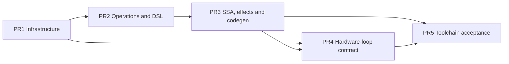

# VF IR Implementation Design: Five Independently Verifiable PRs

| Item | Contract |
| ---- | -------- |
| Status | Design draft; later PRs describe planned capabilities |
| Related RFC | `16-vf-ir-rfc.md` (separate research draft) |
| Goal | Split VF IR into five independently constructible and testable PRs |
| Scope | RegType, RegScope, register operations, store SSA/effects, PTO codegen and hardware loops |
| Non-goals | Automatic vectorization, register allocation and performance optimization |

This is an implementation plan, not a replacement RFC. Required semantic contracts
take precedence over reference implementations. Existing ScopeStmt, tile.store,
PTOAS and pass behavior establish integration boundaries; they do not prove new
behavior correct. PR1 implements infrastructure only. APIs in subsequent sections
remain proposed until their corresponding PR is implemented and validated.

## 1. Delivery goal

Load Vec Tiles within RegScope, compute register/mask values, write a new Tile
SSA version with `reg.store`, and use that Tile outside the scope. Capture external
references automatically; registers and local scalars cannot escape. The Tile
result aliases the destination allocation. Target `vstore` has no result, but its
write effect and source order must survive lowering.

Ordinary `pl.range` uses automatic hardware-loop analysis. Proposed
`pl.hardware_loop` requires hardware realization. Qualification distinguishes
Eligible, Ineligible and Unknown. Surviving nonempty Require loops need final
artifact evidence; they cannot silently become ordinary loops. Proven zero-trip
Sequential loops may be removed by Simplify without an error or hardware evidence.

```text
RegType / RegScope
  -> reg.* schema / Tile SSA store / Write effect
  -> SSA, alias and effect verification
  -> pto.vecscope / vmi.vload, arithmetic and resultless vstore
  -> hardware-loop qualification and artifact evidence
```

## 2. Shared boundaries

### 2.1 Required semantics

1. One `RegType(shape, dtype, kind)`: shape is one positive integer; RegKind
   distinguishes vector and mask values.
2. `RegScopeStmt : ScopeStmt` adds no captures, results or other data fields.
   Free-variable analysis derives inputs from the body.
3. `reg.store` uses AssignStmt, returns the destination Tile/View type, declares
   `output_reuses_input(0)` and a Write effect.
4. Tile versions may escape; registers and locally defined scalars may not.
5. SSA versions and memory effects coexist: stores using the same old destination
   still execute in source order.
6. `HardwareLoopPolicy::{Auto, Require}` expresses intent independently of ForKind.
7. Emit RegScope as `pto.vecscope`; lower store to a resultless target write.

### 2.2 Exclusions

No physical register numbering/allocation, automatic vectorization, masked loads,
gather/scatter, reductions, shuffles or register parameters crossing RegScopes.
Do not redesign general CSE/DCE/scheduling/WAW optimization or the public tile.store
contract. Adapt existing effect consumers only as required for correctness. Do not
modify PTOAS VMI definitions here; report unsupported target capabilities explicitly.

### 2.3 Dependencies



PR4's pure analyzer can start after PR1, but should merge on PR3 to test loops
within RegScope. Each PR builds and tests on its declared dependencies, without
requiring capabilities from a later PR.

## 3. Data and error model

### 3.1 RegType

```cpp
enum class RegKind : uint8_t { VecReg, MaskReg };
class RegType : public Type {
 public:
  RegType(int64_t shape, DataType dtype, RegKind kind);
  int64_t shape_;
  DataType dtype_;
  RegKind kind_;
};
```

Do not inherit ShapedType or store a vector shape/layout/storage identity. `lanes`
aliases shape. MaskReg requires BOOL; VecReg rejects BOOL. All three fields affect
structural equality, hashing and serialization. Canonical notation is
`pl.Reg[L, dtype, kind]`; omitted kind defaults to VecReg.

### 3.2 RegScopeStmt

Only constructor, ObjectKind, ScopeKind, TypeName and field descriptors are added.
Inputs are temporary free-variable analysis results, not persisted fields. Initial
support is A5 InCore/AIV, without nested RegScopes. An outer InCore scope is not a
RegScope. Tile SSA updates remain visible after the body; verify register/scalar
escape using defining and using scopes.

The scope effect is the union of body calls. Load reads the root allocation and
`[offset, offset+L)`; store writes it. ReadWrite is reserved for future atomic
stores. Propagate these effects to enclosing statements and loops.

### 3.3 Store result

```text
out1 : TileType(out0) = Call("reg.store", [out0, offset, value, mask?])
```

out1 shares root allocation, view offset and communication context with out0.
It creates neither storage nor a snapshot. Both chained stores and two stores
referencing the old destination are legal. Aliasing Write effects impose ordering
even when no result-to-operand dependency exists; later writes overwrite overlap.
Reordering/deletion must consult alias/effect information, not only Var def-use.

### 3.4 Errors

- Construction: reject invalid field types, shapes, kinds, arity or API forms at entry.
- Verification: reject dominance, escape, initialization, address and loop-contract
  violations with source spans.
- Unsupported target: report missing emitters, capabilities or proof explicitly.
- Require: reject Ineligible/Unknown qualification or missing final evidence for
  surviving nonempty loops. Removing proven zero-trip loops is not a Require error.

## 4. PR1: IR infrastructure

### 4.1 Scope

Provide directly constructible RegType, RegScopeStmt and ForStmt policy through
C++, Python bindings and binary serialization. Old serialized loops default to
Auto. No register operations, register-specific SSA semantics, PTO lowering or
hardware-loop analysis. Full scope/loop DSL roundtrip belongs to later PRs;
unsupported text printing and codegen must fail rather than erase semantics.

### 4.2 Files

| Area | Change |
| ---- | ------ |
| type.h / type.cpp | RegKind, RegType, accessors and constructor validation |
| core.h / kind_traits.h | Register kinds and dispatch; include new nodes in base kind sets |
| stmt.h / statement implementation | RegScopeStmt; trailing default Auto ForStmt policy |
| visitor/mutator / reflection | Traverse common scope fields and preserve policy on reconstruction |
| structural comparison / hash | Include descriptor fields and policy; exclude spans, SSA names and analysis caches |
| serialization | Type, scope and policy persistence; reject unknown/malformed enums |
| bindings / ir.pyi | Synchronized constructors, enums and read-only properties |
| type resolver / printer | Canonical Reg annotation with scalar logical lane count |
| scope string/bindings/serialization | Append ScopeKind.Reg = 9; preserve all old values, including unused 1 |

ForKind continues to describe Sequential/Parallel/Unroll/Pipeline scheduling.
Hardware intent is a separate field.

### 4.3 API

```cpp
RegType::GetShape() -> int64_t;
RegType::GetDType() -> DataType;
RegType::GetRegKind() -> RegKind;
ForStmt::GetHardwareLoopPolicy() -> HardwareLoopPolicy;
```

Reject nonpositive/dynamic shape, unknown dtype/kind, Mask non-BOOL and Vec BOOL.
RegScope constructor order is `name_hint, body, span, leading_comments, attrs`.
Simplify may eliminate proven zero-trip Require loops and return initial carried
values. Nonempty Require loops must survive ordinary single-trip folding.

### 4.4 Acceptance

Native and Python tests cover constructor/accessor contracts, invalid descriptors,
all three structural identity fields, scope traversal/metadata preservation,
Auto/Require identity, new/legacy serialization and corrupt enums. Run existing
type, statement, printer and serialization tests. No register operations or real
PTOAS are needed. Invalid descriptors fail before codegen.

## 5. PR2: Operations, DSL and automatic capture

### 5.1 Scope and files

Implement P0 schemas, Builder and Python DSL on PR1. Update op_registry,
`src/ir/op/reg_ops/`, builder.h/builder.cpp, language operation wrappers, scope.py,
dsl_api.py, language exports, AST parser and type resolver. Add verifier/property
and pipeline integration. This PR describes effects but does not yet implement
SSA/effect consumers or the final vecscope emitter.

### 5.2 P0 schema

```text
reg.load(tile, offset; lanes) -> VecReg [Read(root, interval)]
reg.store(tile, offset, value; mask?) -> Tile/View
reg.index_gen(base; lanes, dtype, order) -> VecReg
reg.broadcast(scalar; lanes, dtype) -> VecReg
reg.full_mask(lanes) -> MaskReg
reg.active_mask(active_lanes, lanes) -> MaskReg
reg.add/sub/mul/div/minimum/maximum(Vec, Vec; mask?, pmode) -> Vec
reg.convert(Vec; dtype, rounding?, saturate?) -> Vec
reg.compare(Vec, Vec, Mask seed; predicate) -> Mask
reg.select(Mask, Vec, Vec) -> Vec
reg.mask_and/or/xor/not(Mask...) -> Mask
```

Calls remain Call nodes; computations and stores use AssignStmt. Load/store
destination is operand 0; store value is Vec and optional mask has matching lanes.
Store returns the Tile/View type, reuses input 0 and declares Write, not ReadWrite.
Track root allocation, absolute view interval and whether a mask provably narrows
the write. Dynamic offsets/lanes require conservative unknown intervals and must
prevent unsafe reordering. Scope effects establish enclosing RAW/WAR/WAW and
initialization constraints.

PR2 verifies Vec UB, contiguous views, lane/offset/capacity/active-lane conditions,
dtype, signedness, pmode and capacity available directly from Tile metadata. Use
schema effect snapshots without depending on PR3. PR3 integrates init_memref,
alias analysis, dynamic intervals, cross-statement initialization and barriers.

### 5.3 Capture and escape

`pl.reg_scope()` accepts no captures parameter or region yield. Record local
definitions and analyze free variables: external Tiles, Views, parameters and
read-only scalars are inputs; local registers/scalars belong to the scope. Store
Tile versions may escape. Reject local register/scalar uses outside, outer-loop
results and writes to external containers. Apply verification to both parser and
manual Builder IR, including name rebinding; Python lifetime is insufficient.

### 5.4 Context validation

1. Before ExpandMixedKernel: validate A5, InCore context, parent scope restrictions,
   no nesting and no escape. Accept unspecialized FunctionType.InCore without
   requiring AIV placement. Reject explicitly incompatible AIC, Group, Spmd,
   Orchestration/Graph functions and Runtime/Graph/CommDomain parent scopes.
2. After ExpandMixedKernel: add a final placement verifier. Every surviving
   RegScope must belong to FunctionType.AIV. Reject AIC and unresolved InCore with
   source spans before PTO codegen, for parser and Builder IR alike.

Reuse IsInCoreType and existing FunctionType/placement verification. Do not require
the final AIV property before early passes have resolved placement.

### 5.5 User form and rejection

```python
with pl.reg_scope():
    x = pl.reg.load(src, offset=0, lanes=256)
    y = pl.reg.add(x, x)
    out1 = pl.reg.store(dst, offset=0, value=y)
z = pl.tile.add(out1, out1)
```

Reject operations outside scope, unsupported context, nested scopes, Vec+Tile
arithmetic, non-BOOL masks, non-Vec Tile destinations, mismatched lanes, register
escape, bare store and explicit captures bypasses.

### 5.6 Acceptance

Test every schema and negative parameter matrix, effects/result inference,
initialization/capacity, AST/Builder equivalence, canonical printer/parser forms,
capture and escape. Explicitly test early InCore acceptance and final AIV
acceptance/AIC rejection after ExpandMixedKernel. Tests run without hardware;
use fixtures for unsupported backends.

## 6. PR3: SSA, memory effects and PTO codegen

### 6.1 SSA

Treat RegScope as a transparent, non-outlined region in convert_to_ssa_pass.cpp.
Keep updated Tile mappings after the body; PR2 verifies register/scalar ownership.
Stores within loops propagate Tile versions through explicit iter_arg/yield/result.
Entering/leaving RegScope adds no yield. Zero trips return the initial Tile and
must not be treated as an executed write.

Preserve equivalent root allocation, view offset/interval and communication
context for every version. SSA dominance alone does not solve memory conflicts.
Reads depend on previous writes/initialization; propagate scope RAW/WAR/WAW.

### 6.2 Effects and ordering

Keep unused-result stores because they write. Order conflicting writes using
roots/intervals, even when both name the old destination. Initially prohibit
reordering across potentially conflicting VF statements. Def-use-only dependency
analysis is not full WAW analysis: add conservative alias/effect barriers in IO
ordering, DCE and dependency consumers, or explicit WAW edges. False mask lanes
are unwritten; masks do not prove complete initialization. Tile versions are not
snapshots. Unknown VF nodes must be supported, preserved or explicitly rejected.

### 6.3 Codegen

Map Vec/Mask types to VMI with profile lane/dtype checks. Emit resultless
pto.vecscope, VMI SSA loads/arithmetic, and resultless pto.vmi.vstore. Bind the
frontend Tile result to the same view/base address/communication context.
Prepare external Tile addresses outside the region; do not leak local registers,
addresses or VMI SSA values. Diagnose address, offset, capacity, initialization
and mask errors with spans; do not insert implicit copies/runtime checks.

### 6.4 Files and acceptance

Update SSA conversion, init_memref, effect/dependency/IO/DCE consumers,
BackendHandler and PTO emitter/reg_codegen. Test rebinding, chained and old-target
stores, outer Tile uses, escapes, overlapping views, masks, valid_shape,
uninitialized loads, store-only DCE and RAW/WAR/WAW ordering. Golden MLIR proves
vecscope, resultless store, address identity and no local-value leak. Use fixtures
without PTOAS; optional compilation smoke tests do not prove numerical correctness.
Run existing tile.store regression tests without changing its public semantics.

## 7. PR4: Hardware-loop contract and qualification

### 7.1 API and analysis data

Proposed `pl.hardware_loop(n)` creates Sequential Require loops; ordinary
`pl.range(n)` remains Auto. Do not combine Require with Parallel/Unroll/Pipeline.
Qualification contains state, reason, optional trip_count/post_iv and profile_id.
Analysis/report caches do not affect structural hashes; compilation cache keys
include target profile and toolchain versions. Counter narrowing alone is not
hardware-loop proof.

### 7.2 Qualification algorithm

```text
N = max(0, ceil((upper - lower) / step))
post_iv = lower + N * step
```

Validate constant nonzero step and allowed sign before dividing. Use wide integer
arithmetic. For nonempty Require loops require positive step; check signed-i16
counter/post_iv, profile-specific trip count, one induction variable, body effects,
register/Tile carries, nesting, memory dependencies and unsupported control flow.
Unproved conditions are Unknown. For example, lower=32760, upper=32767, step=4
has N=2 and post_iv=32768: reject the overflow despite an in-range upper bound.
Dynamic bounds/steps/resources are Unknown, not guessed Eligible.

### 7.3 Empty loops

Static N=0 is not a Require error; there is no HWL_EMPTY failure requirement.
Simplify may remove zero-trip Sequential Auto and Require loops and replace
results with initial iter_arg values. Such loops need neither qualification nor
artifact evidence. If the analyzer sees one, handle it as an empty-loop
simplification, not generic Ineligible/Unknown failure. Unknown dynamic emptiness
does not receive this exemption. Separate zero-trip removal from single-trip
unfolding so nonempty Require semantics remain intact. PR1 establishes this
preservation boundary; PR4 tests it alongside the analyzer.

Use bottom-up body summaries with O(N log N) target complexity, never enumerate
iterations. Reports identify stable loop ID, profile ID, inputs and reasons.

### 7.4 Backend decisions and invalidation

BackendHandler/profile supplies counter width, steps, resources, nesting, allowed
carry types and final checker. Avoid A5-specific branches in the analyzer.

1. Verify policy, ForKind, SSA/body; simplify proven zero-trip loops first.
2. Qualify remaining loops as Eligible/Ineligible/Unknown.
3. Reject Require Ineligible/Unknown; never rewrite policy to Auto.
4. Eligible still requires final artifact mapping; otherwise report missing evidence.
5. Invalidate/recompute after body, transformation, profile or toolchain changes.

Auto permits the original loop in all three states and may emit a report without
changing semantics because qualification failed.

### 7.5 Files and acceptance

Update statement APIs/bindings, DSL/parser/printer, hardware_loop_analysis,
BackendHandler/PassContext, verifier/property registry and transformation guards.
Keep Simplify's zero-trip Require removal separate from nonempty folding.
Use artificial profiles to test static eligibility, dynamic Unknown, step 0 and
negative step, empty-loop initial carries/no evidence, 32767/32768 boundaries,
post_iv overflow, nesting/carries/resources, cache invalidation, stable missing
evidence failure and unchanged Auto behavior. No hardware is required.

## 8. PR5: Toolchain acceptance and final evidence

### 8.1 Backend boundary

Connect PyPTO artifacts to the selected PTOAS/target compiler and synchronize
documentation. Do not redesign preceding APIs or hide backend defects in profiles.
Current compilation passes neither --pto-backend nor pto.backend metadata, so it
uses default EmitC without mixed backends. No user backend-selection option is
added. Validate actual VMI/vecscope support in PR3/PR5. If VPTO is required, specify
invocation, artifact format and wrapper ABI/link adaptation in that integration.
Default EmitC alone does not establish VF support.

### 8.2 Evidence contract

Assign stable IDs only to surviving nonempty Require loops. Removed static empty
loops are excluded. Persist this versioned sidecar with the artifact:

```json
{
  "schema_version": 1,
  "toolchain_version": "ptoas-<version>",
  "kernel": "<symbol>",
  "loops": [{"loop_id": "hwl-<stable-id>", "source_span": "...", "policy": "Require"}]
}
```

The checker consumes artifact, sidecar and profile ID; returns verified, missing,
mismatch or unsupported with per-loop reasons. Verified output has:

```json
{
  "schema_version": 1,
  "artifact_digest": "<sha256>",
  "toolchain_version": "ptoas-<version>",
  "profile_id": "<profile>",
  "loops": [{"loop_id": "hwl-<stable-id>", "kernel": "<symbol>", "region_id": "<target-id>", "instruction_id": "<target-instr>", "status": "verified"}]
}
```

Each sidecar loop gets exactly one result. Duplicate/missing loop IDs, reused
region IDs or inconsistent artifact/profile digests are mismatches. Normalize
MLIR metadata/debug mappings into the same schema. Evidence must map loop ID to
target kernel and actual hardware-loop instruction/region. Missing mappings,
version mismatches, transformed-away nonempty loops, or only i16/scf.for/vecscope
are failures. A narrowing pass in PTOAS source is not artifact evidence.

### 8.3 Files and acceptance

Update compiler/codegen handoff, add artifact checker and versioned fixtures;
synchronize operation, loop and roundtrip specifications and their translations.
Fixtures cover valid evidence, missing evidence, conflicting IDs, transformed
loops and old versions. Add minimal P0 compilation smoke tests when PTOAS is
available, then run type/address/mask/SSA/scope/loop and tile.store regressions.
Open the supported Require backend path only when the checker supplies traceable
evidence for every surviving nonempty required loop. Otherwise keep explicit
unsupported behavior; Auto and fixtures can still be merged.

## 9. Branch and merge strategy

Use stacked PR1 -> PR2 -> PR3 -> PR4 -> PR5. PR4 development may start from PR1,
then rebase onto PR3. Each PR includes implementation, tests, fixtures and API docs.
Independent verification means building on declared dependencies, running new and
affected tests, producing reviewable IR/MLIR/reports and proving explicit failure
for capabilities that remain unavailable. It does not require PR1 to implement
all VF, PR2 to require hardware or PR4 to depend on a real device.

Merge gates: one valid RegType; verified schemas/capture/escape; no store deletion,
reordering/address/register leakage; qualification distinct from hardware proof;
no silent Require downgrade or supported backend path without final evidence.

## 10. Acceptance matrix and risks

| Capability | PR1 | PR2 | PR3 | PR4 | PR5 |
| ---------- | --- | --- | --- | --- | --- |
| RegType structure/roundtrip | Complete | Use | Use | Use | Regression |
| RegScope capture | Node | Complete | SSA | Loops | Regression |
| Store Tile SSA | Infrastructure | Schema | Effects/codegen | Carries | Toolchain |
| WAW/alias order | — | Effect declaration | Enforce | Loop checks | Target regression |
| Hardware loop | Policy, preservation | Preserve | Preserve carries | Analyze | Evidence |
| Missing backend/hardware | Roundtrip | Explicit unsupported | Golden fixtures | Require failure | Fake artifacts |

Do not confuse SSA versions with snapshots, tile.store with complete WAW analysis,
masks with capacity/initialization proof, or i16 narrowing with hardware loops.
Use root/interval effects, conservative barriers, capacity/initialization checks,
three-state qualification and final artifact mappings respectively. Every existing
pass must preserve, support or reject new nodes explicitly, never silently drop them.
