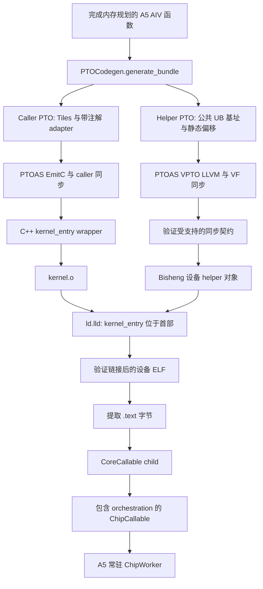

# EmitC 与 VPTO VF 执行接入

显式 `pl.reg_scope()` 可以通过常驻运行时（persistent runtime）在 A5 AIV
kernel 内执行。普通 Tile 操作使用 EmitC，每个寄存器作用域生成一个独立编译的
VPTO helper。本功能扩展 typed VMI lowering，不改变 DSL，也不自动选择向量作用域。

## 产物与执行



`PTOCodegen.generate()` 保留组合的 typed VMI 表示，供诊断使用。执行路径使用
`generate_bundle()`，把 helper 写入 `vpto/<kernel>/`，并生成记录符号、参数类型、
effects 与偏移的 manifest。`kernel_config.py` 通过 `vpto_sources` 关联这些路径。
多个显式作用域生成多个 helper，最终链接进同一个 kernel。

Helper 发射复用 `PTOCodegen` 的寄存器操作 lowering。UB 指针对应内存规划得到的
MemRef 基址；VMI 发射器为每次访问加上 Tile view 的元素起点，且只加一次。
不同静态分配 view 的捕获项通过一个公共 UB 基址和常量位移重建，使独立编译后的
helper 仍保留访问重叠关系。

Tile 参数及其派生 view 会被拒绝：它们的运行时 UB 指针关系不能通过局部
分配的规划偏移确定。
可执行 VF helper 也会拒绝由 If 在运行时选择的 Tile，包括其别名和派生 view。
这些 Tile 的代表性 MemRef 偏移无法证明它们与其他捕获项之间的静态位移。
进入 RegScope 前，应将所选数据复制到独立的固定存储中。两支返回同一个实际
Tile 描述符的 If 仍受支持。

## 两层同步边界

| 边界 | PyPTO 提供的信息 | PTOAS 完成的工作 |
| ---- | ---------------- | ---------------- |
| Caller | SIMD adapter 上的 Tile 参数与 `pto.tileop.effects` | 为搬运和调用插入 MTE2 → V、V → MTE3 事件 |
| VF body | 公共 UB 指针基址、常量偏移与 VMI 内存操作 | 为重叠的 WR、RW、WW 访问插入屏障 |

Caller adapter 在依赖分析期间保留 Tile，只有 adapter 函数体才通过
`pto.tile_buf_addr` 取出 UB 指针并调用 helper。Tile 捕获项标记为 `read`；只要有
store 就标记为 `readwrite`；标量标记为 `none`。Effects 覆盖整个捕获 Tile。
Masked store 使用 `readwrite`，表示未激活 lane 的内容需要保留，不表示硬件实际
读取了这些 lane。

PyPTO 不在调用前后添加固定的 `pipe_barrier(PIPE_ALL)`，正常的 kernel 尾部同步仍
保留。调用边界契约依赖 A5 VF 完成语义，因此当前限定为 AIV helper。

在把 LLVM 编译为设备对象前，PyPTO 验证受支持的指令子集、指针来源及已有屏障的
覆盖情况。此检查不会插入屏障。未知关系或未知 LLVM 输出形式会明确报错，避免
静默执行。Masked 访问按完整 64 个 lane 检查，因此这不是基于 mask 的最少屏障优化器。

## 设备代码与 ABI

LLVM 的 `ptr addrspace(6)`、PTO 的 `!pto.ptr<f32, ub>` 与 caller 的
`__ubuf__ float*` 必须描述相同的 UB 地址空间和传参 ABI。Helper 编译保留
`--cce-generic-addrspace=off`，使用 A5 vector 设备目标，生成设备对象而非 host fat
object。LLVM 导出与 Bisheng 编译分步进行，以便链接前验证 helper；相关编译选项
全部参与二进制缓存标识。

运行时接收原始代码字节。本路径只提取 `.text`，因此链接后的镜像必须满足：

- 非空 `.text`，可执行的小端 AI Core ELF64。
- `kernel_entry` 位于 `.text` 开头，运行时从这里开始执行。
- 没有未解析符号或剩余重定位。
- 没有其他非空的已分配 section，包括 `.rodata`、`.data` 和 `.bss`。

符号表和调试表可以留在 ELF 中，但不会装载。需要其他数据存储或 Bridge/外部函数
的 helper 会被拒绝。结构检查不能证明任意手写机器码都与装载位置无关；helper
仍必须遵守设备调用 ABI。

## 当前可执行子集

| 属性 | 当前支持 |
| ---- | -------- |
| 目标 | A5、AIV、ONBOARD、PyPTO Tile 内存规划器 |
| 作用域 | 直线寄存器操作；静态循环须先展开 |
| 内存 | 连续 FP32 访问、64 lane、32 字节对齐的静态偏移 |
| 别名 | 公共 UB 基址、静态 view 位移、store SSA 别名 |
| Mask 与标量 | 运行时 mask 与受支持的标量捕获 |
| 打包 | 源码 artifact 迁移、包含 helper 标识的二进制缓存 |

Grouped/peer 函数、设备对象的 CPU 模拟执行、Bridge 调用、动态内存偏移、一般
helper 控制流及其他内存格式尚不支持。诊断 VMI 生成支持的 IR 范围比执行路径更广。
扩展准入范围需要相应的编译器和硬件证据，不能放宽对未知关系的拒绝检查。

## 运行完整示例

在当前 checkout 构建 PyPTO 及其固定版本 runtime，选择 PTOAS v0.70 或更新版本，
配置匹配的 CANN/Bisheng 工具链，保持 runtime pin 检查开启。先预约空闲 A5 设备，
再运行以下命令：

```bash
python examples/runtime/vf_emitc_vpto.py \
  --device "$DEVICE_ID" --timeout 600 --output build/vf-add-example
python examples/runtime/vf_adapter_ub_overlap.py \
  --device "$DEVICE_ID" --timeout 900 --output build/vf-overlap-example
```

输出目录必须是新目录。父进程的超时涵盖编译、设备初始化、执行和退出。两个示例
都保存真实编译产物、命令日志和机器可读结果。记录 hook 观察生产编译器的结果，
不会替换代码字节。

加法示例验证 `n = 0, 1, 63, 64, 65, 127, 128, 1023, 1024`、32 元素 Tensor
offset、哨兵和输入变化。它复用一个常驻 Worker，依次检查冷编译、缓存命中、把
helper 加法改成减法后的失效与数值变化，以及删除原目录后的 artifact 迁移执行。

重叠示例加载一个 640 元素 Tensor slice，建立重叠 view，保存 masked 写入前后的
快照。它同时检查 caller 搬运依赖和 VF 内部 WR/RW/WW 顺序，覆盖前缀/后缀 mask
以及不应变化的哨兵。

## 定向验证

单元测试覆盖 bundle 接口、view 起点、拒绝情况、ELF 检查、helper 缓存和 artifact
路径。`tests/st/runtime/vpto/` 下的硬件测试需要显式开启、预约的 device ID 和超时，
应串行运行：

```bash
PYPTO_RUN_VPTO_ONBOARD=1 PYPTO_VPTO_DEVICE_ID="$DEVICE_ID" \
PYPTO_VPTO_TIMEOUT=900 python -m pytest \
  tests/st/runtime/vpto --platform=a5 -k persistent -v
```

每个 PR 的 `onboard-tests-a5` job 通过 `vf-tests-a5` 步骤运行此套件，
显式开启真卡执行，并使用 `task-submit` 预约的卡号。套件通过有超时限制的子进程
使用 ACL 核验所选设备型号，不依赖 `torch_npu`。验收 Worker 显式调用
`check_runtime_pin(checkout_root=...)` 指定源码 checkout，因此通过 wheel 安装的
CI 环境仍会比较扩展编译标记、runtime HEAD 和 checkout 的 gitlink。版本未知或
不匹配都会导致验收失败。每次测试调用分配全新的输出目录，
串行执行并限制子进程超时。源码/缓存迁移检查的直接调用也会创建独立的 `run-*`
目录，根目录的 `build-result.json` 指向最近一次运行。其他平台会取消选择
这些仅支持 A5 的测试。`vf-a5-results` CI artifact 在失败时也会保留 JUnit
结果、设备信息、命令日志和编译产物。

仅编译检查、独立 ACL launch 和常驻 Worker 执行属于不同证据。模拟器或 ACL launch
成功不能证明生产 `.text` 已被 Worker 接收并调度。每次运行都应记录工具链版本、
runtime pin、卡号、命令和日志。
