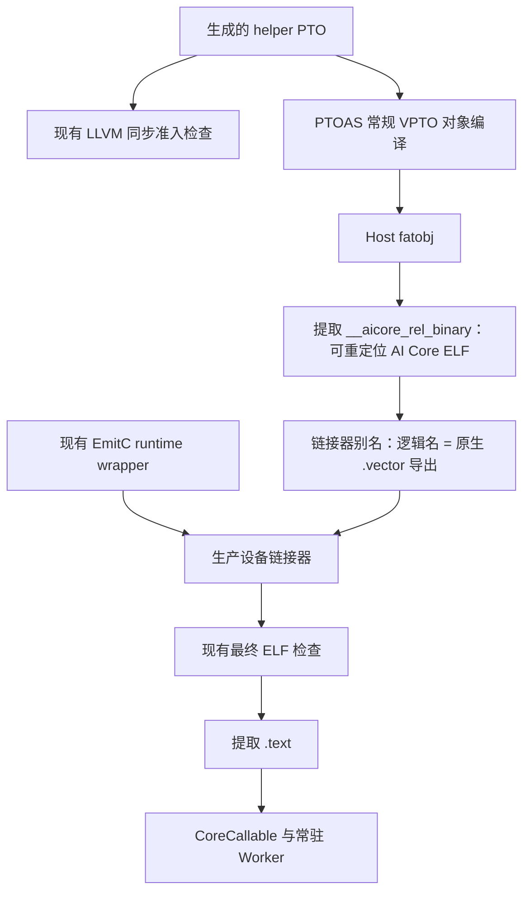

# PTOAS 原生设备对象验证

初始实验基于已合入的 PR #3226（`72a62d13e`），证明由 PTOAS 负责 helper
对象编译、PyPTO 保留常驻 runtime 接入可行。仅移交 helper 的路径现已接入
`KernelCompiler`，完整 mixed caller/helper 迁移仍是独立事项。

## 实验路径与验收边界



初始实验通过测试作用域内的 hook，仅替换 helper 编译。PTOAS 自行调用 Bisheng，
处理地址空间、调度和 ABI；PyPTO 不再手动编译导出的 LLVM。实验仍单独导出
LLVM，执行现有同步准入检查；Bridge、外部依赖和无法证明的同步关系仍被拒绝。

提取的对象必须是小端 ELF64，类型为 `ET_REL`，机器类型为 `0x1029`。
测试核对全局函数 `<逻辑名>.vector`，再添加供现有 caller 使用的链接器别名，
并断言别名前后的 `.text` 字节完全相同。这不会增加可执行 adapter；它与用于
caller 同步分析的现有 Tile adapter 是两个不同概念。

section 名称和符号后缀是工具链接入细节，不是 PyPTO 公共 API。生产代码校验
单对象容器，读取实际 `.vector` 或 `_mix_aiv` 导出，并使用新的对象 ABI 缓存标识。
当前测试直接执行生产代码，不再使用实验编译 hook，也不绕过 runtime pin。

## 编译观察

使用已安装的 PTOAS 0.70 wheel 和 CANN 9.3.0：

| 探针 | 实际结果 |
| ---- | -------- |
| PTOAS 仓库的混合后端 GM 指针加法 | 原生混合编译成功 |
| 将 PyPTO caller/helper fixture 合为两个 backend 子模块 | 原生 UB 指针混合编译成功 |
| 仅 helper 的常规对象输出 | `__aicore_rel_binary` 中包含可重定位设备 ELF |
| 带 launch 入口的 mixed fatobj | `.aicore_binary` 中包含 launch 镜像 |
| 将 launch 入口改成设备函数导出的 mixed fatobj | `__aicore_rel_binary` 中包含两个可重定位设备 ELF |
| 将提取的 mixed launch 镜像交给 PyPTO 镜像校验 | 因遗留重定位而拒绝 |

UB 混合探针的 `.rela.text` 仍有指向 `run_vf.vector` 的重定位。镜像还导出
`_mix_aic`、`_mix_aiv` 入口，而不是 PyPTO 的 `kernel_entry(args)` 契约。
因此，直接提取其 `.text` 尚不能替代 runtime 接入。

将 caller 的 `pto.aicore` launch 标记改为 `pto.visibility = "external"`，
产物会发生变化：设备函数形式的混合探针包含独立的 EmitC 和 VPTO 对象，
host 重定位记录分别指向载荷偏移 `0` 和 `0x820`。caller 对象导入
`run_vf.vector`，helper 对象定义它。不能把整个 section 当成一个 ELF：
工具只读取第一个 ELF 时，会漏掉第二个对象。该探针证明编译和打包成功，
尚未证明完整混合路径的常驻执行。

PTOAS 同时报告 Bisheng 未提供 SIMD VF 栈用量报告，自动调度保持开启，但
无法比较栈大小。编译成功，该警告保留在探针日志中。

另行核对的本地 PTOAS 源码为 `f03c6cb5c934`，实现与 `235f381f31ac` 相同。
上述编译使用发布 wheel，不能称为该本地源码版本的重新构建结果。

## 定向真卡验收

在当前 worktree 构建 PyPTO 和固定版本 runtime。将指定 PTOAS wheel 的包路径
放在 CANN 自带 Python 包之前，保持 runtime pin 检查开启。通过机器的任务队列
预约 A5 卡后，串行运行：

```bash
PYPTO_RUN_VPTO_ONBOARD=1 \
PYPTO_VPTO_DEVICE_ID="$DEVICE_ID" \
PYPTO_VPTO_TIMEOUT=900 \
PYPTO_VPTO_RUNTIME_OUTPUT="$OUTPUT" \
python -m pytest tests/st/runtime/vpto/test_tile_helper_sync.py \
  -k tile_adapter_persistent \
  --platform=a5 -v
```

两个用例复用完整加法和 masked overlap 示例，核对 caller 搬运同步、helper
内部 WR/RW/WW 顺序、32 元素 Tensor offset、哨兵、改变输入的重复调用、缓存
命中、修改 helper 后的数值变化与缓存失效，以及 artifact 迁移后的执行。
加法边界包括 `0, 1, 63, 64, 65, 127, 128, 1023, 1024`。

编译检查、独立 ACL 执行和常驻 Worker 执行必须分别记录。真卡结果和版本
记录存放在 `build/native-object-validation/`；编译成功不代表真卡验收完成。

## 2026-10-31 初始实验结果

| 证据 | 结果 |
| ---- | ---- |
| 当前 worktree 的 PyPTO 扩展和固定版本 A5 runtime | 构建成功；runtime 为 `6b6b88f2353c`，pin 匹配 |
| 纯 EmitC `tile_add_64` 对照 | 预约 device 3，通过 |
| 原有 VF 加法和重叠路径 | device 1 上通过 108 + 192 次数值检查 |
| 原生对象 VF 加法和重叠路径 | device 1（`Ascend950DT_9581`）上通过 108 + 192 次数值检查 |
| 两个例子的初始和修改后代码 | 四份最终 `.text` 均与原路径逐字节相同 |
| 缓存和 artifact | 每例编译两次；warm 和迁移后均命中缓存；原 artifact 路径已移除 |
| 定向测试基础设施回归 | 17 项通过 |
| 独立 ACL / 模拟器 | 本轮未运行，未用于证明 Worker 执行 |

环境：CANN 9.3.0、驱动 25.6.rc2.b023、PTOAS 0.70 发布 wheel、Bisheng
clang 15.0.5（2026-09-22 构建）、Python 3.11.6、torch/torch_npu 2.6.0。
`versions.json`、`runtime-stamp.json`、`acceptance-summary.json`、JUnit、
设备日志和各例的 `native-result.json` 保留对应证据。代码相同的结论仅适用于
这些用例，不能推广为一般的最少屏障优化或动态、未知别名放行证明。

## 2026-10-31 生产接入验证

生产改动基于 `f9b7d5d84469` 重新构建，使用上述相同版本，并保持 runtime pin
检查开启。以下测试直接执行 `KernelCompiler`，不使用实验编译 hook。

| 证据 | 结果 |
| ---- | ---- |
| Runtime 编译器、同步校验器和测试基础设施单元测试 | 92 项通过 |
| 使用已安装 PTOAS 的别名与同步编译测试 | 87 项通过 |
| 纯 EmitC `tile_add_64` 对照 | 预约 A5 device 5（`Ascend950DT_9581`），通过 |
| `tests/st/runtime/vpto --platform=a5 -k persistent` | device 5 上 8 项通过；另有 7 项不相关用例未选择 |
| 上述测试中的完整加法和重叠示例 | 108 + 192 次数值检查；缓存、helper 修改与迁移均通过 |
| 初始和修改后四份最终 `.text` | 与原路径逐字节相同；链接器别名也保持 helper 的 `.text` 不变 |
| 配置的 pre-commit 检查 | 通过，包括 Pyright 和中英文文档检查 |

现有 A5 CI 的 `vf-tests-a5` 步骤已选择这些测试，包括两个参数化示例，无需新增
CI workflow。证据保存在 `build/native-object-validation/`：`production-ut.xml`、
`production-alias.xml`、`production-onboard/{control,vpto}.xml`、
`production-onboard/retry.log`、`production-code-comparison.json` 和
`production-precommit-clean.log`。

首次队列提交因多行 shell 命令解析失败，在执行测试前失败；改成单行提交后通过。
首次 Pyright 调用继承了真卡环境的 torch 2.6，而非 hook 固定的 torch 2.8；
使用 hook 自身的包环境后通过。原始失败保留在 `production-onboard/queue.log`
和 `production-precommit.log` 中，未跳过或屏蔽这两处失败。

## 完整混合编译：Tile adapter 阻塞

编译职责移交及 runtime 接入通过
[PyPTO #3238](https://github.com/hw-native-sys/pypto/issues/3238) 跟踪，
其中包含这一 PTOAS 编译阻塞。
仅用于编译验证的缩减复现保存在
`tests/ut/backend/vpto_vf_validation/native_mixed_tile_adapter_repro.pto`。
它复现相同错误；仅编译设备对象和保护 adapter 后编译 fatobj 的两组对照均成功。
命令和日志位于 `build/native-object-validation/issue-reproducer/`。

将实际生成的加法、重叠 caller 与 helper 合为原生 backend 子模块后，
PTOAS 0.70 与当前 CANN 环境均报错：

```text
error: no template named 'Tile'
```

生成的 `__pypto_vf_body_0_tile_adapter` 函数签名含有 Tile 参数，但签名位于
AIV 预处理保护之外。原生 fatobj 路径同时编译 host 与设备代码，而 PTO-ISA
头文件在设备编译上下文中提供 Tile 定义。错误发生在 VPTO helper 链接之前。

| 配对探针 | 结果 |
| -------- | ---- |
| 原始生成 caller，原生 fatobj 编译命令 | 加法和重叠均失败 |
| 原始加法 caller，仅编译 AIV 设备对象 | 成功 |
| 仅用 `#if defined(__DAV_VEC__)` 包住 adapter 定义，保持 fatobj 命令 | 两例均成功 |

这些是保存在 `generated-mixed/` 下的生成源码探针，不是 PTOAS 源码修复，
也不是完整 mixed 路径的 runtime 验收。后端需要让 helper 的函数签名和函数体
都遵守其执行域。

## 后续输出契约

- 在目标 PTOAS 版本修复或确认已修复 Tile adapter 对 host 编译的可见性问题，
  然后重跑实际生成的 mixed-module 探针。
- PTOAS 提供稳定的 AIV 可重定位设备对象输出，避免依赖 CANN host fatobj
  的内部容器布局。
- 明确逻辑导出名与设备符号的映射，或直接保留指定的设备调用 ABI，避免在
  caller 一侧维护后缀规则。
- 对象输出同时支持保留检查 IR 或严格同步校验结果，不能删除未知依赖拒绝检查。
- 验证完整 mixed caller/helper 路径与 PyPTO runtime 入口的组合；仅 helper
  的实验不能证明整个编译流程已经迁移。
- runtime 参数包装、最终 ELF 兼容性检查、缓存标识、artifact 迁移和 Worker
  调度继续由 PyPTO/runtime 负责。
