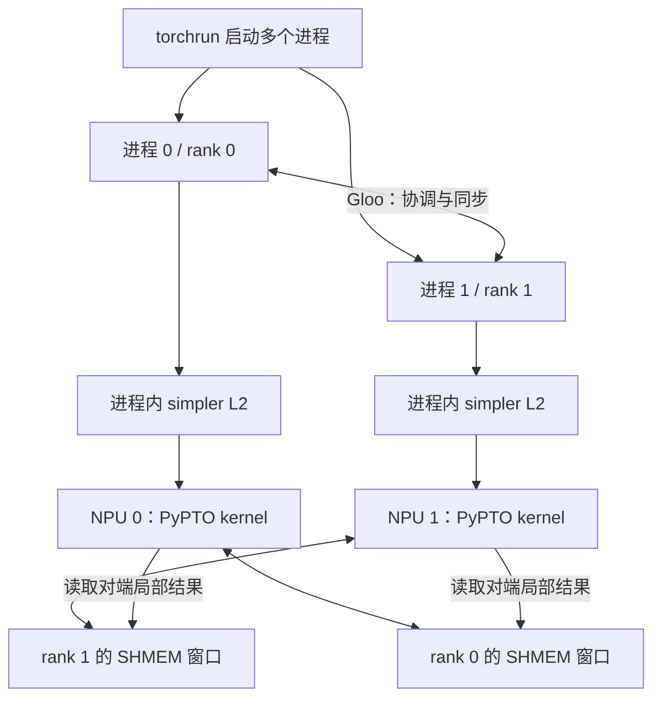

# 从零理解 Path B：我们做了什么，为什么这样做

这篇文章面向第一次接触 PyPTO、多卡推理和 Path B 的读者。
不需要先理解编译器或 NPU 指令；先把它看成一个问题：
**怎样让几张计算卡分工运行同一个大模型，并把各自算出的结果正确合起来？**

本文总结本次实现和收尾验证，不代表一个通用生产推理服务已经交付。
更详细的接口、调试过程和原始结果位置见
[Gloo 与对称内存窗口：技术记录](gloo-shmem-pathb.md)。

## 1. 最终交付是什么

我们实现了一个独立运行的 Qwen3-14B 多卡推理示例：

- 在一台机器上使用 2、4 或 8 张 Ascend NPU。
- 每张卡由一个独立进程负责，用 torchrun 启动。
- 加载真实模型权重，处理输入文本，并逐步生成后续 token。
- 用 PyPTO kernel 完成模型计算，以及多卡局部结果的求和。
- 用 Gloo 协调各进程，用 torch_npu 对称内存提供卡间可访问的数据窗口。
- 支持可选的调用准备缓存和 FFN launch 合并，并验证它们的正确性与性能。

实际改动位于 **PyPTO 仓库**。使用的 simpler runtime 已具备所需基础能力，
本次没有修改 simpler 源码或子模块指针，也没有向 vllm-ascend 合入代码。
最终没有 commit、push 或创建 PR。

## 2. 先认识几个词

| 词 | 用通俗的话解释 |
| -- | -------------- |
| NPU | 执行模型矩阵运算等计算的加速卡 |
| rank | 多进程任务里某个参与者的编号，例如 rank 0、rank 1 |
| TP（Tensor Parallel，张量并行） | 把部分模型权重和计算切开，分给多张卡 |
| TP2 / TP4 / TP8 | 分别用 2 / 4 / 8 个 rank 做张量并行 |
| kernel | 在设备上执行的一段计算程序 |
| host | 负责启动、协调和管理设备计算的 CPU 一侧 |
| launch / dispatch | host 向运行时提交一次设备执行请求 |
| allreduce | 把各 rank 的局部结果合成一个结果，并让各 rank 都得到它 |
| barrier | 所有参与者都到达后才能继续的同步点 |
| prefill | 一次处理输入 prompt，建立后续生成需要的上下文 |
| decode | 根据已有上下文逐步生成后续 token |

这里的 TP 不是“每张卡各跑一个完整模型来服务不同用户”。
例如把一个矩阵计算拆成两份，两张卡各算一份，必要时把结果相加，
才得到这次推理真正需要的结果。部分权重仍复制到各卡，并非所有权重都均分。

## 3. Path B 的各个组件怎么配合

“Path B”是这次工程路线的名称，不是一个新模型或新的通信协议。

可以把各组件理解成下面这些角色：

| 组件 | 本次负责什么 |
| ---- | ------------ |
| torchrun | 启动多个进程，并给它们 rank 等身份信息 |
| PyTorch / torch_npu | 管理设备上下文、加载和搬运权重、提供设备张量与对称内存 |
| Gloo | CPU 侧协调、同步，以及测试时的结果核对 |
| 对称内存 SHMEM | 提供本卡和其他卡可以通过已发布地址访问的通信窗口 |
| PyPTO | 编译模型算子和窗口读写、求和等设备计算 |
| simpler L2 | 在当前进程中调度、执行编译后的任务 |

运行关系如下：



图中画了两个 rank，4/8 卡沿用相同原则。
Gloo 不负责代替 PyPTO 做模型中的设备 allreduce；
测试时将 logits 拷回 CPU 并通过 Gloo 核对，是另一条验证路径。

### 为什么坚持进程内 L2，不走 L3

对称内存的地址有其所属进程和设备上下文。
“父进程里有这个地址”不意味着另一个子进程可以直接使用它。
已有调试发现，L3 fork 子进程不能照用父进程发布的 SHMEM 映射。

因此本次沿用原需求：**使用同一进程内的 L2 worker，借用 torch_npu
已经建立的设备上下文**。这不是在判断所有 L3 场景都不可用，
而是说本次 Path B 不走那条地址空间和生命周期不同的路线。

## 4. 我们按什么顺序完成工作

### 第一步：修好通信双方共同理解的“地址说明书”

旧参考代码使用 1056 字节的 CommContext，新运行时要求 1088 字节，
其中 rank、窗口地址等字段的位置也发生了变化。

可以把它想成一张约定好格式的表格：
写入者把地址放在第 3 栏，读取者却按第 5 栏找，即使表格能传过去，
读到的内容也会错。这就是 ABI（程序之间的数据布局约定）问题。

我们先对齐到 1088 字节布局，并用测试直接检查字段位置。
当前只使用对端窗口地址，因此通信引擎的三个 workspace 描述符填零；
这不意味着依赖这些 workspace 的 URMA/RDMA/SDMA 操作也能直接使用。

### 第二步：让旧参考代码适配当前 PyPTO 和 simpler

这不是把旧分支整个合并进来，而是按需要移植和适配：

- 增加 SHMEM 窗口申请、切分和 CommContext 打包辅助。
- 增加声明外部窗口的 DSL 接口，以及 parser、runtime 的对应支持。
- 使用现有 `Buffer.wrap` 注册调用者持有的设备内存。
- 让 PyPTO 的 worker 转发借用 context 和调用 stream 所需的参数。
- 修正生成的调用签名，让普通 scalar 和通信 context 指针都被正确计数。

先验证小型通信示例，再运行完整模型，避免把通信错误和模型错误混在一起。

### 第三步：让多卡通信真正读到新数据

通用示例验证了 TSTORE、TPUT 和多 rank 求和。
可以把前两种理解成设备侧向通信窗口写入或传送数据的操作。

模型中的 allreduce 使用 **remote_load + add**：
读取各 rank 的局部结果，再在设备上相加。
我们没有使用存在已知问题的 builtin allreduce。

每次求和的关键顺序是：

1. 每个 rank 将本轮局部结果写入自己的 SHMEM 窗口。
2. 等所有 rank 都完成发布。
3. PyPTO kernel 读取各 rank 的窗口并求和。
4. 等所有 rank 都读完，再允许下一轮覆盖窗口。

这两个同步点分别防止“读到尚未写完的数据”和“旧数据还没读完就被覆盖”。
本次没有删除它们。

### 第四步：接上真实 Qwen3-14B 模型

完成权重切分、prefill、KV cache、decode，以及
o_proj / down_proj 后面的多卡求和，先验证 TP2，再扩展到 TP4/8。

实现借鉴了参考消费者中的模型代码，并保留原始来源和许可证。
**参考实现与引入 vLLM 运行时是两回事**：交付物是独立的 PyPTO 示例，
没有接入 vLLM Engine。

## 5. “跑出了文字”为什么还不算验证成功

能生成文字，只能证明程序运行到了输出阶段。
数值有偏差、缓存读错、某个 rank 使用旧数据，都可能暂时生成看似合理的文字。

我们分别检查了几个层次：

| 检查层次 | 主要防什么问题 |
| -------- | -------------- |
| ABI、parser 和 codegen 检查 | 参数布局、通信 context、依赖关系被错误生成 |
| 通用通信真机测试 | 地址不可访问、读到旧数据、同步不正确 |
| rank 间结果比较 | 各张卡算出的最终结果不一致 |
| 模型参考比较 | 多卡一致，但大家一起算错 |
| 融合前后逐位比较 | 性能改动悄悄改变模型数值 |
| 多轮重复生成 | 缓存复用或多次调用后才出现错误 |

### 必须说明的数值契约

本次接受的是 **BF16 存储、FP32 算术** 的约定，并在指定位置转换回 BF16。
BF16 可以简单理解成一种更省空间、但表示精度更低的数据格式。

在什么位置转换、使用什么舍入方式，会影响结果。
实现明确保留 BF16 的 RINT 舍入点，并使用高精度的归一化倒平方根计算。

这套实现已经通过对应参考验证，**不能据此宣称与未经修改的
Hugging Face eager BF16 执行完全等价**。技术记录保留了此前不匹配的结果，
没有把它们当作通过。

完整 FFN 融合后，在 TP2/4/8、四种 prompt 长度、各八步生成的检查中，
**96 个保存的 logits 张量与已接受的非融合基线逐位一致**。
logits 是模型选择下一个 token 之前的分数，比只比较最终文字更细。

## 6. 后来做的性能工作是什么

正确性通过后，你要求进行性能测量，并进一步尝试 launch 合并。

### 先减少重复准备

相同编译产物反复执行时，一些调用配置可以复用。
因此增加可选的 DispatchPlan 缓存。

缓存的是调用描述和配置，**不是旧 tensor 地址或旧 Buffer 注册**。
数据地址、scalar 值和内存注册仍按每次调用处理，避免拿上一次的输入当本次输入。

### 再合并相邻的 host 调用入口

原来的 FFN 部分，每层需要分别提交：

```text
Residual + RMS → Gate/Up GEMM → SwiGLU → Down GEMM
```

我们先把最后两步放进一个 chip 入口，再把四步放进一个 chip 入口。
每次 host 提交后，设备运行时根据张量依赖调度内部任务。

**这不是把四个算术 kernel 改写成一个大 kernel。**
内部仍保留原有 AIV/AIC 任务、中间缓冲区和舍入点；
改变的是 host 提交的次数及任务编排入口。

| 方式 | 每 rank 每步 host dispatch 次数 |
| ---- | ------------------------------: |
| 非融合 | 723 |
| SwiGLU + Down 合并 | 683 |
| 完整 FFN 合并 | 603 |

完整 FFN 每步少 120 次提交，减少约 16.6%。
这不等于总耗时必然下降 16.6%，因为实际计算、通信和同步仍然存在。

两个融合选项互斥，默认都关闭：

- `--fuse-swiglu-down`：只合并最后两步。
- `--fuse-ffn`：合并完整 FFN。
- `--cache-dispatch-plan`：另外开启调用配置缓存。

## 7. 性能结果能说明什么

为了减少“恰好后跑的那组机器更空闲”的影响，使用 A–B–B–A 顺序：
A 为非融合，B 为完整 FFN。每种 TP 内使用同一组分配设备，
双方都开启调用配置缓存，每个分组独立预热后再测量。

标准场景是 batch 1、32-token prompt、七步 decode。
每组测量五轮，合并同一种配置的 70 个 decode 样本，得到：

| 配置 | 非融合 decode 中位数 | 完整 FFN | 观察到的降幅 |
| ---- | -------------------: | -------: | -----------: |
| TP2 | 941.2 ms | 866.5 ms | 7.9% |
| TP4 | 848.8 ms | 768.1 ms | 9.5% |
| TP8 | 903.8 ms | 790.0 ms | 12.6% |

收尾时还在 TP4 补了两种场景，每组测量三轮：

| 场景 | 非融合中位数 | 完整 FFN | 降幅 |
| ---- | -----------: | -------: | ---: |
| 1-token prompt + 七步 decode | 850.4 ms | 756.2 ms | 11.1% |
| 32-token prompt + 31 步 decode | 842.5 ms | 771.0 ms | 8.5% |

这些结果支持“当前测试范围内，完整 FFN 合并带来可重复的收益”。
但需要避免三种误读：

- 这是共享主机上的测量，不是任意环境中的加速保证。
- TP2/4/8 使用不同的设备分配，不能据此断言 TP4 永远最优。
- 测量的是模型 forward 延迟，不是完整在线服务的吞吐或 SLA。

较长 decode 的新增 benchmark 检查了有限 logits、rank 一致性、
重复生成和融合前后的 token 一致性，没有对每个新位置补做独立 CPU 参考。

## 8. 修改在哪里，为什么 simpler 没有单独的 PR

| 位置 | 作用 |
| ---- | ---- |
| `python/pypto/runtime/shmem_gloo.py` | 窗口管理、1088 字节 context、外部 domain 适配 |
| `python/pypto/language/` | 外部窗口 DSL 及解析支持 |
| `python/pypto/runtime/` | provider 转发、借用 context 和 stream 参数适配 |
| `src/codegen/`、绑定和类型声明 | 调用签名中的 scalar pool ABI 对齐 |
| `examples/distributed/` | 通信示例、直接 dispatch 辅助 |
| `examples/models/qwen3_tp/` | 模型、权重加载、benchmark 和结果分析 |
| `tests/` | 通信、编译、生命周期和模型辅助测试 |
| `docs/` | 技术记录、验收证据和本文 |

本次实际使用的 runtime 子模块是 simpler `355ce3015e3e`。
所需的借用 context、caller stream、Buffer 注册等能力已经存在，
所以改动集中在 PyPTO 如何调用它们。

`typings/simpler/*.pyi` 虽然名字带 simpler，但属于 PyPTO 仓库中的类型声明，
不代表修改了 simpler 仓库。收尾快照共 45 个文件：
核心库与类型声明 20 个、示例代码 8 个、测试 11 个、文档配置 5 个、许可证 1 个。
本文和配套英文页是在该收尾快照之后新增的文档，不计入那 45 个文件。

## 9. 最后交付到了什么状态

你最后要求只完成三项收尾、不再继续优化，这三项已经完成：

1. **扩大性能覆盖**：补短 prompt 和 31 步 decode，完成 A–B–B–A 测量。
2. **最终审查与回归**：964 项相关回归通过；TP2/4/8 共 90 项模型入口编译通过；
   修复测试类型问题后又跑过 90 项受影响测试。后一次与前面有重叠，
   不能把这些数字相加当作独立测试总数。
3. **整理交付材料**：完整 patch、源码快照、复现命令、日志、性能 JSON 和文件哈希。

Ruff、Pyright、文档中英文配对和导航检查也通过。
失败清理测试验证了先关闭 worker、再释放 Buffer；
如果关闭失败，则不提前撤销仍可能被使用的注册。

收尾包位于 `build/pathb-closeout/pathb-review.tar.gz`，
其中 patch 已在记录的基线索引上验证可以应用，结果哈希与快照一致。
这是收尾时的源码包，不是可直接启动的模型镜像；不包含模型权重、
编译二进制和机器环境。本篇入门文档是后续补充。

## 10. 还有哪些事情不应被误认为已经完成

| 不属于本次交付的内容 | 当前边界 |
| -------------------- | -------- |
| 通用模型支持 | 固定为 Qwen3-14B |
| 任意 batch 或 prompt 长度 | batch 1，prefill 1..32，cache 容量 128 |
| 在线推理服务 | 独立离线示例，不是 vLLM Engine 集成 |
| 多机通信 | 只验证单机 |
| L3 SHMEM 路线 | 不支持本次窗口映射跨 L3 fork 使用 |
| 更深入的通信/stream 优化 | 没有删除 barrier，没有继续推进可选优化 |
| 主仓已经合并 | 未提交、未 push、未创建 PR |

“可以进入 PR 评审”也不等于“已经被主仓接受”：
对齐目标分支、完整提交检查、CI 和维护者审查仍是提交合并阶段的工作。

如果只需要向别人转述一句话：
**我们把一条单机多卡、每卡独立进程、由 PyPTO 执行计算和通信的模型路线
做成了可运行、可验证的离线示例，并在不改变已验收数值的前提下，
通过减少 host 调用次数取得了实测性能改善。**

## 11. 从哪里查证

- 原始目标：交接材料 `pathb_codex_handoff.md`。
- 设计约定和历史验证：[技术记录](gloo-shmem-pathb.md)。
- 多卡顺序复测：`build/pathb-ffn-abba/tp{2,4,8}/comparison.json`。
- 短 prompt / 长 decode：`build/pathb-closeout/{short,longdecode}/comparison.json`。
- 最终包清单：`build/pathb-closeout/review-package/manifest.json`。

上述 `build/` 路径是本次本地实验产物，不是从仓库 clone 后自然就会出现的文件。
阅读结论可以看本文，审查或复现时再结合交付包和技术记录。
