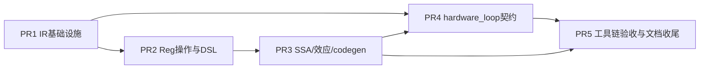

# VF IR RFC 实施设计：五个可自验证 PR

| 项目 | 内容 |
| ---- | ---- |
| 状态 | 设计稿，供实现前评审 |
| 对应 RFC | `16-vf-ir-rfc.md`（独立研究稿） |
| 目标 | 将 RFC 拆成五个可独立构造、独立验证的 PR |
| 范围 | RegType、RegScope、Reg 操作、`reg.store`、SSA/内存效应、PTO codegen、hardware loop |
| 非目标 | 本文不修改 RFC 语义，不实现自动向量化、寄存器分配或性能优化 |

本文是实现设计和任务拆分，不是第二份 RFC。RFC 中写“本 RFC 的预期修改点”的内容是必须实现的语义契约；RFC 中标记为“实现参考”的现有 `ScopeStmt`、`tile.store`、PTOAS 源码和当前 pass 行为只用于确定接入边界。参考实现的现状不能覆盖 RFC 契约，也不能被测试当作新增行为的证明。

## 1. 总体交付目标

实现后，用户可以在一个 `RegScope` 中加载 Vec Tile，执行 Reg/Mask 运算，通过 `reg.store` 写回 Tile，并在 scope 外继续使用更新后的 Tile 版本。RegScope 自动捕获 body 中的外部引用；Reg 和局部 Scalar 不得逃逸。`reg.store` 的前端结果是 Tile SSA 版本，目标 codegen 将它消解为同一存储地址上的无结果 `vstore`，同时保留写效应和顺序。

用户还可以使用普通 `pl.range` 让编译器自动分析 hardware loop 资格，或使用 `pl.hardware_loop` 表达强制要求。分析结果必须区分 `Eligible`、`Ineligible` 和 `Unknown`；`Require` 对优化后仍保留的非空循环，在没有最终后端证据时必须失败，不能静默退化为普通循环；静态零次循环允许被 `Simplify` 消除，不要求后端证据。

交付后的最小闭环如下：

```text
RegType/RegScope IR
       ↓
reg.* schema + reg.store(Tile SSA + Write effect)
       ↓
SSA/alias/effect verification
       ↓
pto.vecscope + vmi.vload/vadd/vstore
       ↓
hardware_loop qualification and final evidence check
```

## 2. 设计边界与共同约束

### 2.1 本次必须改变的语义

1. 增加一个 `RegType(shape, dtype, kind)`，`shape` 为单个正整数；Vec 和 Mask 由 `RegKind` 区分。
2. 增加无专属字段的 `RegScopeStmt : ScopeStmt`。区域输入由 body 的自由变量自动捕获，不保存用户填写的 `captures_`。
3. `reg.store` 使用 `AssignStmt`，结果类型为目标 Tile/View，声明 `output_reuses_input(0)` 和 `Write` 效应。
4. Tile 版本可以从 RegScope 向外传播；Reg 和局部 Scalar 不得在区域外使用。
5. 结果版本和内存效应同时存在。两个 store 即使都使用旧目标，也必须按照源程序顺序保留。
6. 增加 `HardwareLoopPolicy::{Auto, Require}`。普通范围循环默认为 `Auto`，`Require` 不允许无证据降级。
7. PTO codegen 为 RegScope 发射 `pto.vecscope`；`reg.store` 前端结果在目标层无结果，只保留目标地址和写入。

### 2.2 明确不在本次 PR 中实现的内容

- 物理寄存器编号、寄存器分配和自动向量化。
- masked load、gather/scatter、reduce、shuffle、跨 RegScope 的 Reg 参数。
- 新增 CSE、DCE、调度或通用 WAW 图优化。现有写效应消费者只做保证正确性的最小适配。
- 修改旧 `tile.store` 的公开语义。
- 直接修改 PTOAS 的 VMI 定义。若公共 PTOAS 缺少能力，PyPTO 必须报告不支持。

### 2.3 五个 PR 的依赖图



PR4 的 `ForStmt` 字段和纯分析器可以在 PR1 后开发；为了让测试覆盖 RegScope 内循环，合并基线建议包含 PR3。每个 PR 都必须在“包含其依赖的基线”上独立构建、运行自己的测试并生成可审阅 fixture；不得把后续 PR 的功能作为本 PR 的验证前提。

## 3. 共同的数据和错误模型

### 3.1 RegType

```cpp
enum class RegKind : uint8_t { VecReg, MaskReg };

class RegType : public Type {
 public:
  RegType(int64_t shape, DataType dtype, RegKind kind);
  int64_t shape_;  // 一维 lane 数，必须大于 0
  DataType dtype_;
  RegKind kind_;
};
```

不使用 `std::vector` 保存 shape，不继承带 layout 或存储语义的 `ShapedType`。`lanes` 直接返回 `shape_`。`MaskReg` 只接受 `BOOL`，`VecReg` 不接受 `BOOL`；三字段都参与 structural equal/hash/serialization。规范 Python 标注为 `pl.Reg[L, dtype, kind]`，省略 kind 时默认 `VecReg`。

### 3.2 RegScopeStmt

```cpp
class RegScopeStmt : public ScopeStmt {
  // 仅提供构造器、ObjectKind、ScopeKind、TypeName 和字段描述。
  // 不增加 captures、results、yield 或专属数据字段。
};
```

`body_` 中的外部 Tile、Scalar 和参数通过自由变量分析得到；分析结果是临时信息，不写回节点。首期只允许 RegScope 出现在 A5 InCore/AIV 上下文，RegScope 之间不允许嵌套；外层 InCore 不是 RegScope。现有 SSA 映射在离开 body 后继续生效，使 Tile 版本可被外部使用。验证器按定义/使用所属的 RegScope 检查 Reg 和局部 Scalar 逃逸。

RegScope 的 body effect 是其中所有 Call 的 effect 并集：`reg.load` 对根存储和 `[offset, offset+L)` 产生 `Read`，`reg.store` 产生 `Write`，未来 atomic store 才能产生 `ReadWrite`。区域 effect 必须向外围语句和循环传播，不能因为节点没有结果就丢弃访存依赖。

### 3.3 reg.store 的统一结果契约

```text
AssignStmt
  var: out1 : TileType(out0)
  value: Call("reg.store", [out0, offset, value, mask?])
```

`out1` 与 `out0` 共享根分配、View 偏移和通信上下文；它不是快照，也不创建新存储。结果版本让连续写可以表达 `out0 → out1 → out2`。写旧目标的两个语句仍然合法：

```python
out1 = pl.reg.store(out, value=x)
out2 = pl.reg.store(out, value=y)
```

这里没有 `out1 → out2` 的值依赖，但两个 Call 的目标别名和 `Write` 效应要求保持程序顺序；后一次写入覆盖重叠位置。任何会重排或删除语句的 pass 必须查询效应/别名，不能只看 Var def-use。

### 3.4 错误等级

- **构造错误**：字段类型、shape、kind、参数个数或 Python API 形状错误，在 Builder/DSL 入口立即抛出。
- **验证错误**：IR 可构造但违反 dominance、逃逸、初始化、地址范围或循环契约，在 verifier 阶段拒绝并带源码 span。
- **目标不支持**：语义合法但当前 target/profile/PTOAS 无法证明或没有 emitter，报告“不支持”，不改变程序语义。
- **Require 失败**：对优化后仍保留的非空循环，`HardwareLoopPolicy::Require` 在资格为 `Ineligible/Unknown` 或最终 artifact 没有对应硬件证据时必须失败；静态零次循环的消除不属于 Require 失败。

## 4. PR1：IR 基础设施

### 4.1 目标和非目标

PR1 只建立可以被后续 PR 使用的类型、节点和持久化基础设施。它不注册 Reg 操作，不改变 SSA，不生成 PTO MLIR，也不执行 hardware loop 分析。

完成后，C++ Builder、Python binding 和 IR serializer 可以构造并往返包含 `RegType`、`RegScopeStmt` 和 `ForStmt.hardware_loop_policy` 的 IR；旧 IR 在缺少新字段时仍按默认 `Auto` 读取。规范 Python DSL parser/printer 的完整往返属于 PR2，PR1 只提供可独立运行的直接 IR/serialization fixture。

### 4.2 文件级修改

| 文件或目录 | 修改 |
| ---------- | ---- |
| `include/pypto/ir/type.h`、`src/ir/type.cpp` | 增加 `RegKind`、`RegType(int64_t, DataType, RegKind)`、shape/dtype/kind 访问器和合法性检查 |
| ObjectKind/type registry | 注册单一 `RegType`，删除/禁止新增 Vec/Mask 两个类型节点 |
| `include/pypto/ir/stmt.h`、`src/ir/stmt.cpp` | 增加 `ScopeKind::Reg`、`ObjectKind::RegScopeStmt`；新增 `ForStmt` 尾部默认字段 `HardwareLoopPolicy policy_ = Auto` |
| visitor/mutator、reflection | 将 RegType 三字段、RegScope 公共字段和 For policy 纳入遍历/字段描述 |
| `src/ir/transforms/structural_equal.cpp`、`structural_hash.cpp` | RegType 三字段和 For policy 参与结构比较；span、SSA 名称、分析缓存不参与 |
| `src/ir/serialization/` | 注册类型、scope、policy 的序列化；旧数据缺省 Auto；未知 policy 拒绝读取 |
| `python/bindings/modules/ir.cpp`、`python/pypto/pypto_core/ir.pyi` | 暴露 RegKind/RegType/RegScopeStmt/HardwareLoopPolicy 和属性 |
| `python/pypto/language/parser/type_resolver.py`、printer | 识别规范 `pl.Reg[L,dtype,kind]`，不输出 vector shape |
| `include/pypto/ir/core.h`、`include/pypto/ir/kind_traits.h` | 增加 `ObjectKind::RegType/RegScopeStmt` 及 kind trait；更新所有 ObjectKind/ScopeKind switch，避免未处理枚举导致编译或运行期遗漏 |
| `ScopeKindToString`、binding/stub、scope serializer | `ScopeKind::Reg` 使用新尾值 `9`，不复用现有空缺值 `1`；旧数值保持原含义，未知值反序列化时拒绝 |

`ForKind` 仍表示 Sequential/Parallel/Unroll/Pipeline 等循环形式；hardware loop 意图放在独立 policy 字段，不增加新的 ForKind，避免改变已有调度语义。

### 4.3 API 和字段要求

```cpp
RegType::GetShape() -> int64_t;
RegType::GetDType() -> DataType;
RegType::GetRegKind() -> RegKind;
ForStmt::GetHardwareLoopPolicy() -> HardwareLoopPolicy;
```

构造器必须拒绝 `shape <= 0`、Mask 非 BOOL、Vec BOOL、动态 shape 和未知 kind。`RegScopeStmt` 构造器参数顺序与其他 ScopeStmt 一致：`name_hint, body, span, leading_comments, attrs`。

### 4.4 PR1 自验证

1. C++ 单测构造 Vec/Mask，检查三字段、非法 shape/dtype/kind 和 lanes。
2. structural equal/hash 覆盖只改变 shape、dtype、kind 的三组不等场景。
3. RegScope visitor/mutator 不丢 body、attrs、span；For policy Auto/Require 比较不相等。
4. 直接构造的 IR 进行 serialization roundtrip，覆盖旧数据默认 Auto、新数据 Require、未知枚举拒绝；规范 Python parser/printer roundtrip 放到 PR2。
5. 运行既有 IR 类型、语句、打印、序列化回归；不依赖 Reg op 或真实 PTOAS。

PR1 的失败路径必须是确定的构造/反序列化错误，不能把非法类型延迟到 codegen。静态零次 Require 应允许 `Simplify` 消除并返回初始 iter_arg；非空 Require（包括单次循环）必须保留，不能被普通折叠静默展开。

## 5. PR2：Reg 操作、RegScope DSL 与自动捕获

### 5.1 目标和非目标

PR2 在 PR1 的节点上实现 P0 Reg/Mask schema、Builder 和 Python DSL。它负责把用户写法规范化为统一 IR，并完成类型、scope 归属和自动捕获验证。它不修改 SSA pass，不实现最终 vecscope emitter，也不声称 PTOAS 编译通过。

### 5.2 文件级修改

| 文件或目录 | 修改 |
| ---------- | ---- |
| `include/pypto/ir/op_registry.h`、现有 op registry 实现 | 增加 Reg schema 字段：操作数约束、结果推导、effect、RegScope 要求、emitter 名称 |
| `src/ir/op/reg_ops/`（拟新增） | 注册 `reg.load/store/index_gen/broadcast/full_mask/active_mask`、P0 算术、compare/select、mask 逻辑 |
| `include/pypto/ir/builder.h`、`src/ir/builder.cpp` | `BeginRegScope`、`EmitReg`、`EmitRegStore`、`EndRegScope`；统一调用 schema 验证 |
| `python/pypto/language/op/reg_ops.py`（拟新增） | Reg 包装、P0 API、参数规范化和错误映射 |
| `python/pypto/language/scope.py`、`dsl_api.py`、`language/__init__.py` | `pl.reg_scope()` 入口、scope 栈和 RegScope 内部分发 |
| `python/pypto/language/parser/ast_parser.py` | 自动识别 scope body 的外部引用，解析 Assign/裸 store |
| `python/pypto/language/parser/type_resolver.py` | Reg 标注和 dtype/kind 一致性检查 |
| verifier/property registry、pass pipeline | 拆分 RegScope 结构检查和最终 AIV placement 检查；后者在 `ExpandMixedKernel` 之后执行 |

### 5.3 P0 schema

首期最小闭环包含：

```text
reg.load(tile, offset; lanes) -> VecReg [Read(root, interval)]
reg.store(tile, offset, value; mask?) -> Tile/View
reg.index_gen(base; lanes, dtype, order) -> VecReg
reg.broadcast(scalar; lanes, dtype) -> VecReg
reg.full_mask(lanes) -> MaskReg
reg.active_mask(active_lanes, lanes) -> MaskReg
reg.add/sub/mul/div/minimum/maximum(Vec, Vec; mask?, pmode) -> Vec
reg.convert(Vec; dtype, rounding?, saturate?) -> Vec
reg.compare(Vec, Vec, Mask seed; predicate) -> Mask
reg.select(Mask, Vec, Vec) -> Vec
reg.mask_and/or/xor/not(Mask...) -> Mask
```

所有调用仍然是 `Call`，Reg 计算和 store 的赋值统一使用 `AssignStmt`。schema 必须同时声明结果和 effect：`reg.load` 的目标为 operand 0，产生 `Read(root, [offset, offset+L))`；`reg.store` 的目标为 operand 0，value 为 Vec，mask 为同 lane Mask，结果推导为目标 Tile/View，`output_reuses_input(0)`，effect 为 `Write(root, interval, mask)`（atomic 形式另行定义为 `ReadWrite`，不在 P0 偷换语义）。

effect 记录根分配、View 的绝对区间、读写类型和 mask 是否能静态缩小区间。首期动态 offset 或动态 lane 不能被当作无效 effect；必须形成保守的未知区间并阻止危险重排。RegScope 的 effect 是 body effect 的并集，外围依赖分析据此建立 RAW、WAR、WAW 和初始化约束。

PR2 只完成 schema 级 effect 描述和静态参数前置检查：Vec UB、连续 View、lane/offset/active_lanes、dtype/signedness/pmode，以及能直接从 Tile 元数据得到的容量证明。PR3 负责把这些 effect 接入 `init_memref`、别名/区间分析和 pass barrier，处理跨语句初始化、动态未知区间、RAW/WAR/WAW 与 DCE。PR2 的测试不依赖 PR3，可用 schema 中的 effect snapshot fixture；PR3 再用真实 SSA/存储状态验证聚合结果。

### 5.4 自动捕获和逃逸验证

`pl.reg_scope()` 不接受 captures 参数，也不产生区域 yield。AST/Builder 在进入 scope 时记录局部定义集合；离开时对 body 做自由变量分析：

- 外部 Tile、View、函数参数和只读 Scalar 是隐式输入。
- scope 内定义的 Reg 和局部 Scalar 归属于当前 scope。
- `reg.store` 返回的 Tile 绑定是可向外传播的版本。
- Reg 或局部 Scalar 在 scope 外被使用、作为外层循环返回值或写入外部容器时，产生验证错误。

自动捕获结果不作为节点字段持久化。验证必须同时作用于 parser 生成和手工 Builder 生成的 IR，不能只依赖 Python 变量生命周期。当前 RegScope 不允许嵌套；外部 Tile 只能来自 RegScope 之外的 InCore/AIV 上下文。Reg 不能跨越 RegScope 边界。

上下文验证分为两个阶段，不能在前端因 Function 尚未特化为 AIV 而拒绝合法 IR：

1. **`ExpandMixedKernel` 之前**：在 AST/Builder 和通用 verifier 中检查 A5 target、InCore 上下文、父级 ScopeKind、禁止嵌套和逃逸等结构约束；允许尚未完成核类型特化的 `FunctionType::InCore`，不要求已有 AIV placement。明确属于 AIC、Group、Spmd、Orchestration/Graph 的 Function，以及 Runtime/Graph/CommDomain 等 orchestration scope，仍应拒绝。
2. **`ExpandMixedKernel` 之后**：增加最终 placement 校验，此时 Function 的核类型已经确定。所有保留下来的 RegScope 必须位于 `FunctionType::AIV` 中；若落在 AIC 或仍为未解析的 InCore 等上下文，报告带源码 span 的验证错误。该校验必须覆盖 parser 和手工 Builder 生成的 IR，并在进入 PTO codegen 前完成。

实现应复用现有 `IsInCoreType`、FunctionType/placement verifier，不新建一套上下文标签。最终 AIV 校验只在完成 `ExpandMixedKernel` 的阶段启用，不得作为所有早期 pass 的通用前置条件。

### 5.5 用户写法和失败路径

```python
with pl.reg_scope():
    x = pl.reg.load(src, offset=0, lanes=256)
    y = pl.reg.add(x, x)
    out1 = pl.reg.store(dst, offset=0, value=y)
z = pl.tile.add(out1, out1)  # 合法：Tile 版本可逃出
```

以下必须拒绝：`pl.reg.load` 在 scope 外调用；在非 A5 InCore/AIV 中调用；嵌套 RegScope；Vec 与 Tile 直接相加；Mask dtype 非 BOOL；store 目标非 Vec Tile；lane 数不一致；Reg 赋给外部 Scalar；将局部 Reg 作为 `ForStmt` return value；以 `captures=` 绕过自动分析。

### 5.6 PR2 自验证

1. 每个 P0 schema 的正例、dtype/kind/shape/参数负例和 effect/result 推导单测；覆盖 Vec UB、连续区间、offset/L/capacity、初始化证明、active_lanes 范围和 signedness/pmode 矩阵。
2. Builder 与 AST parser 构造同一 IR，检查 `reg.store` 是 AssignStmt、结果为 Tile、目标复用 operand 0。
3. 自动捕获覆盖外部 Tile/Scalar、拒绝嵌套 scope、非 InCore 上下文、同名重绑定、Reg/Scalar 逃逸、裸 store；合法的未特化 InCore 在 `ExpandMixedKernel` 前通过结构验证，展开为 AIV 后通过最终校验；落在 AIC 或展开后仍未解析的 InCore 中则拒绝。
4. printer/parser roundtrip 覆盖规范 reg.* 名称、kwargs、store 顺序和 scope body。
5. 仅运行 PyPTO IR/DSL 测试；PTOAS 不可用时用 schema fixture 验证稳定的“不支持后端”错误。

## 6. PR3：SSA、内存效应与 PTO codegen

### 6.1 目标和非目标

PR3 使 `reg.store` 的 Tile 版本和写效应在现有分析、删除/重排边界和 PTO codegen 中闭环。它不引入通用内存 SSA，也不重写旧 tile.store。

### 6.2 SSA 和循环处理

在 `convert_to_ssa_pass.cpp` 中把 RegScope 作为透明的非 outline 区域处理：body 转换后不恢复已更新的 Tile 映射；Reg/局部 Scalar 的区域归属由 PR2 verifier 保持。概念 IR 为：

```text
RegScope:
  x    = reg.load(src)
  out1 = reg.store(out0, x)
use(out1)
```

若 store 位于 `ForStmt`，Tile 版本作为显式 iter_arg/yield/result 传播；进入和离开 RegScope 不增加额外 yield。零次循环返回初始 Tile，不能把未执行的 store 当作已写入。

SSA 只解决版本和 dominance，不解决内存冲突。实现必须为每个 Tile 版本保存根分配、View 偏移、访问区间和通信上下文的等价信息，供 effect/alias 消费者查询。`reg.load` 的 Read 必须约束此前 Write/初始化状态；RegScope 聚合后的 Read/Write 必须参与外层语句和循环的 RAW、WAR、WAW 依赖。

### 6.3 effect、DCE 与重排

- `reg.store` 即便结果未使用也必须保留；DCE 判断 Write/ReadWrite effect 后再决定。
- load/store 与其他 VF 语句之间的 RAW、WAR、WAW 依赖按根存储和区间建立；两个 store 都引用旧目标时，按语句顺序发射；首期遇到可能冲突的 VF 语句时禁止跨语句重排。
- `stmt_dependency_analysis` 若只建立 Var def-use，不能被宣称为完整 WAW 分析；PR3 应在重排入口增加 effect/alias barrier 或显式 WAW 边。
- masked store 的 false lane 不产生写入；初始化分析不得因为 mask 存在而把整个目标区间标记为已初始化。
- `reg.store` 的 Tile 版本可供外部消费者使用，但不是 snapshot；后续旧地址上的写仍可改变其可观察内存。

推荐先在 `canonicalize_io_order_pass`、DCE 和依赖工具中加入保守 barrier，待后续专门内存 SSA 设计再放宽。任何 pass 不认识 RegScope 或 reg.store 时应显式拒绝，而不能透明删除 body。

### 6.4 PTO codegen

PTO emitter 必须完成以下映射：

1. RegType Vec/Mask 映射到对应 VMI 类型，检查 profile 支持的 lane/dtype。
2. RegScope 发射 `pto.vecscope`，不发射区域结果和 terminator。
3. `reg.load`/Reg 算术产生 VMI SSA 值。
4. `reg.store` 发射无结果 `pto.vmi.vstore`；前端 Tile 结果名绑定到目标的同一 view/base address/comm context。
5. 局部 Reg、临时地址和内部 VMI SSA 不得出现在 vecscope 外；外部 Tile 使用区域外准备好的地址。
6. 地址、offset、bounds、初始化和 mask 失败时报告 source span，不能插入隐式 copy 或 runtime check。

### 6.5 文件级修改

| 文件或目录 | 修改 |
| ---------- | ---- |
| `src/ir/transforms/convert_to_ssa_pass.cpp` | RegScope 透明传播、Tile store 版本和循环 iter_arg/yield 处理 |
| `src/ir/transforms/init_memref.cpp` | 依据实际 store interval/mask 更新初始化状态；禁止虚增 valid_shape |
| DCE、依赖、IO 顺序 pass | 保留副作用、添加 alias/effect barrier、未知 VF 节点显式拒绝 |
| `include/pypto/backend/common/backend_handler.h`、PTO emitter | Reg/Mask 类型、VecScope、地址适配和 target capability 查询 |
| `src/codegen/pto/pto_codegen.cpp` 及拟新增 `reg_codegen.cpp` | vecscope 包装、无结果 vstore、外部 Tile 地址绑定和诊断 |

### 6.6 PR3 自验证

1. SSA 测试覆盖同名重绑定、不同名链式 store、两次写旧目标、scope 外 Tile 使用、Reg 逃逸。
2. 内存测试覆盖重叠 View、masked store、valid_shape、未初始化 load、store-only DCE、RAW/WAR/WAW 和冲突顺序。
3. 固定 MLIR golden 检查 `pto.vecscope`、无结果 vstore、同一 base address 和无局部值泄漏。
4. 无 PTOAS/硬件时使用 emitter fixture；有工具链时只增加最小编译 smoke test，不把编译成功当作数值正确性。
5. 既有 `tile.store` 测试全部通过，证明参考路径未被改写。

PR3 的阻塞错误包括：store 被删除、两个冲突写顺序变化、外部 Tile 使用丢失、Reg 出现在 scope 外或 vstore 仍错误返回 VMI SSA 值。

## 7. PR4：hardware_loop 契约和资格分析

### 7.1 目标和非目标

PR4 表达循环意图、执行静态资格分析并提供 Require 失败路径。它不声称 i16 counter narrowing 就等同于最终硬件 loop，也不修改普通 Auto 循环的执行语义。

### 7.2 IR/API

```cpp
enum class HardwareLoopPolicy : uint8_t { Auto, Require };

struct HardwareLoopQualification {
  enum class State { Eligible, Ineligible, Unknown };
  State state;
  std::string reason;
  std::optional<int64_t> trip_count;
  std::optional<int64_t> post_iv;
  std::string profile_id;
};
```

Python API：

```python
for i in pl.range(n):                 # policy=Auto
    ...

for i in pl.hardware_loop(n):         # policy=Require
    ...
```

`hardware_loop` 首期只允许 Sequential 循环；不能与 Parallel/Unroll/Pipeline 混用。`ForStmt` 持久化 policy，分析结果和报告缓存不进入 structural hash；编译缓存键必须包含 target profile/toolchain 版本。

### 7.3 分析算法和资格条件

新增 `AnalyzeHardwareLoop(for_stmt, target_profile)`，按宽整数计算：

```text
N = max(0, ceil((upper - lower) / step))
post_iv = lower + N * step
```

先检查 step 是否为常量、非零及 profile 允许的符号，再用宽整数计算 trip count；不要用非法 step 参与除法。之后检查静态 lower/upper/step；对非空循环，Require 要求 `step > 0`。静态 `N=0` 时，Auto 和 Require 都保持普通零次循环语义，允许 `Simplify` 消除该 Sequential 循环，不将空循环作为 Require 错误。对仍需生成的非空循环，counter 和 post_iv 在目标 signed-i16 合法范围，trip_count 的范围单独由 profile 决定。还要检查单一 induction variable；body 副作用、Reg/Tile loop-carried 值和嵌套深度满足 profile；内存依赖不会改变循环语义；没有不允许的 break/return/异常控制流。任何不能证明的条件返回 Unknown，不猜测 Eligible。

例如 `lower=32760, upper=32767, step=4` 时 `N=2, post_iv=32768`，即使 upper 在 i16 内，Require 也必须因 post_iv 溢出失败。动态 bound、动态 step、未知 body 资源返回 Unknown。静态 `N=0` 的 Require 不报错，不定义 `HWL_EMPTY` 失败要求；现有 `Simplify` 已提供零次 Sequential 循环消除及循环结果替换为初始 iter_arg 的逻辑；PR1 在保护 Require 元数据时即应拆分零次消除与单次展开条件，使静态零次 Require 同样可被消除，非空 Require 不因此被展开或降级；PR4 继续以此作为资格分析的前置契约。该循环不进入后续 hardware loop 资格和证据检查，也不要求最终 artifact 中存在硬件 loop。若分析入口仍看到静态零次循环，应将其按零次循环处理并交由化简消除，不能落入通用的 Ineligible/Unknown 报错路径。动态 bound 的 Unknown 不属于静态零次循环豁免。

对嵌套循环使用 bottom-up body summary；复杂度目标为 O(N log N)，禁止在 pass 中枚举每次迭代。分析报告带稳定 loop ID、profile ID、输入值和失败原因。

### 7.4 后端能力和失效规则

能力通过 `BackendHandler`/target profile 提供：counter 位宽、允许的 step、body 资源、最大嵌套深度、可接受的 Reg/Tile loop-carried 类型以及最终证据检查器。分析器不写 A5 专用分支。

Require 的决策顺序：

1. IR/verifier 检查 policy、ForKind、SSA 和 body 结构；先通过 `Simplify` 消除静态零次 Sequential 循环，保留零次循环的初始结果语义，不对其报 Require 错误或请求后端证据。
2. 对仍保留的非空循环执行资格分析，得到 Eligible/Ineligible/Unknown；无法证明是否为空的动态循环仍按 Unknown 处理。
3. Ineligible/Unknown 立即报错，不能改成 Auto。
4. Eligible 仅表示满足 PyPTO/profile 条件；没有目标 artifact 的最终硬件化映射时仍报告“后端证据缺失”。
5. body、profile、变换或 toolchain 版本变化时使报告失效并重新分析。

Auto 对三态都允许继续生成原循环，并在可选 report 中记录状态；Auto 不因分析失败而改变循环行为。

### 7.5 文件级修改和自验证

| 文件或目录 | 修改 |
| ---------- | ---- |
| `stmt.h/stmt.cpp`、binding/stub/Builder | policy 字段、构造器默认值、访问器 |
| `dsl_api.py`、`ast_parser.py`、`language/__init__.py` | `hardware_loop` 入口、参数校验、policy 解析和 printer 规范化 |
| `include/pypto/ir/analysis/hardware_loop_analysis.h`、`src/ir/analysis/hardware_loop_analysis.cpp` | 三态分析、宽整数计算、body summary、版本化报告 |
| `backend_handler.h`、`PassContext` 配置 | profile provider、Auto report、Require capability/evidence hook |
| verifier/property registry、unroll/pipeline passes | `HardwareLoopContractValid`；变换保留或拒绝 Require |
| `src/ir/transforms/simplify_pass.cpp` | 允许静态零次 Require 消除并返回初始 iter_arg；与非空循环折叠条件分离，不放开 Require 的单次展开 |

PR4 测试必须覆盖：正常静态循环、动态 Unknown、step=0、step<0、Auto/Require 静态空循环经 `Simplify` 消除且返回初始 iter_arg、不触发 Require 错误或证据检查、32767/32768、post_iv 溢出、嵌套深度、Reg/Tile loop-carried、资源不满足、body 修改后缓存失效、Require 无后端证据稳定失败、Auto 继续生成原循环。测试使用人工 profile，不依赖硬件。

## 8. PR5：工具链验收、证据闭环和文档收尾

### 8.1 目标和非目标

PR5 将 PyPTO 产物与选定版本 PTOAS/目标编译器连接，验证最终 hardware loop 证据，并同步文档。它不重新设计前四个 PR 的 IR 或 API，也不通过修改 profile 来掩盖后端缺陷。

当前 PyPTO 未显式传入 `--pto-backend`，生成的 module 也未指定 `pto.backend`，因此沿用 PTOAS 默认 EmitC 路径，不使用混合后端；本设计不新增用户可见的后端选择选项。VF 生成的 VMI/vecscope 是否被选定工具链支持，必须在 PR3/PR5 实际验证。若接入需要 VPTO，应在相应工具链步骤内明确调用方式、产物类型和 wrapper ABI/链接适配，不能由当前默认 EmitC 路径推断 VF 已受支持。

### 8.2 证据契约

PyPTO 为优化后仍保留的每个非空 Require 循环生成稳定 loop ID，并把 ID 以版本化 mapping 传递；已由 `Simplify` 消除的静态零次循环不进入证据清单。PR5 定义最小 JSON sidecar schema，随目标 artifact 保存：

```json
{
  "schema_version": 1,
  "toolchain_version": "ptoas-<version>",
  "kernel": "<symbol>",
  "loops": [{"loop_id": "hwl-<stable-id>", "source_span": "...", "policy": "Require"}]
}
```

artifact checker 输入为 artifact、sidecar 和 profile ID，输出 `verified | missing | mismatch | unsupported` 及逐 loop reason。`verified` 的最小输出 schema 为：

```json
{
  "schema_version": 1,
  "artifact_digest": "<sha256>",
  "toolchain_version": "ptoas-<version>",
  "profile_id": "<profile>",
  "loops": [{"loop_id": "hwl-<stable-id>", "kernel": "<symbol>", "region_id": "<target-id>", "instruction_id": "<target-instr>", "status": "verified"}]
}
```

每个 sidecar loop 必须且只能对应一个 verified/missing/mismatch 结果；重复 loop_id、缺失 loop_id、重复 region_id 或 artifact/profile digest 不匹配都返回 `mismatch`。mapping 也可由目标 MLIR metadata/debug info 生成，但必须先规范化为同一 schema。最终 checker 必须回答：

```text
loop_id -> target function/kernel -> actual hardware-loop instruction/region
```

缺少 mapping、artifact 版本不匹配、循环被展开/删除、只看到 i16 counter/scf.for/vecscope 而没有硬件指令时，都属于证据缺失并失败。PTOAS 源码中存在 narrowing pass 只能作为实现参考，不能替代 artifact 证据。

### 8.3 文件和工具链修改

| 范围 | 修改 |
| ---- | ---- |
| PTO codegen/目标编译调用链 | 传递 stable loop ID、profile/toolchain 版本和 Require 信息 |
| artifact checker（拟新增） | 解析版本化 MLIR/汇编/编译报告，输出 loop ID 映射和失败原因 |
| tests/fixtures（拟新增） | 成功、缺证据、ID 不匹配、循环被变换和旧工具版本 fixture |
| `docs/zh/dev/language/17–19`、`vf-ir-ops`、英文镜像 | 同步单 RegType、隐式 RegScope、Tile store SSA、hardware_loop 表述 |

### 8.4 PR5 自验证和开放条件

在没有真实工具链时，版本化伪 artifact 必须验证成功映射、缺证据、ID 冲突和版本不匹配；有 PTOAS 时增加最小 P0 MLIR 编译 smoke test。最终运行类型、地址、Mask、SSA、scope、循环和既有 tile.store 全量回归。

只有 checker 能对每个 Require 返回可追溯硬件证据后，才开放 Require 的正式后端路径。若接口仍不可用，PR5 仍可合并 Auto、fixture 和稳定失败路径，但 Require 保持“不支持”。

## 9. 合并顺序、分支策略与独立构造

推荐 stacked PR：

```text
PR1 → PR2 → PR3 → PR4 → PR5
```

PR4 的基础 policy/analysis 可从 PR1 分支并行开发，提交时 rebase 到 PR3，以覆盖 RegScope 内循环。每个 PR 的提交应包含实现、单测、fixture 和必要文档；不得先合并无法构造或无法验证的半节点。

“独立自验证”定义为：在包含声明依赖的基线中，PR 可单独配置/构建，运行自身新增测试和受影响的既有测试，生成固定 IR/MLIR/report，并在缺少后续能力时验证明确失败路径。它不要求 PR1 单独实现完整 VF，也不允许 PR2 依赖 PTOAS 真机，或 PR4 依赖真实硬件。

合并门槛：

1. PR1 没有遗留双 RegType 或不可解析字段。
2. PR2 没有未验证的 schema、自动捕获和逃逸漏洞。
3. PR3 没有丢失 store、错误重排或地址/Reg 泄漏。
4. PR4 没有把资格分析当成硬件证明，也没有 Require 静默退化。
5. PR5 没有在缺证据时开放 Require，文档与代码契约一致。

## 10. 验收矩阵和风险闭环

| 能力 | PR1 | PR2 | PR3 | PR4 | PR5 |
| ---- | --- | --- | --- | --- | --- |
| RegType 结构/往返 | ✓ | 使用 | 使用 | 使用 | 回归 |
| RegScope 自动捕获 | 节点基础 | ✓ | SSA 传播 | 循环结合 | 回归 |
| reg.store Tile SSA | schema 前置 | ✓ | ✓ 完整效应/codegen | 循环携带 | 工具链 |
| WAW/别名顺序 | — | effect 声明 | ✓ 保证 | 循环检查 | 目标回归 |
| hardware_loop | policy 字段 | 保留字段 | 保留循环值 | ✓ 分析 | ✓ 最终证据 |
| 无后端/无硬件 | roundtrip | 稳定不支持 | golden fixture | Require 失败 | 伪 artifact |

关键风险和对应措施：

- 将 SSA 版本当作内存快照：PR3 强制根分配/区间别名和 Write effect。
- 认为 tile.store 自动建立 WAW：PR3 对冲突语句加保守 barrier；后续另立内存 SSA RFC。
- 认为 mask 保护了 load 或初始化：PR2/PR3 要求完整容量和初始化证明。
- 认为 i16 narrowing 就是 hardware loop：PR4 三态分析，PR5 artifact 证据。
- 旧 pass 不认识新节点：每个 pass 明确支持、拒绝或保留规则，禁止静默跳过。

本设计完成后，开发者可以按 PR 顺序实现；每个 PR 的测试和 fixture 都能在后续能力缺失时验证其边界，最终由 PR5 完成目标工具链闭环。
