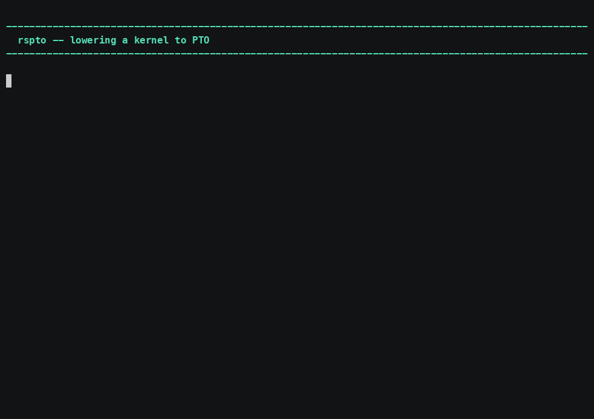
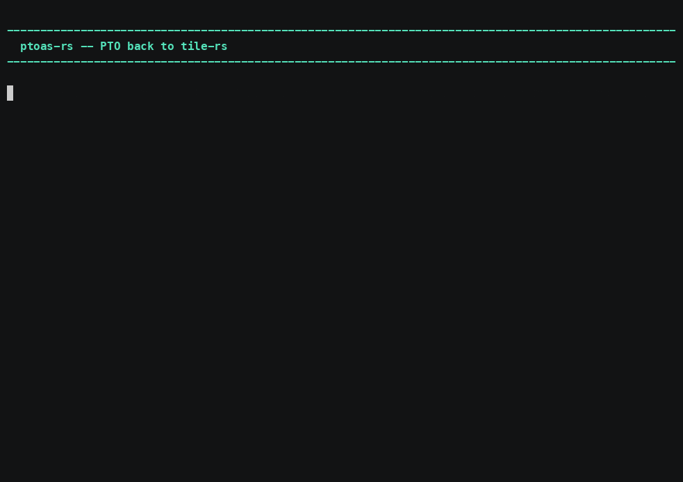
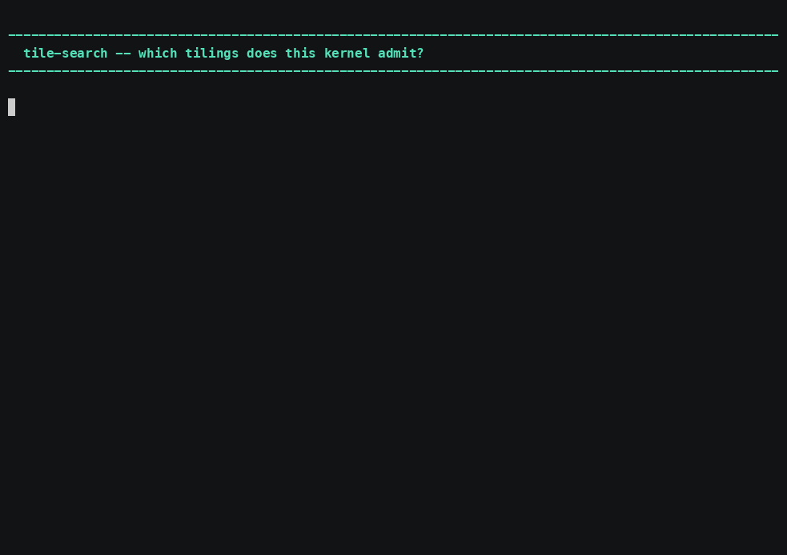
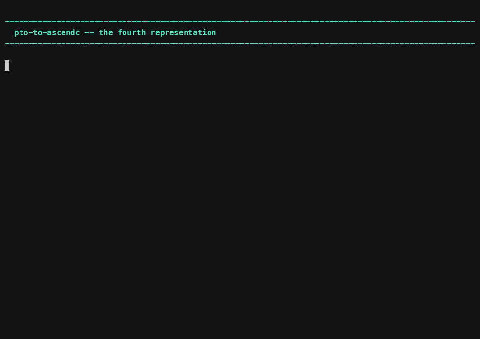
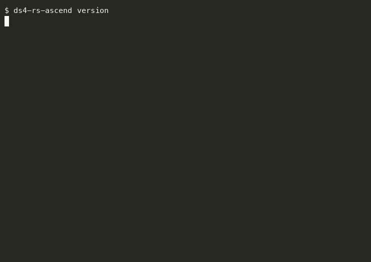

# Rust frontend for PTO

A Rust path into PTO, alongside the Python one. Kernels are written as Rust,
lowered to tile-dialect MLIR, and emitted as PTO assembly — the same `.pto` the
Python backend produces, for the same assembler — or as AscendC C++, so the two
can be read side by side.

Why Rust at all: the compiler can prove two things about a kernel before any of
it runs. Tile shapes agree, through const generics on `Tile<R, C, T>`. And every
tile handle is consumed exactly once, because a tile is deliberately not `Copy`
— so a double store or a use after scope is a borrow-check error rather than a
wrong answer on a card.

**One tree, four tools, a corpus and a serving utility.** Everything below lives
under `rust/`: the tools in `crates/`, the corpora in `bench/`, the narrated demo
in `demo/`, and the serving utility in `ds4-rs-ascend/`. Each section here is
collapsed to a summary — open what you need.

| section | what is in it |
| ------- | ------------- |
| [Installation](#installation) | one line, stable Rust, no third-party dependencies |
| [Usage](#usage) | quickstart, then one collapsible per tool |
| [Features and configuration](#features-and-configuration) | options, exit codes, verification tiers, refusals |
| [Benchmarks](#benchmarks) | the four corpora, the denominator, and which absences are whose |
| [Running a model: `ds4-rs-ascend`](#running-a-model-ds4-rs-ascend) | planning and serving on an Ascend box |
| [The five utilities](#the-five-utilities-each-with-its-demo) | one narrated recording per tool |
| [Rebuilding the recordings](#rebuilding-the-recordings) | record, render, voice, publish |

## Installation

```sh
curl -fsSL https://raw.githubusercontent.com/hw-native-sys/pypto/main/rust/install.sh | bash
```

Builds from source and installs into `~/.local/bin`. Honours `PREFIX` and
`PYPTO_BUILD_JOBS`. From a checkout, `bash rust/install.sh` builds what you
have rather than what is on a branch.

**Stable Rust is enough.** No nightly, no LLVM, no MLIR bindings, and no
third-party dependencies — a release build is a few seconds, which is why this
installs from source instead of shipping a binary and a supply chain with it.

```sh
$ rspto --version
rspto 0.1.0
$ pto-to-ascendc --version
pto-to-ascendc 0.1.0
```

## Usage

Four tools over one kernel. The extension decides the mode, and nothing else:

Four tools over one kernel:

```sh
rspto kernel.tile                      # -> kernel.pto
rspto kernel.tile -o -                 # PTO on stdout
rspto kernel.mlir --emit tile -o k.tile

pto-to-ascendc kernel.tile             # -> kernel.cpp
pto-to-ascendc kernel.tile --soc 950   # for a different part

ptoas-rs kernel.pto                    # -> kernel.rs  (lift PTO back to tile-rs)
ptoas-rs kernel.pto --safety           # + the address-shape findings
ptoas-rs kernel.pto --verify rustc     # + compile it and report what rustc proved

pto-diff a.pto b.pto                   # what moved between two memory plans

tile-search kernel.tile                # -> kernel.opt.tile
tile-search kernel.tile --dry-run      # report the search, write nothing
tile-search kernel.tile --emit rs      # lift the winner back to tile-rs
```

<details open>
<summary>`rspto` — a kernel to PTO</summary>

Folds `.tile` and `.mlir` into the same emitter, then refuses what the part refuses. Two input spellings, one output, asserted byte-identical.

See [`crates/rspto/README.md`](crates/rspto/README.md).

</details>

<details>
<summary>`tile-search` — the emitter decides what is feasible</summary>

`tile-search` enumerates the tilings a kernel admits, asks the **real emitter**
about each one, and ranks what it accepted. The oracle is the emitter rather
than a model of the hardware, deliberately: a model would be a second place for
the bounds to be written down, the two would drift, and a search whose model is
wrong still returns a confident answer.

Its measured case is `gate_up_silu` from the bench, which the target **refuses
as captured** — the live tile set exceeds the unified buffer. The search finds
seven tilings it accepts and picks the largest:

```text
$ tile-search rust/bench/playground16/tile/gate_up_silu.tile
knob %c captured=8960 candidates=8 from=correctness:fractal-span
  %c = 8960     refused: NPU UB budget (arch a2a3): tile of 35840B ... > UB_SIZE 194560B
  %c = 4480     accepted (41 lines)
  %c = 1792     accepted (41 lines)
  ...
7 of 8 candidate(s) accepted; ranked by largest-accepted-extent (a declared model, not a measurement)
chose %c = 4480
```

Two things that are easy to get wrong here, and both were got wrong first time
in this crate:

**Halving is not enumeration.** Sweeping by repeated halving from 8960 never
reaches 896, because 896 is 8960/10 — so it reports one feasible tiling where
there are several. The ladder enumerates divisors, which also means every
candidate covers the original extent exactly and no tail handling is invented.

**The ragged feasible set is an alignment rule, not a mystery.** A naive sweep
shows 4480 accepted, 2240 and 1120 refused, 896 accepted — which looks
non-contiguous. Every refusal there is a *misaligned* extent: a row-major data
tile must span whole 512-byte fractals. Once the ladder applies that rule, the
remaining candidates are all accepted. A test asserts the filter matches what
the emitter actually refuses, in both directions, so it can neither discard
feasible tilings nor propose impossible ones.

</details>

<details>
<summary>`pto-diff` — which tiles moved, and why</summary>

`pto-diff` answers a different question and is useful without lifting anything:
given two assembler memory-plan dumps it reports which tiles moved, which is how
a placement change gets attributed to the pass that made it rather than guessed
at from a performance delta.

</details>

<details>
<summary>`ptoas-rs` — PTO back to tile-rs</summary>

`ptoas-rs` runs the pipeline backwards: PTO in, tile-rs out. That is useful
because compiling the result puts two invariants in front of a checker that the
assembler emits without independently proving — const-generic `Tile<R, C, T>`
makes a `tmatmul` with disagreeing inner dimensions a type error, and a tile is
deliberately not `Copy`, so a double store is a borrow-check error. `--verify`
is what turns "rustc could check this" into "rustc did".

Every run prints a coverage line. **Read it before trusting an exit of 0:** an op
the lift does not model is carried through verbatim, which keeps a round trip
faithful and says nothing about whether the lift understood the kernel. A module
that parses while modelling nothing exits 4, not 0.

</details>

<details>
<summary>`pto-to-ascendc` — the fourth representation</summary>

`pto-to-ascendc` exists for comparison rather than for production: having a
kernel's AscendC beside its PTO is what makes "which representation shows this
better" an answerable question. It lowers `.tile` in-tree and needs nothing to do
it; `.pto` it hands to the pinned `ptoas` assembler rather than carrying a second
implementation that could disagree with the device path — see the comparison
section below.

</details>

<details>
<summary>Input modes — the extension, and what it needs</summary>

The input mode comes from the extension, nothing else:

| extension | what it is | needs |
| --------- | ---------- | ----- |
| `.tile` | tile-dialect MLIR | nothing |
| `.mlir` | the same thing, as the codegen backend spells it | nothing |
| `.rs` | tile-rs Rust source | the prebuilt codegen backend (`rustc_codegen_tile`) and the pinned nightly, **not in this release** |
| `.pto` | PTO assembly | `ptoas-rs`: nothing. `pto-to-ascendc`: the `ptoas` assembler on `PATH` or `$PTOAS` |

`rustc_codegen_tile` is the rustc codegen backend that lowers a tile-rs kernel
to the tile dialect. It is named here because the comments throughout these
crates refer to it by name as the producer of the MLIR they consume, and a
reader meeting the name twenty-four times with no definition is being pointed at
nothing. It is a `-Zcodegen-backend` plugin, dlopened and matched exactly to the
pinned nightly, and it is not part of this contribution — which is why `.rs`
input is not either.

</details>

<details>
<summary>Composability, and the gate it gave the emitter</summary>

What comes out: `rspto` writes `.pto` (or `.tile` with `--emit tile`),
`ptoas-rs` writes `.rs` (or `.tile`), `tile-search` writes `.tile` (or `.rs`),
and `pto-to-ascendc` writes `.cpp`. **All three of the first tools can emit the
tile-dialect MLIR**, which is what makes them composable: the extension decides
how the next tool reads the file, so any of them can feed any other.

`ptoas-rs --emit tile` writes that MLIR **straight from the PTO AST** and needs
no Rust toolchain. It used to refuse with exit 4, on the reasoning that getting
MLIR meant lifting to Rust and compiling the Rust with the codegen backend. That
was one route taken for the only one: the `.tile` form is `llvm.func` +
`hacc.entry` + `llvm.call @__tile_*`, which is the same intrinsic-level
information the lift already computes.

That also gives the emitter a gate it cannot talk its way out of — `rspto`
consumes the form, so the loop closes:

```text
$ ptoas-rs rust/bench/playground16/pto/vec_add.pto --emit tile -o vec_add.tile
$ rspto vec_add.tile -o roundtrip.pto
$ diff rust/bench/playground16/pto/vec_add.pto roundtrip.pto && echo identical
identical
```

Over the 60 distinct artifacts in the repository: 10 are accepted by
`--emit tile`, **7 round-trip byte-identically**, 2 differ only in comments the
input's own producer left behind, and 1 — a matmul — comes back as the
cube/vector `_aic`/`_aiv` pair over a `c2v_fifo`, which is the canonical PTO for
a matmul on this part and richer than the plain input. The other 50 are refused:
this emitter validates through the *checked* lift, which refuses strictly more
than the default one.

The gate earned its place immediately. The matmul arm emitted its extents as
`(M, N, K)` where the convention is `(M, K, N)` — unguessable from the argument
names, well-formed MLIR, every type matching, and for a 32×64 @ 64×32 kernel it
reads as a 32×64 result. `rspto` refused its own form and named the shape.

`pto-to-ascendc` takes both ends of the comparison the fourth utility exists to
make. From `.tile` it lowers in-tree and needs nothing. From `.pto` it hands the
file to `ptoas`, which is the reference implementation of that translation —
writing a second one here would produce an answer that can disagree with the one
the device path uses. It names which it used, and which version:

```text
$ pto-to-ascendc rust/bench/playground16/pto/vec_add.pto -o vec_add.cpp
pto-to-ascendc: note: ptoas 0.68 in use, this repository pins v0.70 — the
emitted C++ may differ from the device path's
pto-to-ascendc: wrote vec_add.cpp (via ptoas)
```

A version other than the pin is reported, never enforced: refusing would make
the tool useless on a machine with a working assembler of a different version,
while staying silent would hide a difference in the C++ that reaches the
device.

`.tile` and `.mlir` reach the same emitter, so they cannot produce different
PTO — asserted on real emitter output, not on the mode enum, which would pass
even if the two were wired to different emitters.

```text
$ rspto rust/bench/playground16/tile/vec_add.tile -o vec_add.pto
rspto: wrote vec_add.pto

$ head -2 vec_add.pto
// Generated by tile-rs mlir_to_pto — DO NOT EDIT
// Compile: ptoas --enable-insert-sync <file.pto> -o <file.cpp>
```

</details>

## Features and configuration

<details open>
<summary>Options, per tool</summary>

| option | effect |
| ------ | ------ |
| `-o, --output <file>` | where to write; `-` is stdout. Default: the input with the emitted extension |
| `--emit <form>` | `rspto`: `pto` (default), or `tile` to stop at the MLIR. `ptoas-rs`: `rs` (default) or `tile`. `tile-search`: `tile` (default) or `rs` |
| `--soc <part>` | `pto-to-ascendc`: `910b` (default), `950`, `950pr`, `950dt` |
| `--safety` | `ptoas-rs`: report aliasing, capacity, op-constraint, matmul-bound, dead-tile and linear-use findings |
| `--verify <tier>` | `ptoas-rs`: `rustc`, `miri`, or `both` |
| `--raw` / `--checked` | `ptoas-rs`: skip pattern fusion / emit the intrinsic-level form |
| `--dry-run` | `tile-search`: report the search and write nothing |
| `--emit rs` | `tile-search`: lift the chosen tiling back to tile-rs |
| `--check` | `rspto`: report whether the Rust → MLIR half is usable. Reads no input |
| `-V, --verbose` | narrate the steps on stderr |
| `-v, --version`, `-h, --help` | |

</details>

<details>
<summary>Exit codes — they carry information a message cannot</summary>

| code | meaning |
| ---- | ------- |
| `0` | ok |
| `1` | the transform failed |
| `2` | usage — a bad flag, or an extension the tool does not know |
| `4` | the toolchain or route is unavailable, **or** the lift modelled none of the input's ops — either way, nothing was proved |
| `5` | `ptoas-rs`: lifted, but a requested checker rejected the result |

`.rs` input returns `4`, not `2`. The mode is understood; the half that serves it
is absent. A user who got "unknown extension" would go looking for a typo
instead of for the missing toolchain.

`--verify` also returns `4` when the checker could not run, and **this is the
important one**: an empty finding list and a checker that never ran are the same
thing to a caller reading only an exit code. So an unavailable verifier is never
reported as a clean one.

</details>

<details>
<summary>`--verify rustc` — it compiles what it lifted</summary>

**`--verify rustc` works.** It stages the lifted kernel against the kernel-side
DSL and compiles it on the pinned nightly:

```text
$ ptoas-rs rust/bench/playground16/pto/vec_add.pto --verify rustc -o vec_add.rs
ptoas-rs: coverage 16 modelled op(s), 0 unmodelled
ptoas-rs: rustc: accepted the lifted kernel
ptoas-rs: wrote vec_add.rs
```

It needs `nightly-2025-08-04` installed, because the DSL is a `#![no_core]`
crate — permanently nightly, not pending a stabilisation. Override the
toolchain with `PTOAS_RS_KERNEL_TOOLCHAIN`.

</details>

<details>
<summary>`--verify miri` — it runs the kernel</summary>

**`--verify miri` runs the kernel.**

```text
$ ptoas-rs rust/bench/playground16/pto/vec_add.pto --verify both -o vec_add.rs
ptoas-rs: rustc: accepted the lifted kernel
ptoas-rs: miri: accepted the lifted kernel
```

This tier reported itself unavailable until the reference crate existed, and the
reason was structural rather than unfinished work: `cargo miri run` needs a
binary, a lifted kernel is a library of `extern "C"` functions, and the
kernel-side DSL is `#![no_core]` — so it cannot host a `#[test]` and cannot
share a crate graph with `std`, because it declares its own lang items. There
was nothing to execute.

`tile_std_ref` is the way out: the same tile-API signatures with ordinary Rust
bodies in an ordinary `std` crate. A lifted kernel repointed at it runs as
normal Rust, so Miri sees every load and store it makes through the pointers it
was handed, and reports an out-of-bounds access, a misaligned or dangling
pointer, or a read of uninitialised memory.

**The driver's buffers are sized from the PTO, not from the emitted Rust**, and
that is what makes the run a measurement. Extents read back out of the lift's
own output would agree with it by construction — a kernel whose extents were
wrong would get buffers wrong in the same way and pass clean. A test proves the
tier can fire by widening the *lifted* kernel's extents while leaving the PTO
alone: the driver still allocates 256 elements, the kernel reads 512, and Miri
names the exact element.

What this does **not** prove is that the lifted kernel computes what the PTO
meant. The reference's numerics are its own reading of each op, so a kernel that
loads, adds and stores agrees with its `add` whatever either of them does.
Pinning the numerics against the PTO needs an interpreter for the PTO. What *is*
pinned is the reference against closed forms worked out by hand, plus invariants
for the reductions — softmax rows summing to 1 and being shift-invariant, a
normalised row having RMS 1 — so it is not merely self-consistent.

Over the corpus, Miri proves the 10 distinct artifacts the checked lift can
describe; the other 50 report unavailable, because the signatures come from that
lift and it refuses strictly more than the default one.

</details>

<details>
<summary>A refusal is a result</summary>

**A refusal is a result.** Kernels that exceed a hardware bound are refused with
the bound named, not emitted and left to fail on the card:

```text
$ rspto rust/bench/playground16/tile/gate_up_silu.tile
rspto: NPU UB budget (arch a2a3): tile of 35840B at offset 179200B would use
       215040B > UB_SIZE 194560B (C1)
```

</details>

<details>
<summary>`--soc` is not decoration</summary>

`--soc` is not decoration. The emitter checks each tile against that part's
unified-buffer budget, and a blank target has **no** unified buffer — so every
budget check answers "fits", and every kernel then appears to overflow. Measured
before the default was made a real part: 0 of 16 emitted, with `vec_add`
"overflowing" at 1024 bytes.

</details>

<details>
<summary>The tools read no environment variables</summary>

Environment: the installer reads `PREFIX`, `PYPTO_BUILD_JOBS`, `PYPTO_REPO` and
`PYPTO_BRANCH`. **The tools read no environment variables and touch no files but
their input and output.** That is a property worth stating, because it was not
always true: the AscendC emitter used to look up an optimization-knowledge JSON
through a build-time path constant and prefix each kernel with an advisory
comment when it found one. The same binary on the same input therefore emitted
different C++ on a machine where that file existed, and the build machine's
absolute path was baked into the shipped binary. Both are gone; emission is pure
text to text, so the same input gives the same output anywhere.

</details>

## Running a model: `ds4-rs-ascend`

<details>
<summary>Planning, and what needs a card</summary>

`ds4-rs-ascend/` is a serving utility for DeepSeek V4.1 Flash on Ascend — a
separate Cargo workspace, *excluded* from this one, because these four tools
have no third-party dependencies at all and that is a property worth keeping
checkable. A serving utility needs a SQLite registry, a signature verifier and a
memory map.

```sh
cd ds4-rs-ascend && cargo build --release --jobs "$PYPTO_BUILD_JOBS"

ds4-rs-ascend mem                      # what this box has
ds4-rs-ascend plan  --mode latency     # the split it would choose, without running
ds4-rs-ascend deploy --mode balanced   # plan, then serve
```

`--mode` is the one choice most deployments make: `latency` for a single user,
`throughput` for aggregate tokens/sec, `balanced` for a middle point,
`max-context` for the longest context the box can serve at all. Card memory is
profiled per chip, and the TP/DP/EP/PP split is chosen against the stated
objective rather than fixed.

**`mem` and `plan` need an Ascend driver on PATH** — correcting a claim an
earlier draft of this file carried over from the crate's own manifest comment.
That comment says the planning half works without the `ascend` cargo feature,
and it does; but the feature was never the only dependency. The memory profile
shells out to `npu-smi`, and `--mem-source` offers `npu-smi` or `acl` and
nothing synthetic, so a capacity question still needs a box. What does work off
a card: `version`, `help`, `help --advanced`, and the kernel registry
(`kernels list` / `verify`).

**Two things it does not claim.** The parallel module's own header says it:
nothing in it has run on multiple chips, so the collective cost is an
assumption and so is the claim that *n* host links deliver *n* times one
link's bandwidth. And `deploy` reports what it would run and refuses, rather
than pretending to serve, until the engine lands under it. Both are kept
verbatim from the source rather than smoothed over.

**Kernel sets are signature-verified.** A set is content-addressed and hashed,
and the index that names the sets is signed with Ed25519. The check answers one
question — *is this what was published* — and is the only thing standing between
an index and the code it names.

**What is not carried here**, because none of it could work: a hand-written FFI
bridge to a vendored third-party engine, its build script, and the Apple
framework links they needed — that bridge was a correctness oracle on Apple
hardware, and **the Ascend side has no equivalent yet, so a CPU-reference
comparison is owed**. A Metal kernel registry, keyed by the `[[kernel]]` symbol
in a generated `.metal` file, which nothing on the Ascend path referenced. And a
signed tuning-policy layer whose verifier was implemented against Apple's
Security.framework and returned `UnverifiablePlatform` everywhere else — inert
on every machine this utility is for.

</details>

## The five utilities, each with its demo

Every tool has its own page and its own narrated recording, paced for about five
minutes of voice-over. Click through for the detail; the recordings below are
the whole set.

| tool | what it does | demo |
| ---- | ------------ | ---- |
| **[rspto](crates/rspto/README.md)** | tile-dialect MLIR → PTO assembly | [gif](demo/media/rspto.gif) · [mp4](demo/media/rspto.mp4) · 4:43 |
| **[ptoas-rs](crates/ptoas_rs/README.md)** | PTO → tile-rs, with a safety and rustc report | [gif](demo/media/ptoas-rs.gif) · [mp4](demo/media/ptoas-rs.mp4) · 5:00 |
| **[tile-search](crates/tile_search/README.md)** | enumerate the tilings a kernel admits | [gif](demo/media/tile-search.gif) · [mp4](demo/media/tile-search.mp4) · 4:50 |
| **[pto-to-ascendc](crates/pto_to_ascendc/README.md)** | tile-dialect MLIR → AscendC C++ | [gif](demo/media/pto-to-ascendc.gif) · [mp4](demo/media/pto-to-ascendc.mp4) · 4:27 |
| **[ds4-rs-ascend](ds4-rs-ascend/README.md)** | serve DeepSeek V4.1 Flash on Ascend | [gif](demo/media/ds4-rs-ascend.gif) · [mp4](demo/media/ds4-rs-ascend.mp4) · 4:51 |

### rspto — a Rust kernel to PTO

<details>
<summary>Two input spellings, one output, and both refusals named</summary>



Proves its two input spellings produce **byte-identical** PTO, then refuses two
of the sixteen bench kernels and names the bound each one hit.
[Page](crates/rspto/README.md) · [narrated mp4](demo/media/rspto.mp4)

</details>

### ptoas-rs — PTO back to tile-rs

<details>
<summary>Four refusals, four different causes, and one that must stay refused</summary>



Shows that its four refusals are four *different* causes — and that one of them
must **stay** refused, because lifting a strided view would read the wrong
elements. [Page](crates/ptoas_rs/README.md) · [narrated mp4](demo/media/ptoas-rs.mp4)

</details>

### tile-search — which tilings does this kernel admit?

<details>
<summary>It rescues one kernel, then fails honestly on a 288-expert router</summary>



Rescues a kernel the hardware refuses, then fails honestly on GLM 5.3's
288-expert router, where the expert count — not the tiling — is the obstruction.
[Page](crates/tile_search/README.md) · [narrated mp4](demo/media/tile-search.mp4)

</details>

### pto-to-ascendc — the fourth representation

<details>
<summary>PTO and AscendC side by side, and where the two emitters disagree</summary>



Puts PTO and AscendC side by side, and shows the two emitters disagreeing on
real model shapes: 7 against 4 of the 14 V4.1 kernels.
[Page](crates/pto_to_ascendc/README.md) · [narrated mp4](demo/media/pto-to-ascendc.mp4)

</details>

### ds4-rs-ascend — planning a deployment

<details>
<summary>Plan a deployment, and hear what it has not measured</summary>



Plans a deployment, shows the kernel-set registry, and states in its own words
what it has not measured — including which commands need a card.
[Page](ds4-rs-ascend/README.md) · [narrated mp4](demo/media/ds4-rs-ascend.mp4)

</details>

## Rebuilding the recordings

<details>
<summary>record → gif → mp4 → voice → mux → publish</summary>

```sh
demo/run.sh plan            # what each segment does, and how long it runs
demo/run.sh cues            # narration cue sheets, with timestamps
demo/run.sh record          # terminal sessions -> demo/out/<scene>.cast
demo/run.sh gif | mp4       # -> .gif, -> silent .mp4
demo/run.sh voice | mux     # -> draft male voice-over, -> narrated .mp4
demo/run.sh publish         # copy the gif and mp4 into demo/media/
demo/run.sh all             # every step, every scene
```

Needs `asciinema` and `agg` to record and convert, `ffmpeg` to mux, and macOS
`say` for the draft voice. A single scene can be named:
`demo/run.sh record tile-search`.

**On the five-minute target.** Each scene is paced for it, and the recorder
**measures what it actually produced**, prints the measured length against the
target, and warns when they disagree. It does not pad a short recording to look
long, and it does not claim five minutes for a three-minute file. That check
earned itself twice while these were made: it caught a segment truncated to 40
seconds, and another that ran 176 seconds short because its binary had not been
built — the scene had reported "complete" while every command in it failed.

(A detail if you touch this: asciinema cast v3 stores each event's time as a
*delta* from the previous one, so reading the last field reports the final
two-second gap and makes a three-minute recording look empty. The driver sums
them, and a test asserts it sums.)

**Narration.** `demo/narration/<scene>.txt` carries every line with the
timestamp it falls at, so a read has marks to hit rather than a transcript to
guess from. `demo/run.sh voice` renders a **draft** with a male system voice so
the timing can be judged before anyone books a studio — explicitly not a
finished read, because `say` ignores the marks and the lines will drift.

A refusal on screen is **labelled as intended** where it is intended. Several of
these tools refuse by design, and without the label a viewer reads a working
demo as a broken one.

</details>

## Benchmarks

`rust/bench/playground16` holds sixteen kernels from a DeepSeek-R1-Qwen-Distilled
decode step — eleven decode kernels and five teaching primitives — in four
representations at once, so the same computation can be read as tile-rs source,
as tile-dialect MLIR, as PTO, and as AscendC. `manifest.json` indexes it, and
every total in it is recomputed from the directory contents by a test rather
than written down.

| what | measured |
| ---- | -------- |
| kernels this model needs | **16** — the baseline set, and all 16 are here |
| kernels emitting PTO | **14 of 16** |
| kernels emitting AscendC | **14 of 16** |
| PTO artefacts the lift accepts | **10 of 14**, with 4 named refusals |
| refused kernels `tile-search` finds a tiling for | **1 of 1** in playground16; **5 of 7** in `deepseek_v41` |
| byte-identical to the reference emitters | **14 of 14** each |
| refused for a hardware bound | 2, with a reason recorded per representation |
| reshaped variants that do emit | 3 |
| release build, stable Rust | ~14 s cold |
| tests | **695 cargo** in `rust/`, **527** in `ds4-rs-ascend/`; **220 pytest** |

### `playground16` — the baseline sixteen

<details>
<summary>Sixteen kernels in four representations, two refusals, and the byte-identity gate</summary>

The two refusals are `argmax` and `gate_up_silu`. They are refused by **both**
emitters and for the same underlying reason — too much live tile for the
unified buffer — but the two check different bounds and report them
differently, so the manifest records a verdict per representation rather than
one for both. Recording a single verdict would hide the day they stop agreeing.
`tile/fixed/` carries the same computations at widths that fit, and those emit.
A bench that hid the refusals would be reporting on something other than what
the hardware can do.

The lift's four refusals are four different causes, which is worth more than one
coverage number: a scalar literal not threaded into an emitter, a tile-to-tile
copy with no wrapper to call, one op not modelled at all, and a strided tensor
view. **That last one must stay refused** — lifting it would alias the base
pointer and read the wrong elements, so it is a kernel that compiles and computes
the wrong answer.

Every generated file in the corpus is re-emitted from its `.tile` and compared
byte for byte on every test run — one gate per emitter, since they check
different things. A checked-in generated file has no owner unless something
regenerates it: left alone the emitter changes, the artefact does not, and both
stay green because nothing compares them — at which point the corpus documents
an emitter that no longer exists.

```sh
cd rust && cargo test --release          # includes the corpus comparison
```

</details>

### `deepseek_v41` — real model shapes

<details>
<summary>Fourteen kernels at V4.1's own shapes; six distinct bounds, five of them rescuable</summary>

Operator kernels at DeepSeek V4.1 Flash's **real** shapes, read from the model's
own configuration rather than chosen. That is the difference that matters: these
hit the part's bounds, and most of them are refused as written.

| what | measured |
| ---- | -------- |
| kernels this model needs | **52+** (the published registry's DeepSeek V4 Flash row is 52; V4.1 can only be more) |
| kernels | 14 |
| emit PTO | **7** |
| emit AscendC | **4** |
| lift back to tile-rs | **2** |
| refused by the PTO emitter | **7** |
| of those, `tile-search` finds a tiling for | **5** |
| distinct bounds hit across the corpus | **6** |

The two the search cannot rescue are the informative ones: their bound is not a
tile extent at all — one needs `N` to be a multiple of the block width, the other
needs both operand loads deferred. No choice of tiling moves either, and a
search that reported success on them would be lying. A test asserts the corpus
still hits at least four distinct bounds, because a corpus collapsed to one
failure mode has stopped being a spread of shapes.

The AscendC column covering less than the PTO column (4 against 7) is a measured
fact about the two emitters, not a gap in the corpus.

</details>

### `glm_5_3` — every dimension from the model's own GGUF

<details>
<summary>Ten expressible kernels, two omitted rather than approximated, and a 288-expert router no tiling can fix</summary>

GLM-5.3-Flash decode kernels. Every dimension is a **metadata key from the
model's own GGUF**, not chosen and not inferred from a tensor shape.

| what | measured |
| ---- | -------- |
| kernels this model needs | **20+** (a lower bound; see the denominator note) |
| kernels emitted | 10 |
| emit PTO / AscendC | **7** / **7** |
| lift back to tile-rs | **6** |
| refused | 3, of which `tile-search` rescues **2** |
| **not expressible in the tile API** | **2**, named with the intrinsic each needs |

`glm5-next` is a hybrid, and the corpus says so rather than hiding it: 34 of 46
blocks use a gated delta net, 12 use MLA, 43 FFNs are a 288-expert MoE and 3 are
dense, and there is **no RoPE at all**. That is a different architecture from
GLM-5.2's `glm-dsa`.

Two kernels are **omitted rather than approximated** — the delta-net recurrence
(a sequential scan with a decay term) and its 4-step causal convolution. The
tile API has no recurrent-scan or sliding-window intrinsic, and writing a
recurrence as something else would put a kernel in this corpus that computes
something the model does not. Two thirds of the blocks use them, so the corpus
covers what is expressible and states plainly what it does not.

The one refusal the search cannot rescue is the most interesting line in the
bench: the 288-expert router. An f32 row must span whole 512-byte fractals, so
its extent must be a multiple of 128 — and **288 has no divisor that is**. The
expert count itself is the obstruction, not the tiling, and no search can move
it.

</details>

### `kimi_k3` — shape-sourced, and what it cannot express

<details>
<summary>Eleven kernels, `situ` leaves both FFN paths out, and 896 experts do tile</summary>

Kimi K3 decode kernels, shape-sourced from the released model's own
`config.json`: `D` 7168, 93 blocks (69 KDA, 24 MLA, 1 dense), 896 experts
top-16 with 2 shared, vocabulary 163840, `q_lora` 1536, `kv_lora` 512.

| what | measured |
| ---- | -------- |
| kernels this model needs | **21+** (a lower bound; see the denominator note) |
| kernels emitted | 11 |
| emit PTO / AscendC | **7** / **5** |
| lift back to tile-rs | **2** |
| refused, and rescued by `tile-search` | 3 rescued, 3 it could not help |

Two findings came with the shape table, neither of them a dimension:

* **`hidden_act` is `situ`,** and the tile API has `silu`, `gate_up_silu`,
  `sigmoid` and `exp`. So **both FFN paths are absent** from this corpus, where
  GLM 5.3's SwiGLU FFNs are present. The generator refuses to run if
  `HIDDEN_ACT` stops being `situ`, so the omission cannot silently become wrong.
* **896 experts is 7 × 128, so the expert count DOES tile.** GLM 5.3's 288
  admits no f32 tiling at all. The two are easy to collapse into "expert counts
  do not tile", and they are opposite.

The refusals are the model's rather than the API's, except one: a single f32 tile
of `D`=7168 overflows the 910b per-buffer budget where GLM 5.3's 4096 fits (which
is why the output projection has no AscendC form), the argmax over a 163840
vocabulary is refused by both emitters, and the sigmoid router needs
`__tile_sigmoid_f32`, which `mlir_to_cpp` has no arm for because the model routes
with sigmoid rather than softmax.

</details>

### The denominator

<details>
<summary>How many kernels one decode step needs, and which of the counts are floors</summary>

Every corpus count above is read against an **estimate of how many distinct
kernels one decode step of that model needs**:

| corpus | kernels | tile | PTO | AscendC | tile-rs |
| ------ | ------- | ---- | --- | ------- | ------- |
| `playground16` | 16 | 16 | 14 | 14 | 16 |
| `deepseek_v41` | 52+ | 17 | 8 | 5 | 4 |
| `glm_5_3` | 20+ | 20 | 11 | 12 | 2 |
| `kimi_k3` | 21+ | 21 | 13 | 6 | 3 |

`rust/bench/shapes/estimate_kernels.py` derives it from each model's own
configuration and prints the inventory row by row:

```text
--- kimi_k3: 21
    1  embedding / get_rows at D
    1  rmsnorm at D (attn_norm, ffn_norm and the final norm share it)
    5  MLA projections: q_a, q_b, kv_a, kv_b, output
    1  second attention core: the gated delta net
    ...
```

**Two counts are known; the other two are lower bounds.** Both known counts
come from the project's published kernel registry, read 2026-11-02:

* `playground16` is sixteen by **definition**, and the registry's
  sixteen-kernel paper collection names the same sixteen — no extras on either
  side. The two sets were built from different trees two months apart, so the
  agreement is independent corroboration of the one denominator here that
  nothing else could check.
* `deepseek_v41` takes the registry's DeepSeek V4 Flash row: **52** distinct
  kernels, 13 under a `trace` basis and 39 under `source-scan`. This supersedes
  an earlier floor of 51, which was the smaller of the two floors.

`52+` is a floor three times over, and each reason is separate: the published
view is marked **redacted**, so it is a subset; most rows are **unverified by a
trace**, and the registry's own wording is that only a trace is evidence a
kernel holds measurable time; and V4.1 is a later revision of the same
architecture, so its count can only grow.

Where no count is known, `inventory()` derives one — and that derivation is
**a lower bound, not an estimate**.

**The registry does not override a stronger derivation**, and the two cases it
loses are worth separating:

* For **Kimi K3** it has nothing to say — it lists ten models and none of them
  is that one. A `0` recorded against it would read as a measurement of zero
  rather than an absence, so nothing is recorded.
* For **GLM 5.3** it holds six rows, all model-prefixed and all under
  `source-scan`, which is **fewer** than this bench derives from the model's own
  configuration, under an unverified basis dated before that architecture's work
  landed. Adopting it would lower a bound on the strength of its provenance
  alone, so `20+` stands and the six is recorded as a floor on model-specific
  kernels alone.

⛔**The derivation under-counts by about 3.5×, measured.** It predicts 15 for
DeepSeek V4 Flash against the registry's 52. The reason shows in its own rows:
it collapses each expert's gate, up and down into one line; one attention core
rather than its decode, prefill and partial variants; one matvec rather than the
f16, f32 and per-quantisation forms; and no prefill shapes at all.

That ratio is **not applied as a correction**. One anchor cannot calibrate a
model, and a derived figure multiplied by 3.5 would carry the appearance of
measurement and none of the substance. So `20+` and `21+` are marked as floors
and left alone, and the inventory is kept beside each known count because the
gap between the two is the only measurement of how coarse it is.

**A denominator below the numerator is wrong.** `playground16` derived to 13
against a corpus of 16, and that was once reported as the corpus "exceeding its
estimate" — which reads as a quirk and was a defect: a model predicting fewer
kernels than a corpus already holds has been refuted by that corpus. The fix was
not a note but the known count. A test enforces the invariant per corpus.

A kernel is one (operation, shape) pair, because that is what the corpus holds:
one `rmsnorm` file serves every block sharing `D`, so a layer count does not
multiply the figure.

</details>

### What has run on an actual part

<details>
<summary>Twenty-four kernels verified on an Ascend part; seven of them on two different boards</summary>

A column in the table above says a `.cpp` exists. It does not say the kernel
computes what it claims. These seven do, and the evidence is a device run against
an oracle computed in `f64`:

| kernel | elements | 910B2C | 910B2 | oracle |
| ------ | -------- | ------ | ----- | ------ |
| `residual_add_v41_1x5120` | 5120 | exact | exact | `a + b` |
| `residual_add_glm53_1x4096` | 4096 | exact | exact | `a + b` |
| `residual_add_k3_1x7168` | 7168 | exact | exact | `a + b` |
| `rmsnorm_v41_1x5120_decode` | 5120 | 1.87e-7 | 1.87e-7 | `x / sqrt(mean(x²) + eps)` |
| `rmsnorm_glm53_1x4096` | 4096 | 1.90e-7 | 1.90e-7 | same |
| `rmsnorm_k3_1x7168` | 7168 | 2.47e-7 | 2.47e-7 | same |
| `swiglu_v41_1x2304` | 2304 | 1.25e-7 | 1.25e-7 | `silu(gate) * up` |
| `rmsnorm_v41_8x1280_quarter` | 1280 | 6.51e-7 | — | 8 rows of 1280, `eps` 1e-20 |
| `shexp_gate_up_silu_glm53_1x2048` | 2048 | 1.07e-7 | — | `g=x·wg`, `u=x·wu`, `silu(g)·u` |
| `kda_delta_k3_1x128` | 128 | exact | — | `0.5·s + (q·k)·v`, the broadcast row |

The rows above are the ten with a recorded dual-board or single-board run. The
others -- the decode convolutions, the situ rows at three widths, and the eight
projections -- were verified on the 910B2 only, and their per-kernel records live in
`bench/*/manifest.json` under `device_check`, not here. Twenty-four kernels in
total, out of fifty-six declared.

Where a cell says `—` the kernel was NOT run on that board. Seven rows have both
columns filled; the three newest have one, because they were verified after the
second board stopped being reachable.

"exact" is `max_abs = 0`: the oracle accumulates in `f64` and every `f32` result
equals the `f64` sum rounded once. The normalisations and the gated product land
at the `f32` rounding floor, which is what an exact oracle against a rounding
kernel must produce — the tolerance is `1e-6`, and the figures are recorded as
printed rather than as rounded to look better. Where both columns are filled they are
digit-identical across the two parts, so those artefacts do not depend on which
board ran them. That is a statement about seven kernels, not about the corpus.

The harness is `rust/tools/direct-invoke/`: a host `main.asc` that takes the
launcher symbol, arity, extent, oracle and the kernel's own epsilon from the
build. The kernel is copied in verbatim — nothing in it is edited to make a run
pass. (`vec_add_run.cpp`, which this paragraph used to describe, was never built by
the `CMakeLists.txt` beside it; it is gone.)

**The harness reports correctness only, and that is a gap worth naming.** It
launches once and synchronises; it has no timing at all (`grep` for a clock, an
event or a duration in `op_host/main.asc` finds nothing). So no question of the
form "is this emission faster" can be answered with it, including the one that
decides whether chunking a reduction is worth building: the loop costs some
throughput by construction (smaller DMAs, an accumulator dependency) and the only
way to know whether it is 5% or 40% on this part is to measure it.

It now takes a ninth argument, the repeat count. `1` (the default) reproduces the
old behaviour exactly and pays nothing; above it the launcher brackets each launch
with `aclrtRecordEvent` / `aclrtEventElapsedTime`, prints `TIME_MS`, and **discards
the first launch** so the kernel's first touch of GM and of the UB the allocator
carved is not averaged into the result.

Measured on a 910B2 (`opencompass-01`, CANN at `/usr/local/Ascend/ascend-toolkit/latest`):

```
TIME_MS 0.025023            # rmsnorm_k3_1x7168, 7 timed launches of 8
elements=7168 wrong=0 max_abs=3.834e-07 max_rel=2.466e-07
PASS
```

So a performance claim about this corpus is now measurable rather than reasoned --
which was the point of adding it before building anything whose value depends on the
answer.

`rust/tools/direct-invoke/verify_all.sh <bench-root>` re-runs all twenty-four and
prints the host, part, CANN and `ptoas` version beside each verdict, exiting
non-zero if any fails — so the table above can be reproduced rather than taken
on trust. It has been run on a 910B2C and a 910B2, with `ptoas` 0.68, 0.71 and
0.72 present across the three boxes involved.

**Why the number is not larger, measured rather than assumed:**

* the four `SHAPE_LIMIT` projection kernels compute one output
  (`__mv_n = 1`) and store `n × k`. On silicon, 509 of 512, 1535 of 1536 and 506
  of 512 declared outputs are **never written**; element 0 matches an `f64` dot
  product exactly. Crediting them would add four kernels on one correct element
  each, so they are not credited.
* `rope` emits an identity copy, and the emitter marks it as such
  (`substitution_marker("__tile_rope_f32", "identity-copy", "missing-cos-sin-operands")`):
  device code has no scalar libm and the signature carries no cos/sin LUT. It is
  not the operation, so it is not verifiable.
* `argmax`, `embedding` and `attention_decode` have no AscendC emitter.

</details>

### Which absences are ours

<details>
<summary>Every refusal partitioned by owner, with no catch-all</summary>

A coverage ratio cannot be acted on, because the absences behind it are not one
thing. `rust/bench/shapes/classify_refusals.py` partitions every refusal in the
bench by **who owns the work**, computed from the text the emitters themselves
produce:

| owner | count | kinds |
| ----- | ----- | ----- |
| work in **this repository** | 14 | `EMITTER_GAP` 13, `EMITTER_DEFECT` 1 |
| work in the **corpus** | 4 | `SHAPE_LIMIT` 4 |
| **not ours** | 43 | `HARDWARE_BOUND` 27, `CHECKED_LIFT` 16 |
| **not a problem** | 7 | `DERIVED` 7 |

* `EMITTER_GAP` — `mlir_to_* has no arm for X`. The operation is expressible and
  the emitter says so rather than dropping the call silently, which is the only
  reason this is a tractable list and not a correctness incident.

  ⛔**Thirteen rows is not thirteen arms.** Seven of them are five operations
  that one emitter already lowers — the asymmetries below. The other six are two
  operations whose **call sites cannot express them**, and no arm would close
  either. `__tile_embedding_f32` hands the arm a weight *tile* that cannot hold a
  real vocabulary. `__tile_attention_decode_f32` declares
  `(dst, q, k, v, rows, cols)` where `rows`/`cols` are the head count and head
  width: the caches are `(NKV, max_seq, DH)` at **runtime** and `max_seq` is not a
  parameter, while every fixture loads K and V at Q's own extent — so the tiles
  hold one key. An emitter could only emit `out = v`, which is right for one key
  and wrong for every real decode step. Both claims are pinned by tests, so if a
  fixture starts carrying a cache extent the row becomes real work and the test
  says so.
* `EMITTER_DEFECT` — the arm exists, the shape is fine, and **one of our own
  passes** refuses it. One row: the blocked i8 matmul at `M=1`, refused because
  `detect_blocked_matmul_loads` does not mark i8 inputs. ⛔The pre-pass reads its
  operands by count, and a 6-operand capture against the declared 7 means it
  cannot read the shape at all — so the message names our pass while the
  constraint that appears with the call corrected belongs to the **part**: M
  must be a multiple of 16 on the 910B2 cube. The count stayed at 1 across that
  correction while the content changed completely, which is why this table names
  rows rather than quoting totals. The gqa arm is no longer this kind — it emits
  a view at one type now — and nothing in this table would have found it: the
  assemble gate over the stored artefacts did, which is why that gate exists.
* `SHAPE_LIMIT` — the arm exists and refuses this *shape*, naming the rewrite
  (pad the extent; emit one call per row). Closes in the corpus, not the emitter.
* `HARDWARE_BOUND` — the tile does not fit the unified buffer, or misses the
  512-byte fractal stride. A new arm does not move these.
* `CHECKED_LIFT` — the strict lift refusing PTO the PTO emitter would produce,
  by design.
* `DERIVED` — `no PTO to lift`, the shadow of a refusal one stage earlier. Not
  an independent problem, and a test asserts each one resolves to a real cause.

</details>

### Reproducibility is not validity

<details>
<summary>The gate was green while three artefacts did not parse; here is what that cost</summary>

Three of the stored `.pto` artefacts **did not parse**, and the byte-identity
gate over them was green throughout. That gate re-runs the emitter and compares
against the stored file, so when an emitter writes something invalid both sides
hold the *same* invalid text and the comparison succeeds. A second gate now
assembles every stored artefact
(`rust/crates/pto_to_ascendc/tests/stored_pto_assembles.rs`), and **all 40
assemble**.

The three artefacts named **two** defects, and both were the *first* blocker
rather than the whole of it. Closing them took seven fixes, each uncovered only
by fixing the one before it:

| where | defect |
| ----- | ------ |
| `pto.tci` | `{descending = …}` sat *inside* the `ins(…)` list, where MLIR wants `:`; it belongs on the op |
| `pto.tci` | the index tile was `ui32` and the start scalar `i32`, and the verifier requires one type |
| the topk arm | `pto.tgather` with a mask pattern needs an `axis`; `row` is the only direction a 2:1 gather admits |
| the topk arm | a `1×6` f32 result tile is 24 bytes and cannot be allocated at all; rows must be 32-byte aligned |
| the topk arm | `pto.tmov` refuses `1×cols → 1×k`, so the head extract has to be explicit: `pto.textract` |
| the gqa arm | one partition view carried `<32x64xf32>` and `<16x64xf32>`; the per-head view is built, not reused |
| the gqa store | the store then moved the whole `s*heads_q × d` view out of an `s×d` tile; the result records the extent it covers |

Regenerating the corpus after those fixes changed exactly three `.pto` files and
nothing else, which is the check that the fixes were narrow.

`KNOWN_INVALID` is kept in both gates, and it is **empty**. Deleting it with the
defects would delete the mechanism that retires an entry: each recorded artefact
must still fail with its recorded message, so a fix flips the gate and tells
whoever fixed it to drop the entry. A gate that answers "does the text parse" is
not a claim that the kernel computes what it means — three of the seven fixes
above are forced by the verifier rather than chosen, and the topk arm's `P1010`
polarity is still unresolved.

</details>

### A capture may be wrong; it may not be unanswered

<details>
<summary>What the corpus may record, and what it must answer</summary>

Nothing compared the corpus's hand-captured calls to the intrinsics `tile_std`
declares. Three did not match. `rust/bench/shapes/check_call_conformance.py` reads
the declarations and checks arity, the `dst` convention and pointer operands —
and the specification it enforces is deliberately **not** "every capture
conforms":

* a top-level `tile/` file is a **faithful capture**. A malformed one is *data*:
  it records what the lowering really produced, and overwriting it destroys that
  record.
* what it may not do is go **unanswered**. Each non-conforming capture must have
  a conforming sibling under `tile/fixed/`, so the corpus holds both the defect
  and the kernel the source meant.

One of the three defects has matching arity — 8 operands against 8 declared,
every one shifted by a place — which is why the checker reads the declaration
instead of counting commas. And the `dst` rule accepts a constant *or the same
tile as the next operand*, because the corpus legitimately uses
destination-passing in 19 places; a rule demanding a constant flagged all 19.

**The classifier has no catch-all**: an unrecognised refusal raises. A
classifier with an `other` bucket absorbs exactly the case nobody has looked at
while its totals keep reading as complete — and this one found two whole kinds
that an earlier ad-hoc pass had put in such a bucket.

Five operations are **asymmetries**: one emitter has the arm and the other does
not, so the semantics are already settled and these are the cheapest gaps to
close. All five are missing from the AscendC emitter. Support is **read from the
other emitter's source**, never inferred from it not having refused, and it
requires a dispatch site rather than the bare name: both emitters carry an
intrinsic name list wider than their dispatch.

⛔**A sixth used to be listed, and it was not an asymmetry.** `__tile_embedding_f32`
dispatched in the AscendC emitter and was absent from PTO, so the PTO column read
as short for an unfinished arm. Reading what that arm emits showed the dispatch
was the whole of it: the arm gathers rows **within the weight tile it was handed**,
so the tile has to hold `vocab × dim` — 4.7 GB for Kimi K3, 2.5 GB for GLM 5.3,
against a 192 KiB unified buffer — while every corpus fixture loads **one row** and
then indexes it by the runtime row id. The emitted gather therefore read past its
buffer for every index but 0, and no gate could see it: the byte-identity gate
compares the emitter's output with the file the emitter wrote, and the buffer
check compares the *declared* load with the budget. The arm now **refuses** that
shape, naming the bound and the fix (a GM-driven row copy), and the operation is
refused by both emitters for two different reasons — which is why it is no longer
a pair. A test pins both refusals, and a second proves a table that *does* fit
still lowers, so deleting the arm and deleting the guard are distinguishable.

</details>

## Coverage, as measured

The campaign reports three numbers, and they measure different things:

| axis | meaning | final |
|---|---|---|
| `C_s` | the stored `.pto` assembles under the real tool | **72/72** |
| `C_b` | it assembles **and** the lifted Rust compiles | **72/72** |
| `C` | a device run certifies the numbers it computes | **72/72** |
| `C_M` | model-level shape checks | **3/3** |

Measured on a census of 72 kernels across DeepSeek V4.1 Flash, GLM-5.3 and Kimi
K3, campaign `pto-models-rolling`, iteration 168. Each row joins the corpus scan
against the campaign manifest and unions a kernel's checks across its records.

Two things about these numbers matter more than their value:

- **They are counts of conjunctions.** `C_b` requires both artefacts to exist and
  both tools to accept them; a later record that omits a check does not "keep" an
  earlier pass, so the count can fall when a kernel is re-measured.
- **They are not a claim about speed.** A kernel can be correct at every shape and
  still be slow; nothing here measures time. The decode-speed section is separate
  and its numbers come from a served model, not from these per-kernel runs.

The earlier 58-kernel census and the 0.155/0.552 figures it produced are retired:
that census predates the model-shape correction, and the denominator moved when
the corpus was re-pinned. A number and its denominator travel together; quoting
one without the other is how the old figures became misleading.
