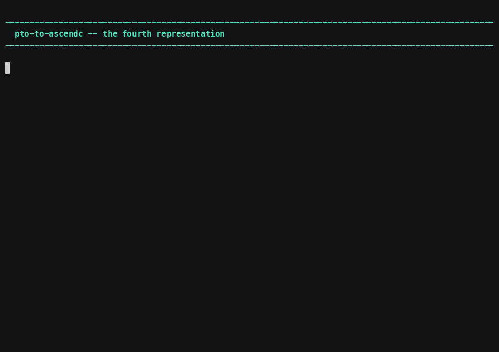

# pto-to-ascendc — the AscendC half of the comparison

`pto-to-ascendc <kernel>.tile` writes `<kernel>.cpp`, so a kernel exists here as
tile-rs, as tile-dialect MLIR, as PTO **and** as AscendC C++.



*[Narrated MP4](../../demo/media/pto-to-ascendc.mp4) · 4:27 · [cue sheet](../../demo/narration/pto-to-ascendc.txt)*

The point is comparison: *which representation makes a thing easy to see* is a
rhetorical question with one of them missing and an answerable one with all four
present.

## Usage

```sh
pto-to-ascendc kernel.tile              # -> kernel.cpp
pto-to-ascendc kernel.tile --soc 950    # for a different part
```

## `--soc` is not decoration

The emitter checks each tile against that part's unified-buffer budget, and a
**blank target has no unified buffer** — so every budget check answers "fits",
and every kernel then appears to overflow. Measured before the default was made
a real part: **0 of 16** emitted, with `vec_add` "overflowing" at 1024 bytes. So
the default is `910b`, a real part, rather than an absence.

Parts and their instruction semantics are returned together so they cannot be
mismatched: arch32 belongs with 910B, arch35 with the 950 family, and they are
different instruction sets rather than two sizes of one.

## Emission is pure

No filesystem, no environment, no toolchain. That is worth stating because it
was not always true: this emitter used to look up an optimization-knowledge JSON
through a build-time path constant and prefix each kernel with an advisory
comment. The same binary on the same input therefore emitted different C++ on a
machine where that file existed — and the build machine's absolute path was
baked into the shipped binary, nine times. Both are gone.

Generated code carries the repository's licence header, **emitted by the
emitter** rather than added afterwards, so the artefact is both compliant and
byte-reproducible.

## The two emitters check different things

Over the 16 playground kernels both emit 14. On DeepSeek V4.1's real shapes they
diverge: **PTO 7, AscendC 4** of 14. That is a measured fact about the two
emitters, not a gap in the corpus, which is why the bench records a verdict per
representation.

## On the name

`.pto` input is the direction this tool is named for and is **not implemented**.
Two routes lead there and neither is in this tree yet: the pinned `ptoas`
assembler, which does PTO → AscendC directly and is the reference answer, and
lifting the PTO back to tile-rs and lowering that. Having both is the point
rather than a redundancy — the two outputs can be diffed, and that diff says
more about either route than either alone. Until then `.pto` is recognised and
refused with exit code `4`.
