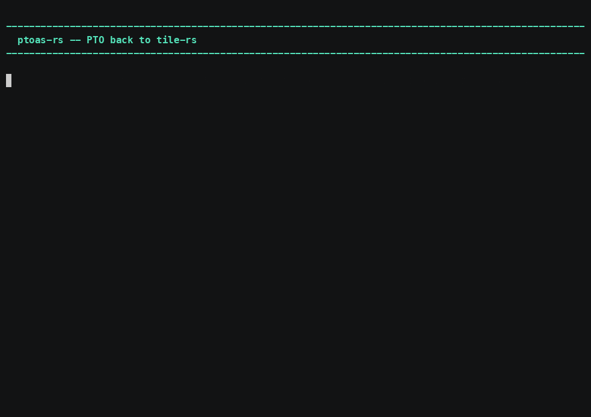

# ptoas-rs — PTO back to tile-rs, and what rustc can prove

`ptoas-rs <kernel>.pto` writes `<kernel>.rs`, and reports on the console what
the lift and the Rust compiler can say about it.



*[Narrated MP4](../../demo/media/ptoas-rs.mp4) · 5:00 · [cue sheet](../../demo/narration/ptoas-rs.txt)*

## Why lift at all

Compiling the result puts two invariants in front of a checker that the
assembler emits without independently proving:

- **shape agreement** — const-generic `Tile<R, C, T>` makes a `tmatmul` whose
  inner dimensions disagree a *type error*, not a surprise on a card;
- **tile-handle linearity** — a tile is deliberately not `Copy`, so a double
  store or a use after scope is a borrow-check error.

`--verify` is what turns *"rustc could check this"* into *"rustc did"*.

## Usage

```sh
ptoas-rs kernel.pto                     # -> kernel.rs
ptoas-rs kernel.pto --safety            # + the address-shape findings
ptoas-rs kernel.pto --verify rustc      # compile it and report what rustc proved
ptoas-rs kernel.pto --raw | --checked   # no pattern fusion | intrinsic-level form
pto-diff a.pto b.pto                    # what moved between two memory plans
```

## Read the coverage line before trusting an exit of 0

An op the lift does not model is carried through verbatim. That keeps a round
trip faithful and says **nothing** about whether the lift understood the kernel,
so every run prints the count. A module that parses while modelling nothing
exits `4`, not `0`.

## Four refusals, four different causes

Ten of the 14 bench artefacts lift. The four that do not are not one problem:

| kernel | cause | kind of work |
| ------ | ----- | ------------ |
| `rms_norm` | a scalar literal is not threaded into the emitter | wiring |
| `matmul` | no tile-to-tile copy wrapper to call | a new intrinsic |
| `rope` | an operation not modelled at all | a new op model |
| `attn_gqa` | a strided view | **must stay refused** |

That last one is a correctness boundary, not a gap: lifting it would alias the
base pointer and read the wrong elements. Relaxing the check would "fix"
coverage by breaking the answer.

## Unavailable is not clean

`--verify` has three outcomes — proved, rejected, **unavailable** — and the third
exits `4`, not `0`. An empty finding list and a checker that never ran are the
same thing to a caller reading only a status, and treating the second as the
first is how a verification step comes to mean nothing. Today it reports
unavailable: compiling the lifted kernel needs the kernel-side DSL, which
arrives with the Rust input mode.

It also says what it does **not** prove — nothing here speaks to pipe barriers,
the per-part sub-view hazard, core partitioning, or DMA bounds under runtime
shapes.
