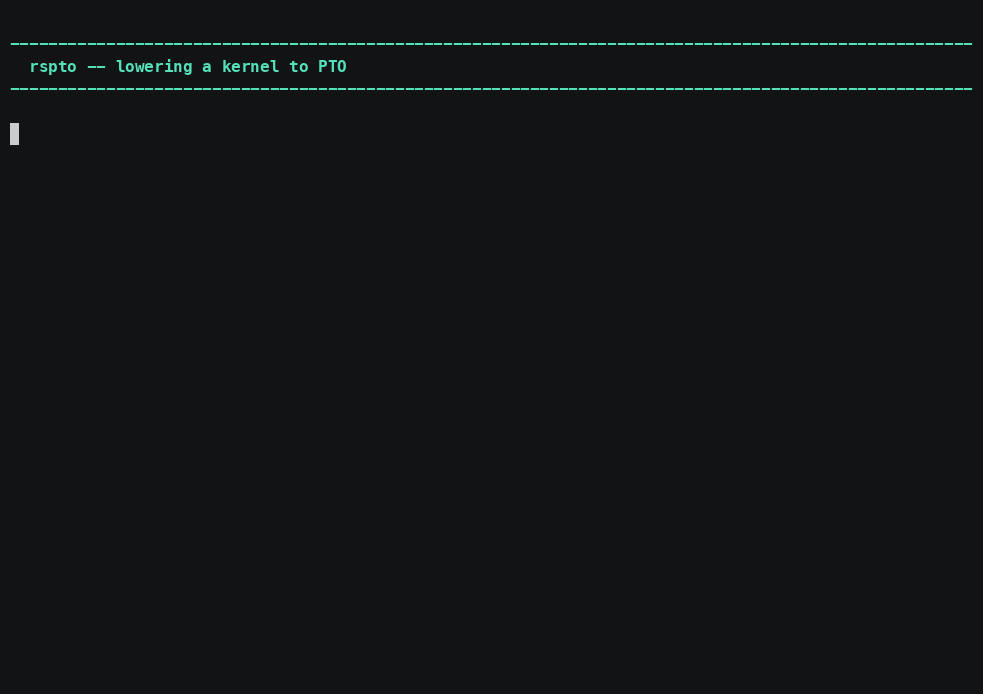

# rspto — a tile-rs kernel to PTO assembly

`rspto <kernel>.tile` writes `<kernel>.pto`: the same PTO the Python backend
produces, for the same assembler.



*[Narrated MP4](../../demo/media/rspto.mp4) · 4:43 · [cue sheet](../../demo/narration/rspto.txt)*

## Install

```sh
curl -fsSL https://raw.githubusercontent.com/hw-native-sys/pypto/main/rust/install.sh | bash
```

Stable Rust is enough. No nightly, no LLVM, no MLIR bindings, and **no
third-party dependencies at all** — a release build is a few seconds.

## Usage

```sh
rspto kernel.tile                       # -> kernel.pto
rspto kernel.tile -o -                  # PTO on stdout
rspto kernel.mlir --emit tile -o k.tile # stop at the MLIR
rspto --check                           # is the Rust input mode usable here?
```

| extension | what it is | needs |
| --------- | ---------- | ----- |
| `.tile` | tile-dialect MLIR | nothing |
| `.mlir` | the same thing, as the codegen backend spells it | nothing |
| `.rs` | tile-rs Rust source | the Rust → MLIR half, **not in this release** |

## The claim this tool makes

**The two input spellings cannot produce different PTO.** Both reach the same
emitter, so it is a `cmp`, not an opinion — and a test asserts byte-identity on
every run, on real emitter output rather than on the mode enum (which would pass
even if the two modes were wired to different emitters).

## A refusal is a result

A kernel that exceeds a hardware bound is refused with the bound named, not
emitted and left to fail on a card:

```text
$ rspto rust/bench/playground16/tile/gate_up_silu.tile
rspto: NPU UB budget (arch a2a3): tile of 35840B at offset 179200B would use
       215040B > UB_SIZE 194560B (C1)
```

Over the 16-kernel bench corpus: **14 emit, 2 are refused** for bounds like the
one above. `rust/bench/playground16/tile/fixed/` carries the same computations at
widths that fit, and `tile-search` can find such a width automatically.

Exit codes: `0` ok, `1` transform failed, `2` usage, `4` that input mode's
toolchain is unavailable. `.rs` returns `4`, not `2` — the mode is understood,
the half that serves it is absent.
