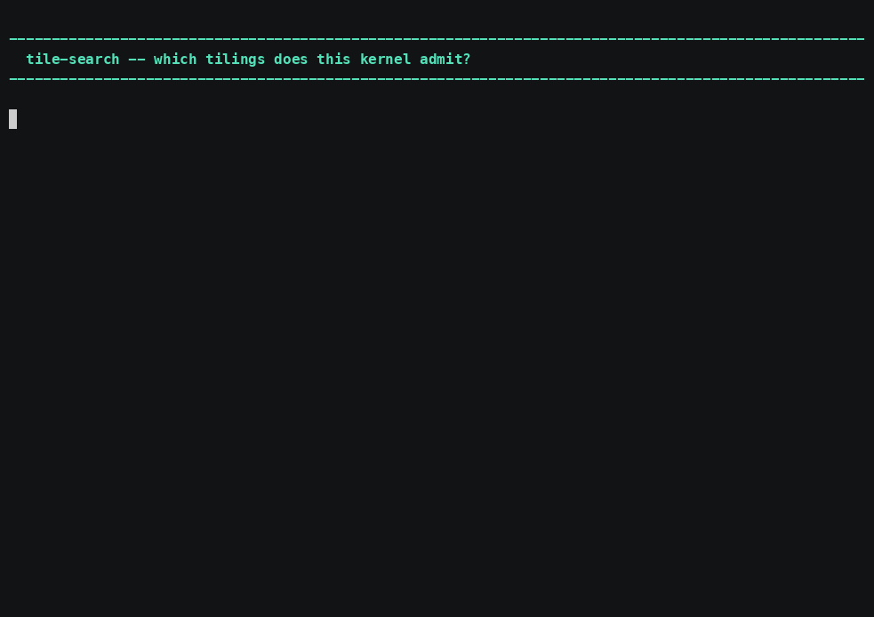

# tile-search — enumerate the tilings a kernel admits

`tile-search <kernel>.tile` writes `<kernel>.opt.tile`, or with `--emit rs`
lifts the winner back to tile-rs so the output is a kernel and not only a
chosen number.



*[Narrated MP4](../../demo/media/tile-search.mp4) · 4:50 · [cue sheet](../../demo/narration/tile-search.txt)*

## The oracle is the emitter, not a model

Every candidate is decided by **running the real PTO emitter** and reading its
answer. A model of the bounds would be a second place for them to live, the two
would drift, and the drift would be invisible — a search whose model is wrong
still returns a confident answer. Refusal messages are kept verbatim for the
same reason: the emitter's wording names the bound that was hit.

## Usage

```sh
tile-search kernel.tile                 # -> kernel.opt.tile
tile-search kernel.tile --dry-run       # report the search, write nothing
tile-search kernel.tile --emit rs       # lift the winner back to tile-rs
```

## The case it exists for

`gate_up_silu` from the bench is **refused as captured** — 215,040 bytes of live
tile against a 194,560-byte unified buffer. The search enumerates eight
candidates, seven are accepted, and it picks the largest:

```text
knob %c captured=8960 candidates=8 from=correctness:fractal-span
  %c = 8960     refused: NPU UB budget (arch a2a3): ... > UB_SIZE 194560B
  %c = 4480     accepted (41 lines)
  %c = 1792     accepted (41 lines)
  ...
7 of 8 candidate(s) accepted; ranked by largest-accepted-extent
  (a declared model, not a measurement)
chose %c = 4480
```

On DeepSeek V4.1's real shapes it rescues **5 of 7** refused kernels.

## Two things that are easy to get wrong

**Halving is not enumeration.** Sweeping by repeated halving from 8960 never
reaches 896, because 896 is 8960/10 — so it reports one feasible tiling where
there are several. The ladder enumerates **divisors**, which also means every
candidate covers the original extent exactly and no tail handling is invented.

**A ragged feasible set is an alignment rule, not a mystery.** A naive sweep
shows 4480 accepted, 2240 and 1120 refused, 896 accepted. Every refusal there is
a *misaligned* extent: a row-major data tile must span whole 512-byte fractals.
Once the ladder applies that rule the rest are all accepted. A test asserts the
filter matches what the emitter actually refuses **in both directions**, so it
can neither discard feasible tilings nor propose impossible ones.

## Ranking is a declared model, not a measurement

Nothing here runs on hardware, so this cannot say which accepted tiling is
*faster* — only which one a stated rule prefers. The rule is
`largest-accepted-extent`, it is a named type rather than a comparator buried in
a sort so you can disagree with the rule itself, and its own failure mode is
written down: the largest accepted extent may leave too little buffer for double
buffering, which this tool cannot see because it does not run anything.

## And where a tiling search cannot help

GLM 5.3 routes over **288 experts**, and no tiling of that kernel is accepted.
An f32 row must span whole 512-byte fractals, so its extent must be a multiple
of 128 — and 288 has no divisor that is. The expert count is the obstruction,
not the tiling. The search reports that rather than claiming a win.
